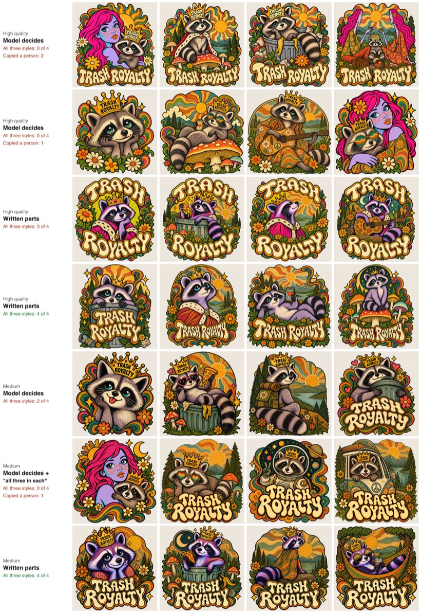

# Styles and mixing: what we tested, and why the prompt works this way

This is the notebook behind the studio's style handling. It records every style test since September 30, each way we tried to mix styles and how it scored, what we chose, and what's still open. It has three companions:

- [How the prompt is built](README.md#how-the-prompt-is-built) describes today's prompt part by part.
- The image test suite reruns everything we support against the real models. Its cases are listed in [CASES.md](../../tests/image-e2e/CASES.md), and its [README](../../tests/image-e2e/README.md) covers running it and trying a new model.
- [experiments/](experiments/README.md) holds the scripts behind these numbers as they ran, and [evidence/](evidence/) holds a few of the comparison sheets.

Unless a section says otherwise, GPT Image 2.5 made the images through the CultRemix Gateway, and GPT-6 Luna wrote the notes, read the requests, and answered the checking questions. "4 of 4" means all four designs of one grid. Most comparisons ran two or three grids per variant, so a difference of one or two designs is within run-to-run noise.

## How styles work today

1. **Two places for images.** The numbered images above the request box are what to work on: their people, words, characters, and layout. The style mixer below the box holds styles, each with a slider from 0 to 100, and nothing joins it on its own. Naming an image's look in words ("in the style of image 2", "use the colors of image 2") does exactly what adding it to the mixer does.
2. **Notes for every image.** When an image arrives, GPT-6 Luna writes notes in two halves. They're stored once per member and image and never reach the browser.
   - The content half says what's in the image: a summary, the subject and layout, every piece of text spelled exactly with its size and lettering, and each person and character with what makes them recognizable.
   - The style half says how it looks: technique, color with hex codes, line and shading, lettering, figure drawing, and ranked signature traits. Figure drawing covers how the image draws people and animals from head to toe and ends with a "Hair:" line.
   - Three rules in the notes prompt came from the tests below. Signature traits are written as ways of drawing that carry to any subject ("hard-edged cyan shadows on lavender base tones," never "vivid pink hair"). A body part only the image's own subject has, such as a lion's mane, is never a trait. Figure drawing describes a way of drawing ("an oversized head above narrow shoulders"), never the image's own person ("the woman is cropped at the chest").
3. **Every request is read.** Before each batch, GPT-6 Luna reads the request at low reasoning (about 2.5 s, `convex/lib/roleReader.ts`). For each numbered image it decides whether the request wants what's in it, only its look, or both. It also decides whether the request asks for the style's hair. It's told what the mixer holds and what the member calls each mixer style (Style 1 to Style 4). When it can't answer, phrase matching decides.
4. **People stay themselves.** With a style, the prompt asks to "keep the recognizable likeness of every person and animal in image 1, such as their hair, glasses, freckles, and smile, so someone who knows them would recognize them, while drawing them fully in the style, from head to toe."
   - The style decides proportions and shapes.
   - Each person keeps their own hair color unless the request says otherwise.
   - The style's hair goes into the prompt only when the reader says the request asks for it.
   - A restyled photo sends only its scene and words from its notes, never its description of faces.
5. **One style sets the whole look:** "Study it closely and match it precisely: technique, line work, color, lettering, and how it draws people and animals from head to toe."
6. **Several styles get a leader, and each smaller style gets a part of every design.**
   - Sliders become shares: two at 100 are 50/50, and 100 with 50 is 67/33. The largest share leads and sets the technique, line work, color, lettering, figure drawing, and level of detail. A style within 10 points of it shares the lead.
   - Each smaller style goes in one part of every design, through its top two signature traits (three at a share of 25% or more). The parts are the main subject (its coloring, shading, and face), around it (a backdrop, frame, or ornaments, and the print texture), the lettering, or small accents.
   - GPT-6 Luna picks each style's part from its notes and the request (`convex/lib/styleParts.ts`, about 2 s). A style known for its lettering goes on the lettering and takes it from the leader; one known for color and shading goes on the subject; one known for scenery or texture goes around it. Without an answer, parts go in order of size.
   - The prompt states the leader's figure drawing as a requirement for every person and animal, people from photos included. The style sections of each style's notes follow as definitions.
7. **Words.** Words in capitals or quotes are spelled out letter by letter and appear on every design of the grid. A style image's own words never appear.
8. **Remixes.** A remix keeps the published design's look and changes only what's asked. With a style in the mixer, it keeps the composition, subjects, words, and likeness, and redraws all of it in the style.

The code is `studioPrompt` and `styleMixSection` in `convex/lib/prompts.ts`, with unit tests in `tests/unit/studioPrompt.test.ts`.

## Ways we tried to mix styles

One lesson runs through all of these: the image model follows what a style looks like far more than the percentage we give it. A number alone gives a style about three settings (off, a visible accent, or leading), so the prompt has to say where each smaller style goes.

Unless noted, the test request was "A raccoon in a tiny crown that says TRASH ROYALTY" with three styles in the mixer: the psychedelic GROW SLOW mushroom design at 100, a pop-art portrait at 50, and a 70s picnic poster at 50 (shares of 50, 25, and 25). A design "shows all three" when it meets every one of these:

- It has GROW SLOW's warped, outlined lettering.
- The raccoon has the pop-art coloring (lavender fur).
- It has a 70s landscape or sky.
- It copies no person from a style image.

| Approach | When | What the prompt said | What happened | Verdict |
|---|---|---|---|---|
| Percentages only | Sept 30 | "Blend them in these proportions," with each style's share | About three visible levels. At 80/20 the small style vanished; at 50/50 both showed clearly | Replaced |
| Each smaller style visible in every design | Sept 30 to Oct 5 | Each smaller style "clearly visible in every design, not a faint hint, through these traits: …" (its top signature traits); where it goes is left to the model | Fixed 80/20 at first (4 of 4). Later the 20% style reached all four designs in only 2 of 5 grids. With three styles, the model gave each smaller style a design of its own and drew that style's woman or picnickers there: all three in 0 of 24 designs at high quality, with a copied person in 13 | Replaced |
| The same, plus "each of the four designs shows all three styles, and no style gets a design of its own" | Oct 6 | One more sentence | All three in 3 of 8 at medium quality (the same as without it), and one design drew the pop-art woman | Rejected |
| A part each, in order of size | Oct 5 | The first smaller style "on the main subject of every design (its coloring, shading, and face)," the next "around the subject in every design (a backdrop, frame, or ornaments, and the print texture)," then the lettering, then small accents | All three in 14 of 16 designs at high quality and 8 of 8 at medium, with no copied person. At 80/20 the pop-art coloring reached all 8 raccoons. But a style known for its lettering, in second place, was told to color the raccoon (mix B below) | Fallback |
| A part each, picked by GPT-6 Luna | Oct 6 | The same parts, chosen from each style's notes and the request; a style put on the lettering takes the lettering from the leader | Mix A: the same parts as size order (9 of 12 against 7 of 12, within noise). Mix B: GROW SLOW's letters in 12 of 12, against 4 of 12 | **In use** |
| One blended description | Oct 6 | GPT-6 Luna merges the styles into one description of about 250 words, in proportion, in place of each style's own notes | The pop-art coloring disappeared: lavender raccoons in 0 of 12 | Rejected |
| A range across the four designs | Oct 6 | The top-left design leans on style 1, the top-right on style 2, the bottom-left on style 3, and the bottom-right blends all three | Each corner leaned as asked (9 of 9 in both mixes), but only the fourth blended: all three in 2 of 12 | Not a blend; worth offering as its own choice ("Show me the range") |



*The same saved prompt, with only the mix wording changed (Oct 6). "Model decides" is the earlier wording, which gave the shares and asked for each style in every design but left where to the model. "Written parts" gives each smaller style a part. The counts are in `experiments/2026-10-04-to-10-06/mix-three-strict.txt`.*

| Prompt | Quality | Designs | Show all three | Copied a person |
|---|---|---|---|---|
| Model decides | high | 24 (six suite runs) | 0 | 13 |
| A part each | high | 16 | 14 | 0 |
| Model decides | medium | 8 | 3 | 0 |
| Model decides, plus "all three in each" | medium | 8 | 3 | 1 |
| A part each | medium | 8 | 8 | 0 |

### Two mixes, four approaches (Oct 6)

Mix A is the test above. Mix B puts a quieter style in the lead: the pop-art portrait at 100, GROW SLOW at 60, and the 70s poster at 40 (shares of 50, 30, and 20). Each approach ran three grids at medium quality, and every design was asked the same questions (`blend-exp.ts` and `blend-score.ts`; answers in `blend-scores.txt`). Sheets: [mix A](evidence/blend-mix-a.jpg) and [mix B](evidence/blend-mix-b.jpg).

| Mix A: GROW SLOW leads | GROW SLOW letters | Lavender raccoon | 70s scene | Copied a person | Show all three |
|---|---|---|---|---|---|
| Size order | 11 | 8 | 12 | 2 | 7 of 12 |
| Luna's parts | 10 | 12 | 11 | 0 | 9 of 12 |
| One blended description | 12 | 0 | 10 | 1 | 0 of 12 |
| Range | 5 | 5 | 7 | 0 | 2 of 12 |

| Mix B: pop-art leads | Pop-art raccoon | GROW SLOW letters | 70s scene | Copied a person | Show all three |
|---|---|---|---|---|---|
| Size order | 3 | 4 | 9 | 6 | 0 of 12 |
| Luna's parts | 2 | 12 | 12 | 5 | 0 of 12 |
| One blended description | 1 | 7 | 9 | 0 | 1 of 12 |
| Range | 4 | 5 | 7 | 0 | 0 of 12 |

Mix B turned up two more problems, and we followed up on both.

**The leading style's person leaked through its figure notes.** The pop-art notes' figure drawing said "the woman is cropped at the upper chest," and the prompt states the leader's figure drawing as a requirement, so the model drew the woman herself in 5 to 6 of 12 designs. Adding "never draw image 1's own person" cut that to 2 of 12. Rewriting the notes so figure drawing reads as a way of drawing ("an oversized head, roughly two-thirds of the visible figure's height, above narrow shoulders and a slender neck") cut it to 0 of 12, with lavender raccoons in all 12. The notes prompt now asks for that (`fig-exp.ts`; [sheet](evidence/figure-leak.jpg)).

**A quieter style can't lead a louder one yet.** We asked the checker which style each design is mostly in. It said GROW SLOW (30%) in 7 to 12 of 12 designs for every approach, and the 50% pop-art leader in 0 to 3. We then described GROW SLOW by its lettering notes alone and said everything else follows the leader. GROW SLOW still dominated 12 of 12 designs, though 10 of 12 raccoons took the pop-art lavender (`lettering-exp.ts`, `blend-dominance2.ts`). The same evening, two new suite cases recorded both results at high quality. `mix-lettering-second` passed: Luna put GROW SLOW on the lettering and the poster around the raccoon, the letters showed in 4 of 4, and no design copied a person. `mix-quiet-lead` recorded the limit: no design was mostly pop-art, and the pop-art drawing reached 1 or 2 of 4 raccoons, depending on the check. The leader's lavender also varied between the two grids. One had 4 of 4 clearly lavender raccoons; the other had gray raccoons with cyan shading and a lavender chest. This problem is still open; see below.

## Every test, by date

### September 29–30: copying a style, words, and the first mixes

- **Copy, don't borrow.** With "use the image as inspiration," 2 of 4 designs drifted into other styles. "Study it closely" kept all 4 in the reference's style.
- **The request's words, not the style's.** We gave a reference reading GROW SLOW and asked for TRASH ROYALTY. The model wrote GRASH ROYALTY in all four designs, or kept GROW SLOW and put the new words on a crown. Three changes together gave 8 of 8:
  - spelling the requested words letter by letter,
  - keeping the reference's own words out of its notes,
  - saying "take the design's words from the request."
- **How mixing behaves** (`mix.ts`, `blend.ts`). Each style showed at about three levels.
  - At 80/20 the smaller style vanished until the prompt required it in every design; then it showed in all four.
  - 50/50 blended clearly.
  - With three styles (100/50/50, a glitter style and a woodblock style behind the lead), the lead's lettering and the glitter reached all four designs of the grid, but the woodblock style landed almost entirely in one design.
- **A photo in a style** (`likeness.ts`). A photo of a woman, with a 70s poster of elongated figures as the style, kept her realistic face in all eight designs. We then separated likeness (who she is) from figure drawing (how the style draws people), in the notes and in the prompt.
  - Three of three single designs then took the poster's longer face, long neck, and simplified features, and kept her hair, glasses, freckles, sweater, and smile.
  - Grids stayed rounder.
- That night the studio got numbered images and the style mixer (`88fa198`).

### October 1: the photo's own notes, and words on one image

- **The photo's notes held the style back** (`notes-test.ts`). We ran "Reimagine image 1 in the style of image 2" three ways, four designs each:

  | Photo notes sent | Faces | Setting |
  |---|---|---|
  | All of them | Her round face in 8 of 8 | The photo's park |
  | Only its scene and words | Narrower | The photo's park |
  | None | The poster's long, narrow faces in all four | The poster's sun and hills |

  All three kept her hair, glasses, freckles, earrings, smile, and sweater. A restyled photo now sends only its scene and words.
- **A style named in words works like the mixer** (`78a85c5`). The same request, with both images in the top row, now builds the mixer's prompt. It's 4,672 characters instead of about 6,300, and the old one asked the model to keep the poster's two women and its words. Notes and prompts moved to the server only (`6c4290a`).
- **Words on one image.** A lion design reading KING OF THE BLOCK was alone in the top row, with "Change the words to NIGHT SHIFT." All four designs kept the lion and the arched varsity lettering (the design came from `lion.ts`).
- **Which model writes the notes** (`style.ts`, `news.ts`). GPT-6 Luna read stylized lettering right in 9 of 9 tries and listed 16 separate pieces of text on a newspaper page. GPT-6 Sol and GPT-5.6 Terra cost about 20 times more and misread the same lettering. Luna's one miss was an ornate blackletter masthead. Vision models see clear pixels as black, so a transparent image goes to Luna on flat gray.

### October 2: likeness wording, the request reader, and many images

- **Likeness wording** (`likeness2.ts`, `judge.ts`; [board](evidence/likeness-wordings.jpg)). We restyled the photo with the 70s poster and with the pop-art portrait, trying four wordings of the keep step, four designs each, at medium quality.
  - All 32 designs kept her recognizable, and the style's way of drawing faces showed in 30 of 32.
  - A GPT-6 Luna judge scored likeness 7.0 to 8.0 and style 8.5 to 9.0 for every wording.
  - Listing her traits didn't hold the style back, so the prompt uses the shortest wording that states the intent (`0723632`).
- **Reading the request with a model** (`roles.ts`). On 16 requests written to be tricky, GPT-6 Luna read 14 as intended and the other two defensibly; phrase matching read 8. With reasoning off it was as accurate as at low, in about 1 s instead of 3 s. It shipped with one grid call per batch (`a3ecd25`).
- **Many images in one call** (`imgcount.ts`). Calls with 4, 6, 8, 12, and 16 images each kept every image's subject in its own look. Each image up to 1024 px adds about 0.66¢ to a call.

### October 4: remixes with a style, whole figures, and hair

- **A style in the mixer did nothing to a remix.** A word remix with a style at 100% came back in the original's look in 4 of 4, because the remix rules said to keep image 1's lettering, colors, and texture. Now a remix with a style keeps the composition, subjects, words, and likeness, and redraws everything in the style (`d018de2`).
  - Pop-art: 4 of 4.
  - The 70s poster: 4 of 4.
  - The same remix without a style is unchanged.
- **Whole figures** (`3fd8f08`). We used the photo and, as the style, a cartoon of three tall boys with huge ears and spiked hair, with "Draw image 1 as a full-body character, head to toe." The notes now describe figures head to toe, and the prompt says the style decides proportions. All four designs took the cartoon's long thin legs, big head, and ears, and kept her glasses, freckles, smile, and curls.
- **Hair** (`44cc8fd`; boards: [no mention](evidence/hair-default.jpg), [asked for](evidence/hair-asked.jpg)).
  - Naming the style's hair gave her upright spikes, in her own color, in 4 of 4.
  - But any mention of the style's hair, even "if the request asks for the style's hair, give people …," gave her spikes unasked in 4 of 4.
  - With no mention, she kept her curls in 4 of 4.

  One person in a style image can't show whether their hair belongs to the style or is just their haircut. So people keep their own hair, and the style's "Hair:" line goes in only when the reader says the request asks for it.
- **The reader didn't know about the mixer** (`roles-test.ts`). It read "make her in this style" as asking for the photo's own look. That put the photo into the mix at full strength and halved the real style: 50 of 68 answers were right.
  - Told what the mixer holds, with reasoning off, it began swapping images (55 of 68).
  - At low reasoning it read 168 of 170, in 2.4 s.
  - With hair questions added, it answered 92 of 92.

### October 5: the image test suite, and what it found

The suite (`511ba12`, `008fe02`) runs every case through production's prompt code and checks each design. It found these problems, all fixed:

- **Words on every design.** With a style and "vary their composition," the model left GOOD DAY off 3 of 4 designs until the prompt said every design shows the request's words.
- **The Hair line flipped between reads** when it tried to judge whether hair belonged to the style: the cartoon's spikes were named in 5 of 8 reads. It now just describes the hair shown, by shape and texture without color, and got it right in 20 of 20.
- **"Use the colors from the second image"** read that image as subject and style in 5 of 6 tries, which would have drawn its woman in. An image used only for its colors now reads as a style: 160 of 162 answers on 27 requests.
- **Traits as ways of drawing** (`traits-cal.ts`, `accent-cal.ts`, `accent-cal2.ts`). At 80/20 the pop-art style was described by "vivid pink hair."
  - That put long pink hair on the raccoon in four runs.
  - "Broad fields of vivid hair" left 3 of 4 raccoons with no pop-art at all.
  - Rewritten as ways of drawing ("hard-edged cyan shadows paired with lavender base tones"), the next grid had lavender fur and cyan shading on all four.
- **Her own hair color** (`hairfix.ts`). The pop-art style, whose notes say "hot pink hair," turned her copper hair pink in all four designs in 2 of 8 grids. "Unless the request says otherwise, each person keeps their own hair color" kept it in 6 of 6 grids, and "with bright pink hair" still made it pink in 4 of 4.
- **A part each for smaller styles** (`d2e07c7`; `limits-exp.ts` with `spec-mix.json` and `spec-zones-high.json`).
  - Before, 7 of 16 designs over four runs drew a style image's person.
  - After, all 16 raccoons took the pop-art coloring, 15 of 16 designs had the 70s landscape or sky, and none had a person.
  - Told to go on the subject, the 20% style in an 80/20 mix colored all 8 raccoons.
- **The lion's mane** (`spec-mane.json` to `spec-mane3.json`; [sheet](evidence/mane-at-high.jpg)). The lion design's notes listed "a voluminous pointed mane" as a trait, which put manes on wolves drawn in its style. This is a known limit, tracked by the suite case `style-copy`.
  - Without the trait, 12 of 12 wolves at medium quality had no mane.
  - At high quality about half still take a mane-like ruff from the picture itself.
  - Removing every mention of a mane didn't change that.
  - A sentence forbidding the style subject's body parts made it worse, so we reverted it.
- **Lettering leaking into new words** (`spec-words.json`, `spec-leak-high.json`). GROW SLOW's letterforms turned TRASH into TrROH or TRROSH in all four designs in 2 of 7 suite runs. The same prompt then spelled 20 of 20 designs right across retries. Because the error stopped showing up, we couldn't tell which of two candidate fixes worked: sending the style image with its words removed, or asking to letter every word fresh. This is a known limit, tracked by `words-not-from-style`.
- **Variation or fork** (`judge-cal2.ts`, `wolf-test.ts`). A design is its look and its layout (Jon's rule).
  - The comparison answered as expected on 45 of 45 tries over 15 fixture pairs.
  - It called 72 of 72 word remixes variations and 24 of 24 photo restyles forks.
  - It called all four pencil-sketch wolves from "Change the lion to a wolf" variations.

### October 6: like for like, named styles, blending, figure notes, Santa, and other models

- **Like for like** (`mix3-q-med.ts`, `mix3-strict.ts`). Every saved three-style design was asked the same three questions; see the second table under "Ways we tried to mix styles."
- **Style names.** Mixer rows are labeled Style 1 to Style 4, and the reader is told the names.
  - Four requests such as "put style 2 on the lettering," three reads each: 12 of 12.
  - The earlier 27 requests still read 79 of 81. One miss was a timeout; the other read "a dragon in this style" as content once.
- **Four ways to blend**, the figure leak, and the quiet lead are covered under "Two mixes, four approaches." Luna's parts and the figure-notes rule shipped in `1534084`.
- **Santa, Mrs. Claus, and the elves** (`santa-exp.ts`, `santa-exp6.ts`, made-up family photos from `family-photos.ts`; [sheet](evidence/santa-family.jpg)).
  - The first wording described each role with the original's looks ("an elderly woman with curled white hair, spectacles"). It kept the original Mrs. Claus in all four designs, and "three elves" next to "exactly 4" gave three elves.
  - Naming people and groups by role only, with their looks coming from their photos, gave 8 of 8 at medium quality: Santa with the dad's beard and glasses, Mrs. Claus with the mom's red curls, and exactly four recognizable elves.
  - With Santa kept, Mrs. Claus left out, and six elves: 8 of 8.
  - Each grid took about a minute and cost about 9¢ with seven input images.
- **Other models** (admins only). On the pencil-sketch lion with "Change the lion to a wolf":
  - Nano Banana 2.1 kept the sketch look, the hand lettering, and the layout in 4 of 4 wolves, as GPT Image 2.5 did.
  - Recraft V4.1 can't see images through the gateway. It drew two wolves and two lions in its own cleaner style.
  - Given a style image's figure notes, Recraft drew the style images' own woman and picnickers, so its prompt leaves figure drawing out.
- **A version for a shirt color.** "Keep the same design, words, and layout" added mountains, pines, or a moon behind 3 of 4 wolves. "Keep exactly the same design … Add nothing new" changed only their colors in 4 of 4.

### October 11: checking and fixing spelling

- **Reading the lettering back** (`convex/lib/wordReader.ts`, Gemini 3.1 Pro at low thinking, with the suite's word-reader prompt). On the four leaked designs from run `20261005-1915` (TrROH, TrROW, TrROSH, TrROH), the first reading caught three. TrROW is three letters off TRASH, so the rule now allows one more letter when a reading starts with the right letter, and a second reading caught all four. Eight correctly spelled suite designs and 16 dev designs gave no warning. A reading took 7 to 16 s and about 0.3¢.
- **The fix request** (suite case `words-fix-spelling`, image 1 the TrROH raccoon, about 14¢ a run). Three wordings, one grid each:
  - "Fix only the lettering in image 1 so TRASH is spelled exactly right. Keep everything else exactly as it is." Image 1's notes had read its lettering as TRASH, and "follow the image" kept its letter shapes: TrRSH in 3 of 4, and 0 of 4 spelled right.
  - Naming the misreading and asking for the word from scratch ("TRASH is drawn wrong; it reads trroh. Redraw that word from scratch with exactly its 5 letters, in the same lettering style, size, colors, and place, without reusing its current letter shapes"): 4 of 4 spelled right, and 2 of 4 kept the layout (the grid line still says to vary the composition; one put the raccoon in the can, one gave it a donut). A second grid: 4 of 4 spelled right and 4 of 4 kept the design, with only the snack changing (run `20261011-1808-fix-spelling-4`).
  - The same request with the grid told to draw all four as image 1, varying only small details (the way a remix's grid is): 4 of 4 kept the layout, and 0 of 4 spelled right (TrRAH, TrRSH). Holding the composition made the model copy image 1's letters back, so that flag was dropped; the studio sends the second wording.

## Open problems, and what to try next

1. **A quieter style can't lead a louder one.** The image model weighs how loud a picture is over its share, so a busy style at 30% takes over a cleaner one at 50%. Ideas, cheapest first:
   - Send the smaller styles as notes only, without their pictures, so the model can't copy how loud they look. Recraft's prompt already works this way. One run of `blend-exp.ts` on mix B would show whether it helps.
   - Label each mixer row by its job ("Leads," "Colors the subject," "Around it," "Lettering") so members know what a slider does, and let them choose the leader directly. Since 2026-10-11 each batch line shows the job every style got ("33% lettering"); the mixer can't say it before generating, since Luna picks the parts from the request at that point.
   - Offer "Show me the range" as its own button.
2. **A lion style still gives wolves a ruff at high quality.** A style image whose subject has a strong silhouette passes that silhouette to new subjects. A style sheet would show the style apart from any one subject: the same style drawn on several subjects, like the Style Of contact sheets. The quick test is a crop of the style image that shows its texture without its subject.
3. **Lettering leak.** It comes and goes. Since 2026-10-11 the studio's spelling check reads every design of a batch that asked for words, using the suite's word reader (Gemini 3.1 Pro, about 0.3¢ a design), marks one whose words came out a letter or two off, and offers **Fix the spelling** ([README](README.md), "The spelling check").
4. **Not tested yet:**
   - four styles in the mixer;
   - a mix whose request has no words (Luna is told not to use the lettering then);
   - Nano Banana 2.1 and Recraft V4.1 against the whole suite (`bun run test:image --image-model <id> --name <name>`).
5. **The Style Of library.** Its styles will come with their own definitions, kept on the server like the notes. They'd enter the mixer like a style image and take parts the same way. A contact sheet of one style across a person, a place, and a scene should also help with problems 1 and 2.

## Rerunning these tests

The suite holds every behavior we support. To check a prompt change or a new model, run the groups it touches:

```bash
bun run test:image --group styles,people        # 13 grids, about $1.60
bun run test:image --case mix-three,mix-lettering-second,mix-quiet-lead
```

| What we tested | Suite cases |
|---|---|
| Copying a style, and the lion's mane | `style-copy` (known limit), `style-of-one-image` |
| A style named in words | `style-named-in-words`, and the reader cases |
| Words with a style | `words-not-from-style` (known limit), `words-change-one-image` |
| Two styles | `mix-80-20`, `mix-50-50` |
| Three styles | `mix-three`, `mix-lettering-second`, `mix-quiet-lead` (known limit) |
| People in a style | `photo-70s-poster`, `photo-pop-art`, `photo-pop-art-pink-hair`, `whole-figure`, `style-hair-when-asked` |
| Remixes with a style or a swap | `remix-words-with-style`, `remix-swap-character` |
| Santa and the elves | `remix-parts-family`, `remix-parts-group-size` |
| Notes | `notes-figure`, `notes-hair-portrait`, `notes-hair-poster`, and the `notes-words-*` cases |
| Reading requests | the 25 `reader-*` cases |
| Variation or fork | the remix comparison cases |

Comparisons between approaches can't be suite cases, because the suite runs only production's prompt. Their scripts are in [experiments/](experiments/README.md), copied as they ran.
