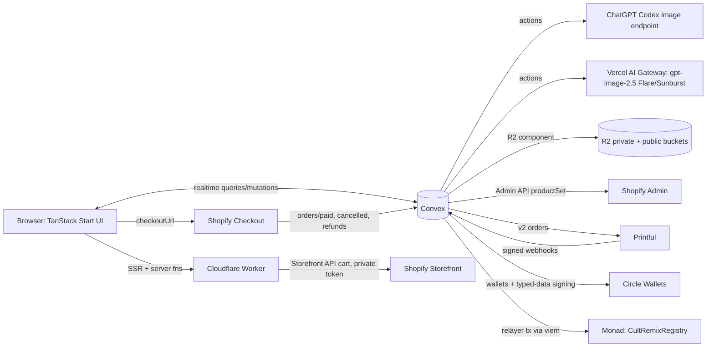

# CultRemix V1 — Core Creative Loop, Real Commerce, Onchain Provenance

Status: Not started
Date: 2026-09-27 · Depth: Deep · product_contract_source: ce-plan-bootstrap
Checkpoint 0: a one-day build on **2026-09-29** delivers the visual core first (email sign-in, studio, remix, fork, publish, work pages, Wall, photo shoots, public deploy). See `docs/plans/2026-09-29-feat-checkpoint-0-one-day-build.md`. Everything below still holds; the dates in "Schedule and critical path" are re-dated after 9/29.
Targets: **V1 core loop complete by 2026-10-04**; hackathon build live on **staging (Monad testnet, Shopify development store)** and submitted by **2026-10-13 20:59 PDT** (Monad "Social, Attention & Culture" track); **production (Monad mainnet, live Shopify) targeted for 2026-10-20**, designed for from day one
Origin documents: `docs/CultRemix_Product_Vision_Architecture_Build_Plan.md` (vision + architecture), `docs/reference/cultremix-chatgpt.md` (planning conversation, 2026-06-18 → 2026-09-23)
Baseline:
  CultRemix: `github.com/jonthewayne/cultremix` (private); `main` and `dev` start at the docs-only initial commit (A13)
  starter source: ~/Projects/starter @ a754258 (copied in U1)
 planned: 2026-09-27

---

## Checkpoint 0 amendments (2026-09-29; authoritative over the sections they name)

Checkpoint 0 (`docs/plans/2026-09-29-feat-checkpoint-0-one-day-build.md`) builds the creative loop, quick publish, photo shoots, and pages on this plan's data model. It changes these V1 decisions:

- **A1. Members and creators.** Generation needs credits (or owner), not creator access; publishing, remixing, and forking need a username (and credits to generate); selling and earnings need creator access. Creator numbers are assigned when creator access first activates (CuriousEntity 1; admin grant or subscription after, in order, never reused). New members receive the signup credit grant set in admin. Overrides R16 ("anyone with creator access"), R34, R35, R41, R42, the authorization matrix rows for sessions and generation, publishing, and remixing, INV-17 (now: revoked creator access blocks selling and earnings; generation and publishing depend on credits and a username; published works stay published), U2, and S1's grant of creator access. **Earnings eligibility (decide before U10):** proposed default is that eligibility is judged at each order's economic event time; a share owed to someone without creator access is recorded as `held` with reason `not_creator` and becomes Available when they activate creator access; revoking creator access affects only later orders and never touches earned amounts. KTD-18's recipient table otherwise stands.
- **A2. Publish before print.** A work can be published without a print file and stays `commerceStatus: preparing`. The publication snapshot records only the artwork and never changes. When Print Studio first produces a print file that passes readiness for a work, it sets `works.printKey` and `works.printSha256` once; after that they never change. INV-14 gates going on sale, not publishing; R10, R11, and U8's publish flow follow. Print Studio can open from a published work's remix source.
- **A3. Fingerprint.** `works.contentHash` is the SHA-256 of the published artwork PNG and is what the registry records (R15, U7). INV-10 becomes "Printful receives bytes whose hash equals `works.printSha256`".
- **A4. Photo shoots.** Shoot photos are `generations` with `kind: shoot` in hidden per-work sessions, using the paid attempt lifecycle; `shoots` and `shootPhotos` join the data model. AI product photography beyond shoots stays deferred.
- **A5. Colors at publish.** Offered colors come from a swatch board with an advisory contrast check (`works.offeredColors`); U0 decides which are orderable. A creator's colorways stay in the same work (`workColorways`); someone else's is a variation.
- **A6. Early-access list.** `waitlist` joins the data model and lives in production from day one; opening checkout emails it.
- **A7. Admin settings.** `appSettings` holds the signup grant, daily gateway cap (feeds `budgetDays.capCents`), and per-member shoot limit; admin capabilities follow the Checkpoint 0 plan's KTD-S.
- **A8. 101-001 is official** (decision 7).
- **A9. Schedule.** Checkpoint 0 replaces the 9/27–9/29 rows; the schedule is re-dated after 2026-09-29.
- **A10. Labels.** Production shows "Early access" until checkout opens; staging, once created, shows "Testnet" (KTD-21).
- **A11. Provider boundary.** U3 extends `convex/lib/providers/` from Checkpoint 0 (adding `chatgpt.ts` and the provider policy there) instead of creating `convex/lib/imageProviders/`.
- **A12. Production starts at Checkpoint 0.** `cultremix.com` runs production (Convex `cultremix` production deployment, `cultremix-prod-*` buckets, `DEPLOYMENT_ENV=prod`) from 2026-09-29 with commerce, chain, and Circle off by flag. KTD-21's "production starts empty and is seeded by script" happens that day: 101-001 in production is CuriousEntity's first seeded original, and automated tests never write to production. Staging is created when V1 first needs Monad testnet or the Shopify development store (U7/U9), seeded by script with its own numbering. U15 becomes turning on commerce and chain writes in the live production. Which link the Monad submission uses (R44: production with mainnet writes if U7's production gates pass, otherwise staging on testnet) is decided when V1 is re-dated.
- **A13. Repo and branches.** The code lives at `github.com/jonthewayne/cultremix` (private; the V1 accounts table's submission sharing still applies). Work lands on `dev`; `main` holds only what production runs and is fast-forwarded to each deployed commit, never committed to directly. CI, when added, deploys `dev` to the dev deployment and release tags to staging, then production.
- **Also added by Checkpoint 0:** `appSettings`, `waitlist`, `shoots`, `shootPhotos`, `workColorways`; `generations.kind` value `shoot`; `creativeSessions.remixMode`, `purpose`, `shootWorkId`; `users.signupGrantAt`; `creditLedger.reason`, `note`; `creatorAccess.activatedAt`; `works.offeredColors`, `publishedAt`, `artKey`, `artThumbKey`, `printSha256` and index `by_status_publishedAt`; the `gen.shoots` flag; bootstrap defaults. The Checkpoint 0 plan's "Settled validators" fix the shapes of the tables it writes.

---

## Decisions most likely to change

1. **Onchain write path — relayer pays gas, the actor's Circle wallet signs (KTD-7 → U7).** A CultRemix relayer account holding MON submits every registry write with an EIP-712 signature from the actor's developer-controlled Circle EOA wallet; the contract records the recovered signer. Alternative: Circle Gas Station sponsoring SCA wallets that call the registry directly. The relayer path needs one transaction per action, behaves the same on testnet and mainnet, and keeps signature verification to plain ECDSA.
2. **Creator access and image connections (KTD-3c, KTD-4 → U3, S1).** Any creator can connect their own ChatGPT account once an admin enables it for them (on by default for CuriousEntity). Creators without a ChatGPT connection use CultRemix Gateway (Vercel AI Gateway) with credits. Week one grants creator access by invitation; paid creator subscriptions (S1) follow.
3. **Print resolution via Topaz Transparent (KTD-9, KTD-20 → U0, U6).** Creative edits happen at native size; **Upscale for print** runs fal's Topaz Transparent (4×, keeps transparency) as the last step before the print check. If U0(k) shows lost transparency or damaged lettering, Topaz Precision is used only if it is shown to keep transparency; otherwise the art is upscaled on a flat background color and cleaned with the server knockout tool.
4. **Social scope (R25–R29 → U12).** Profiles, follow, heart, Following/Latest feed, and onchain Backs with provable backer position. Follows and hearts stay offchain.
5. **Launch product, market, and price (KTD-10, KTD-17 → U0, U9, U10).** One garment (Comfort Colors 1717 via Printful DTG; Bella+Canvas 3001 if U0 finds 1717 unavailable or its base cost above $20), 4 colors, S–2XL, fixed retail $36 (2XL $39), US shipping only at a flat rate. No creator-set pricing in V1.
6. **Launch economics (KTD-18 → U10).** Creator Pool = 15% of line net revenue (price × quantity − discounts; excluding tax and shipping), split by the recipient table in KTD-18. Owner approves this policy before the first production order; changing it later creates a new version and never applies retroactively.
7. **CultRemix numbering (KTD-11 → U8).** Families start at 101: the first publish is **CULTREMIX № 101-001**. Official (Checkpoint 0 amendment A8).
8. **Judge access (KTD-15 → U2, U13).** Admin-provisioned email+password accounts with comp creator access and 40 credits; public sign-up stays email OTP.
9. **Environments: staging is the hackathon build (KTD-14, KTD-21 → U13, U15).** Dev, staging, and production share one codebase and one schema. Staging (Monad testnet, Shopify development store with test checkout, Printful drafts, Circle test keys) is the hackathon build and stays as the pre-production rehearsal; production (mainnet, paid Shopify plan, live Printful and Circle) follows as fast as possible.

---

## What this changes

- CuriousEntity turns a phrase and a style direction into batches of tee concepts, favorites the good ones, flips through favorites full-screen with arrow keys or swipes, and branches a new batch from any concept.
- The Print Studio turns the chosen concept into production art: background removal, AI touch-ups as reversible versions, **Upscale for print** that keeps transparency, placement on the shirt's real print area, and a print check that blocks anything below print quality.
- Publishing gives the work a permanent CultRemix number, a public page, a Shopify product in four colors, and a Monad provenance record.
- People with creator access remix a published work by changing its words; the variation shows and records its parent. Declaring a fork starts a new family that permanently credits its parent.
- Shoppers buy through Shopify checkout; each paid order becomes a Printful order and creates Pending earnings for the work's creator, the family root creator for variations, and the upstream creator one fork generation up.
- People follow creators, heart works, read a Following or Latest feed, and spend up to three Backs a week; each Back lands onchain with its backer position.
- Creators connect their own ChatGPT account with **Sign in with ChatGPT** once an admin enables it (CuriousEntity by default). A status label shows whether it works and when a usage limit resets; creators switch between ChatGPT and **CultRemix Gateway** with one control, get a popup when ChatGPT fails, choose whether CultRemix asks or switches automatically, and are told when ChatGPT is available again. Creators without ChatGPT use CultRemix Gateway.
- Every user receives a Circle wallet automatically; nobody handles seed phrases, MON, or wallet connections.
- The hackathon build runs on staging (Monad testnet, Shopify development store with test checkout); production on mainnet follows right after with the same code and schema.

---

## Product Contract

### Summary

Build the smallest complete, beautiful CultRemix: a studio tuned for generating, favoriting, reviewing, and preparing typography/graphic tee art; fast publishing into a real Shopify + Printful product with Monad provenance; remixing with lineage; and a thin social layer whose key actions are verifiable onchain. Dev runs on Monad testnet, production on Monad mainnet.

### Problem Frame

The vision document describes a large platform; the hackathon and the owner's accelerator goal both need a version a stranger can use end-to-end within days. The owner's priority is the feel of creation: many options, quick reactions, favoriting, paging through favorites large, and turning the chosen one into production-grade print art. Everything else in V1 exists to make that loop real: the output becomes a buyable product, carries permanent provenance, and invites remixes. The track rubric weights technical execution (20%, "does the mechanism run onchain and produce verifiable results"), design and craft (20%), originality (15%), founder/market readiness (25%), and traction/path forward (20%), so lineage and Backs must be real onchain records, and the plan also schedules a small creator cohort and usage evidence.

### V1 overrides of the vision document (authoritative list)

- Creator access is invite-only in week one; paid creator subscriptions arrive in S1 (vision §10 assumes paid access from day one).
- Settlement in USDC is a clearly labeled testnet demo (S2), not live payouts (vision §14–15).
- Affiliate programs, promo codes, and commissions are deferred; V1 only records `ref` on carts and orders (vision §12–13, §25 affiliate minimum).
- Ratings, bookmarks, collections, Drops are deferred (vision §11, §17).
- Onchain anchors in V1: works, lineage amendments, Backs, and economic-config hashes. Settlement records only in S2.
- "Available" earnings means matured and eligible; withdrawal is not offered in V1.
- The hackathon build is staging on Monad testnet with test checkout; production (mainnet, real payments) follows the hackathon, targeted for 2026-10-20.

### Requirements

**Studio — generate, react, favorite, review, branch**
- **R1.** A creative session starts from *Words on the shirt* (the phrase) and *Style direction* (text plus optional presets). The phrase is stored separately and becomes the remixable headline at publish.
- **R2.** Generating creates a batch (default 4, 1–8) whose tiles appear immediately and fill in as each image completes; failures show per tile with retry.
- **R3.** Any concept can be favorited, unfavorited, rejected, or opened full-size by pointer or keyboard.
- **R4.** A persistent favorites tray lists the session's favorites in favorited order; clicking one opens the viewer scoped to favorites.
- **R5.** The full-size viewer pages next/previous within its scope (favorites, batch, session) with arrow keys, on-screen arrows, and horizontal swipe; it preloads neighbors; it supports favorite, reject, branch, and prepare shortcuts; its state lives in the URL.
- **R6.** Branching from any concept starts a new batch that uses that image as the reference plus an optional instruction; the batch shows its parent.

**Print Studio**
- **R7.** Choosing a final opens the Print Studio with a version history; every AI action creates a new version; any version can be selected.
- **R8.** Tools: remove background (AI edit requesting transparency), knock out a background color (tolerance; previewed in the browser, applied server-side), trim transparent margins, AI touch-up by instruction, and **Upscale for print** (fal Topaz Transparent, 4×, keeps transparency) as the last step before the print check.
- **R9.** Placement on the product's real front print area over a selected garment color, with center/top/safe-area guides; placement is saved.
- **R10.** A print check reports source DPI at the placed size, alpha presence, coverage, and semi-transparent haze. Publishing requires a server-rendered print file that passed the server's print-readiness check (INV-14).

**Publishing and identity**
- **R11.** Publish wizard: Remixability (headline field prefilled from the phrase, optional subtitle) → Product (colors with live mockups; fixed price shown) → Publish (CR number preview, optional AKA, description, lineage summary).
- **R12.** Each published work receives a permanent CR number `FFF-EEE` allocated atomically with the work record.
- **R13.** Each work has a public page (`/cr/101-001`) that renders signed-out, with art on product, AKA, creator, lineage, provenance status, and buy controls.
- **R14.** Publishing creates the Shopify product with every color×size variant, images, and CultRemix metadata, published to the Headless channel.
- **R15.** Publishing registers provenance on Monad: work ID, CR numbers, kind, parent, content hash, creator wallet.

**Remix and lineage**
- **R16.** **↻ REMIX THIS** lets anyone with creator access change only the remixable fields and generate a batch that keeps the parent's composition, typography, and palette; the normal favorites/viewer/Print Studio flow follows.
- **R17.** A remix publishes as a **variation** in the parent's family, or as a **fork** (new family, "Forked from CR …") when the creator declares it.
- **R18.** Every work page shows its effective lineage trail (to the family root, and across forks to the origin) and its direct remixes.
- **R19.** Admins correct lineage with append-only amendments; pages show effective lineage with an "amended" note and history; the original record stays intact offchain and onchain.

**Commerce and fulfillment**
- **R20.** Shoppers choose color, size, quantity; the cart can hold several works; checkout happens on Shopify (Shop Pay supported). US shipping only.
- **R21.** A paid order becomes a Printful order with the work's immutable print file; dev creates drafts, production confirms automatically.
- **R22.** Owner admin shows each order's state (paid → submitted → in production → shipped → delivered, or cancelled/refunded/needs attention).
- **R23.** Each paid line creates Pending earnings for its economic recipients (KTD-18); refunds and cancellations reverse them.
- **R24.** Creators see Pending / Available / Paid earnings; Available = maturity reached with no open refund; Paid only via S2's labeled demo.

**Social**
- **R25.** Public profile `/u/<username>` (renders signed-out): creator number when present, avatar, bio, works, remixes, Backs given, follower/following counts.
- **R26.** Follow/unfollow creators; heart/unheart works.
- **R27.** Home feed tabs: **Following** (new works, variations, forks, and Backs by followed users) and **Latest** (all).
- **R28.** Each account can Back ≤3 works per registry week, ≤1 per work, never its own; Backs require a verified email; the UI never implies financial return.
- **R29.** Each Back is recorded onchain with its ordinal; work pages show earliest backers and the viewer's own position.

**Providers and creator access**
- **R30.** Creators whose account has **ChatGPT connection enabled** by an admin (on by default for CuriousEntity) connect their own ChatGPT account with **Sign in with ChatGPT** (device code flow). Each credential is stored encrypted and used only for its own creator's generation; settings show account email, status, usage-limit reset time, last use, and last error; disconnect and reconnect are always available.
- **R31.** A creator with a working connection generates with ChatGPT by default. The composer has a one-tap **ChatGPT / CultRemix Gateway** switch that remembers the last choice. When ChatGPT fails (not connected, sign-in expired, usage limit reached, error), a popup explains why and offers **Use CultRemix Gateway**, **Retry**, or **Reconnect ChatGPT**. A per-creator setting chooses **Ask me** (default) or **Switch to CultRemix Gateway and tell me**; every automatic switch shows a banner and a per-tile label.
- **R32.** When a usage limit is reached, CultRemix records the reset time ChatGPT reports, shows it on the status label, checks again once it passes, and tells the creator "ChatGPT is available again" (in-app notification), switching the default back to ChatGPT when the creator enabled auto-return.
- **R33.** CultRemix Gateway is Vercel AI Gateway with `openai/gpt-image-2.5-flare` (concepts) and `openai/gpt-image-2.5-sunburst` (edits, remixes); user-facing copy always says "CultRemix Gateway" and never "Vercel". CuriousEntity can also pick Flare, Sunburst, or Compare per batch; tiles show their provider to the owner.
- **R34.** CultRemix Gateway generation and upscales require active creator access and credits (CuriousEntity is exempt from credits). Admission is bounded by worst-case reserved cost against daily platform budgets per provider; an observed overage switches that provider off until pricing is corrected. ChatGPT generation uses no CultRemix credits.
- **R35.** Admin grants/revokes creator access, credits, and each creator's ChatGPT connection permission.

**Wallets and chain**
- **R36.** Every user receives a Circle developer-controlled wallet on the deployment's Monad network; missed or failed provisioning is retried until ready.
- **R37.** No user ever needs MON, a seed phrase, or a wallet connection.
- **R38.** Dev and staging use Monad testnet (10143); production uses mainnet (143); each deployment refuses any configuration that mixes environments (INV-13).
- **R39.** Provenance, amendments, Backs, and economic-config hashes are readable from the contract and its events; UI records link to the explorer.
- **R40.** Chain writes are asynchronous; commerce and remixing never wait on them; states are pending/submitted/confirmed/failed with safe retry.

**Identity and launch**
- **R41.** CuriousEntity is creator №1 and platform owner, claimed by the first verified sign-in with `OWNER_EMAIL`.
- **R42.** Public sign-up uses email OTP delivered by Resend; users choose a unique username on first sign-in.
- **R43.** Production (U15, after the hackathon; target 2026-10-20) runs the same code and schema on Monad mainnet with a paid Shopify plan and Shopify Payments, Printful auto-confirm, and Circle live wallets.
- **R44.** Submission deliverables: public GitHub repo shared with `metropolis@hackathon.monad.xyz`; live **staging** link on Monad testnet with judge credentials and access instructions (checkout clearly labeled as a test payment); demo video ≤3 min of the live product and pitch video ≤2 min, both on YouTube, Loom, or Vimeo; logo as JPG/JPEG/PNG/WEBP ≤3 MB (U13/U14, week two).

### Scope Boundaries

**Week one (dev, Monad testnet; done 2026-10-04):** R1–R42; R24 without settlement.
**Week two (hackathon checkpoint on staging, by 2026-10-13):** U13 staging launch + deliverables (R44), U14 cohort + evidence, production prerequisites requested for U15, then stretch in priority order: S2 settlement demo, S1 paid creator subscription, S3 fulfillment/tracking sync, S4 compare view.
**Production checkpoint (U15, target 2026-10-20):** R43.
**Deferred (see Deferred follow-up for triggers):** affiliates/promo codes/commissions; ratings/bookmarks/collections/Drops/challenges/gifts; multi-product catalog; AI product photography beyond Checkpoint 0's photo shoots, and Marketing Studio; channel syndication; Brand Worlds, rights screening, takedown workflow; digital products; identity remixing; video/music; automated similarity detection; onchain follows; recurring creator-referral commissions; international shipping.
**Out of identity:** investment-like Backing or promised returns; users managing keys or gas.

### Success Criteria

- A first-time signed-out visitor understands CultRemix from the home page and a work page.
- CuriousEntity goes from phrase to 3+ favorites to a published CultRemix with a confirmed testnet record and live dev-store product in under 10 minutes hands-on.
- Paging through 20 favorites shows each neighbor image fully rendered on arrival (preloaded) on desktop Chrome and iPhone Safari (F1 + F1m).
- A judge account can remix, publish a variation, Back a work, and find those records on the explorer.
- A calibration sample is ordered by 2026-09-30 and a CultRemix render sample by 2026-10-02; by 2026-10-13 each is recorded **passed**, **failed** (and corrected), or **unverified** (in transit, with tracking).
- Staging checkout: a judge completes a test-payment checkout on the Shopify development store, which creates a Printful draft and Pending (test) earnings (F5).
- Production (U15): a real order reaches Printful confirmed and in production within 3 business days; its shipment is recorded when Printful ships (P1).
- Every chain record shown in the UI matches offchain state and the explorer.

### Judging evidence plan

- **Technical execution:** explorer-verifiable `WorkRegistered`, `Backed` (with ordinal), `LineageAmended`, and `EconomicConfigRegistered` events for the live launch set.
- **Economic stake:** every work page has a public Economics panel showing each role's percentage share of a sale, computed from its confirmed onchain lineage and the canonical config JSON at `/economics/v<version>.json`, whose SHA-256 matches the onchain `EconomicConfigRegistered` hash; anyone can recompute the split formula (INV-29). Actual order amounts stay private; creators see their own Pending earnings from staging test checkouts, labeled "Test"; real-order earnings arrive with U15. While provenance is pending, the panel says so. S2 shows labeled testnet USDC settlement. Production payouts are outside V1, and the pitch states that tradeoff.
- **Founder/market and traction:** U14 cohort, dated metrics, and creator quotes.

### Key Decisions (session-settled)

- **KD1. Vision stack** — TanStack Start on Cloudflare Workers, Convex, Better Auth, R2, Vercel AI Gateway, Shopify headless, one POD, Monad. *Owner + vision doc; chosen over Next.js on Vercel.* Governs R13, R14, R20, R36.
- **KD2. ChatGPT connections are per creator and admin-enabled; each credential serves only its own creator's generation and is saved encrypted in the database.** *2026-09-27 (supersedes owner-only, 2026-09-26); chosen over owner-only use.* Governs R30–R32.
- **KD3. CultRemix Gateway (Vercel AI Gateway) is the backup for ChatGPT-connected creators — ask-first by default, automatic only by the creator's choice — and the provider for everyone else, who ultimately pay a creator subscription. User-facing copy never names Vercel.** *2026-09-23/26/27; chosen over silent fallback.* Governs R31, R33, R34.
- **KD4. Real Shopify checkout and real print-on-demand in V1.** *2026-09-26; chosen over mockup-only.* Governs R20–R22.
- **KD5. Every user gets an automatic, invisible Circle wallet.** *ChatGPT thread messages 064–065, confirmed 2026-09-26; chosen over a single platform wallet.* Governs R36, R37.
- **KD6. Testnet for dev and staging (the hackathon build); mainnet for production right after.** *2026-09-26/27.* Governs R38, R43.
- **KD7. Typography + graphic apparel is V1's only primitive.** *Vision §25.* Governs R1, R16.
- **KD8. Backing is a scarce social signal, not an investment.** *Vision §11, §21.* Governs R28.
- **KD9. Upstream economics travel one fork generation; provenance travels forever.** *Vision §4.* Governs R23, KTD-18.
- **KD10. Upscaling uses fal Topaz Transparent (keeps transparency); upscaled images are never sent back to the image models; no separate background-removal model.** *2026-09-27; chosen over upscale-then-background-removal.* Governs R8.

---

## Planning Contract

### Key Technical Decisions

- **KTD-1. Start from the starter repo (a754258).** Copy `~/Projects/starter` into this repo without `.git`/`node_modules`. Keep Better Auth + email OTP (Resend), roles, capability checks, and test layout. Disable phone auth via `AUTH_CONSUMER_PHONE_ENABLED=false` (flags in `convex/auth.ts` `getAuthFeatureFlags`); remove the phone section from the default E2E run; delete `src/routes/$code.tsx` (phone tap-code) so root paths stay free. Workflow and Resend components are already registered in `convex/convex.config.ts`; add the R2 component.
- **KTD-1a. Public data path.** The starter's shared `ConvexQueryClient` uses `expectAuth: true` (`src/router.tsx`), which blocks all queries until a token exists. Change it to `expectAuth: false`; authenticated routes guard in `beforeLoad` via the Better Auth session; public queries (works, profiles, feeds) accept anonymous callers and return only public fields. Pre-auth pages keep `src/lib/convex-preauth.ts`.
- **KTD-2. One provider interface, one paid attempt per tile.** `generate`/`edit` return PNG bytes + provider/model/pixel size. Implementations: `chatgptSubscription`, `vercelGateway`. Each tile is one admitted paid attempt: the AI SDK is called with `maxRetries: 0`; there are no automatic retries of paid calls anywhere (actions, workflows, SDK). A user retry is a new attempt with its own admission. Each attempt dispatches at most once (INV-26); every outcome is handled by "Paid attempt lifecycle". User-facing copy names the providers **ChatGPT** and **CultRemix Gateway** and never shows the word Vercel.
- **KTD-3. ChatGPT subscription route.** Device flow: request user code (`auth.openai.com/api/accounts/deviceauth/usercode`) → the creator signs in at `auth.openai.com/codex/device` → poll `/deviceauth/token` → exchange `authorization_code` + `code_verifier` at `auth.openai.com/oauth/token` with the Codex client ID and `redirect_uri=https://auth.openai.com/deviceauth/callback`. Calls: `POST https://chatgpt.com/backend-api/codex/images/generations` and `/images/edits` with `Authorization: Bearer`, `chatgpt-account-id` (from token claims), `originator: codex_cli_rs`; model `gpt-image-2`. Refresh with `grant_type=refresh_token`. Evidence: OpenCodex implementation (see Sources). This route is undocumented and is treated as such (Risks); U0(a) must pass in a deployed Convex action before U3 relies on it.
- **KTD-3a. Device-flow lifecycle is durable.** `deviceAuthAttempts` row per attempt (TTL 15 min). Each poll is a short action doing one HTTP call, rescheduled with `runAfter(interval)` by a mutation that first checks the attempt is still `polling` and unexpired. Terminal states: `approved` (exchange + store), `expired`, `cancelled` (owner closed dialog or disconnect), `failed` (4xx other than "pending"). No single action outlives Convex's 10-minute limit.
- **KTD-3b. Credential lifecycle is fenced.** `providerCredentials` carries `version`, `connectEpoch`, and `status` (`active` | `needs_reauth` | `disconnected`); `providerLeases` carries a monotonically increasing `leaseGeneration`. A refresher takes the lease (new generation, 60 s TTL). Every commit it makes — new tokens, `needs_reauth` on `invalid_grant`, or an error note — is a conditional mutation that applies only if its `leaseGeneration` is still current, `version` is unchanged, and `status` is `active`; otherwise it is a no-op. A successful commit increments `version`. Device-flow completion commits only if its attempt is still `polling` and the credential's `connectEpoch` equals the epoch recorded when the attempt started. Disconnect increments `connectEpoch` and `version`, sets `disconnected`, clears ciphertext, and cancels open attempts. **Dispatch boundary:** each provider call first runs `authorizeDispatch` (mutation), which checks `status` + `version` and writes the `providerCalls` row; after a disconnect commits, no dispatch is authorized; a dispatch authorized before it may still complete. Tokens are readable only by internal functions; no public query/mutation/action returns them.
- **KTD-3c. Connection status, limits, and switching.** Each credential records `limitState` (`ok` | `limited`), `resetAt?` (latest of the `x-codex-primary/secondary/tertiary-reset-at` headers present on a 429; unknown if none), `lastUsageCheckAt`, and `lastError`. A 429 sets `limited`; while limited, requests follow the creator's preference without calling ChatGPT. **Recovery evidence:** a `wham/usage` response in which every reported usage window and allowance relevant to image generation has remaining capacity (U0(a) records the response shape); an HTTP 200 that still shows exhausted quota is not recovery. **Checks:** at `resetAt` when known; every 15 minutes for the first 2 hours; then hourly until recovery, disconnect, or permission removal; plus a **Check now** button on the status label. Each check carries the credential's `connectEpoch` and is discarded if it no longer matches (reconnect or disable). On recovery: clear `limited`, write one `notifications` row ("ChatGPT is available again"), and restore the ChatGPT default only if the creator enabled auto-return. Status labels: Connected · Usage limit reached (resets 3:40 PM, or "reset time unknown") · Sign in again · Error · Not enabled. `users.generationPreference` holds `{ defaultProvider, onChatgptFailure: ask | auto, autoReturn }`. Admin disabling a creator's permission disconnects the credential (KTD-3b) and hides the connect card.
- **KTD-4. Creator access, credits, and budget with reservation semantics.** Requests are bounded: prompt ≤1,000 characters; ≤2 input images, each downscaled to ≤1024 px before sending; fixed output size and quality per operation. `shared/config/pricing.ts` (versioned) computes each operation's **worst-case cost** from Vercel's published per-image and per-token prices at those bounds, plus a credit price (concept 1 credit; edit/remix 2 credits; upscale 2 credits). Admission is one mutation per batch: checks access (non-owner), available credits = settled balance − open reservations, and the UTC day's remaining Vercel budget = cap − settled − open reservations; it writes one `reservations` row per Vercel tile (day, credits, worst-case cents, pricing version) or refuses the whole batch. Settlement/release updates that row (see "Paid attempt lifecycle"). If gateway-reported cost ever exceeds a reservation, the overage is recorded, `gen.vercel` switches off automatically, and generation resumes only after the pricing table is updated. ChatGPT tiles reserve nothing and use no credits. CultRemix Gateway tiles and fal upscales reserve against their own daily budgets (`budgetDays` per provider); CuriousEntity's gateway tiles and upscales use no credits but count toward the budgets; the owner can raise caps in admin.
- **KTD-5. Studio model is generation-centric** (tables in Data model). One row per paid attempt; favorites are fields (`favorite`, `favoritedAt`); Print Studio versions are `edit` generations (AI) or `tool` generations (server-side crop/trim/knockout) whose resolution is their own pixel dimensions (KTD-9).
- **KTD-6. Storage isolation by bucket.** Per environment, two R2 buckets: `cultremix-<env>-private` (no public access, no r2.dev, no custom domain; served by short-lived signed GET URLs issued only to authorized users) and `cultremix-<env>-public` (custom domain `media[-dev].cultremix.com`) for published assets. Published print files are content-addressed (`prints/<sha256>.png`), written once (existence check before put), never overwritten or deleted by code. Thumbnails (512 px WebP) are written at generation time with `sharp` in Node actions (`convex.json` `node.externalPackages: ["sharp"]`).
- **KTD-7. Registry writes: relayer + signatures.** See "Registry contract" below. Circle developer-controlled **EOA** wallets on `MONAD-TESTNET` / `MONAD` (Circle lists EOA and SCA support for both); typed-data signatures via Circle's signing API. Relayer: one CultRemix EOA per environment; Convex actions build, sign, persist (raw tx + hash + nonce), then broadcast; retries rebroadcast the same raw transaction or confirm by receipt; nonces serialized by a lease.
- **KTD-8. Workflows (@convex-dev/workflow) with explicit external identities.** Publish, fulfillment, chain writes, and refunds run as workflows; every external effect follows the table in "External operation identity"; each step persists progress before and after the effect.
- **KTD-9. Print pipeline and quality policy.** Placement stored normalized to the product print area. Server render (`sharp`) validates the selected version, resamples it to the placed size at 300 DPI on a transparent print-area canvas (Lanczos3 + light unsharp), writes PNG with DPI metadata, and computes SHA-256. **Source DPI** = min(version width px ÷ placed width in, version height px ÷ placed height in), using the version's own pixel dimensions. Provider outputs, including the Topaz upscale (KTD-20), count as source pixels; crop, trim, and knockout run server-side (`sharp`) from parameters chosen in the browser preview, so every version's pixels come from a provider call or a known non-enlarging operation; V1 accepts no uploaded pixels. Readiness (server-enforced): source DPI ≥150 ("good" 150–199, "great" ≥200); PNG with alpha; opaque coverage 2–98% of the print area; **haze** ≤10%, where haze = pixels with alpha 1–254 outside a 2 px band around opaque edges, as a share of non-transparent pixels (5–10% shows a warning).
- **KTD-10. Printful API-order store, one product.** Printful API v2 (`POST /v2/orders` with `external_id` = Shopify order ID, `catalog_variant_id`, front placement, DTG, file URL; confirm via `/v2/orders/{id}/confirmation`). Product config (catalog IDs, variant IDs per color×size, print-area pixels, costs, garment photos) lives in `shared/config/print-products.ts` from U0 evidence.
- **KTD-11. CR numbers.** `counters` (next family, starting 101) and `crFamilies` (next expression) are updated in the publish mutation that creates the work row, so numbers and works commit together. Withdrawn works keep their numbers (gaps allowed only by withdrawal).
- **KTD-12. Shopify.** Admin API through a Dev Dashboard app with the client-credentials grant (24h token cached server-side, refreshed early and on 401); the app and both stores must be in the same Shopify organization (U0 verifies both stores). Products written with `productSet` using `handle: cr-FFF-EEE` as identity and always the full variant list. Storefront access from TanStack Start server functions using a **private Storefront token** with `Shopify-Storefront-Buyer-IP` forwarded from `CF-Connecting-IP`. Cart ID lives in an httpOnly, SameSite=Lax cookie (10-day expiry); each cart line carries attributes `_work_id` and `_cr`; cart-level attribute `_ref`. All Shopify APIs and webhook subscriptions use one pinned API version recorded by U0(e) in `shared/config/shopify.ts`, with fixtures captured at that version. Webhooks (`orders/paid`, `orders/cancelled`, `refunds/create`) hit Convex HTTP actions verified by HMAC-SHA256 over the raw body.
- **KTD-13. Feed is fan-out-on-read** over `activityEvents` (Following bounded to the latest 200 followed accounts).
- **KTD-14. Deployment environment matrix.** `DEPLOYMENT_ENV` ∈ {`dev`, `staging`, `prod`} fixes: Monad network + chain ID (dev and staging → testnet 10143; prod → mainnet 143), registry address (constant per environment in `shared/config/chains.ts`), Circle key environment (test for dev/staging, live for prod) and wallet-set ID, Shopify shop domain (each environment has its own store: two free development stores for dev and staging, a paid store for prod), Printful store ID, `PRINTFUL_AUTO_CONFIRM` (true only in prod), R2 bucket names, and the CultRemix Gateway and fal keys. `assertDeploymentConsistency()` runs at the start of every action with external effects and fails closed on any mismatch, including a consistently-wrong set (e.g. prod with testnet values).
- **KTD-15. Judge access.** Email+password enabled only for admin-provisioned accounts (public password sign-up rejected at the auth endpoint); judges get comp access and 40 credits.
- **KTD-16. Viewer navigation is a pure module** (scope + current ID → ordered IDs, next/prev without wrap, ±2 preload set, behavior on unfavorite/reject).
- **KTD-17. Commerce policy.** US-only market; Shopify shipping profile with one flat US rate (owner sets, proposed $5.95); variants created with inventory tracking off (`inventoryItem.tracked: false`) and `inventoryPolicy: CONTINUE` as a backstop (U0/U9 verify availability behaves as intended); fixed prices ($36; 2XL $39). Orders that cannot be fulfilled (unmapped variant, Printful rejection, out of stock) move to `needs_attention`; the owner refunds in Shopify, which triggers the refund path. Returns are handled manually in Shopify/Printful in V1; refunds they produce flow through the refund path. Chargebacks bypass refunds, so the owner records each dispute in admin (see Disputes).
- **KTD-18. Economics contract.** Per paid line: base = unit price × quantity − allocated line discounts, excluding tax and shipping, USD integer cents. Pool = floor(base × creatorPoolBps / 10000) with v1 `creatorPoolBps = 1500`. **Economic event time** = `processedAt` of the order's first successful `SALE` or `CAPTURE` transaction (read from the Admin API at hydration); an order with no successful payment transaction creates no earnings. Test orders (Shopify `Order.test`) create earnings only in dev and staging, flagged `simulated` and labeled "Test"; production never creates earnings from them. Economic configs and lineage amendments carry `effectiveFrom`; an order uses the config active at its event time and the effective lineage as of that time. **Unit allocation:** units in a line are numbered 1..quantity; the line pool is split per unit with remainder cents to the lowest unit numbers, and each unit's amount is split among recipients per the table below with the remainder to the work's own creator; one person in several roles receives the sum. Shipments allocate units in ascending unit number and record `shippedAt`; each unit's earnings mature 30 days after its shipment unless a refund hold covers it. **Refunds:** when a refund is created, its unit allocation is fixed and stored (units chosen by the selection order below, with each unit's cents) and a hold on those units prevents them from maturing; reversals are written only when its refund transactions succeed; a failed refund releases the hold. On success, reversals use the stored allocation even if units shipped in the meantime. The selection order at creation reverses unshipped units first (highest numbers first), then shipped-but-unmatured, then matured units (a matured reversal becomes a negative Available adjustment); cumulative reversals never exceed a line's original earnings; shipping-only refunds do not touch the pool; unallocated order-level refund amounts are allocated to lines pro rata by net amount. All inputs are stored on `orderItems`, `refunds`, and `orderShipments`, so earnings can be recomputed after raw payloads expire. Canonical config JSON is public at `/economics/v<version>.json` and its SHA-256 is registered onchain.

| Work kind | Recipients (share of pool) |
|---|---|
| Original by A | A 100% |
| Variation by B in A's family (root A) | A 50%, B 50% |
| Fork by C of parent P (P's creator = U) | U 30%, C 70% |
| Variation by D in fork family rooted by C (upstream U) | U 20%, C 30%, D 50% |
| Fork by E of a work in C's fork family (parent's creator C) | C 30%, E 70% (U gets nothing: one fork generation) |

- **KTD-19. Feature flags for rollout.** `featureFlags` table (admin-editable): `gen.subscription`, `gen.vercel`, `gen.upscale`, `publishing`, `commerce.checkout`, `fulfillment.autoConfirm` (also env-gated), `chain.writes`, `social.backs`. Turning a flag off hides entry points and makes actions refuse new work; in-flight work finishes or pauses at its next step.
- **KTD-20. Upscale for print via fal Topaz Transparent.** One Node action submits to fal's `topaz/upscale/image/transparent` model (4×) on the selected version after all creative edits. Submission is a single direct HTTP POST to fal's queue with no client retries; the returned request ID is persisted immediately; status and result are fetched with GETs that are safe to retry and never resubmit. It runs under the paid attempt lifecycle (credit price 2; fal budget reservation). The output is a new `tool` generation (`toolOp: upscale`) whose pixels count as source pixels and must carry a real alpha channel. Input is bounded (≤1536 px on the long side), so output is ≤6144 px and cost has a fixed worst case (U0(k) records the price). Upscaled images are never sent to ChatGPT or CultRemix Gateway: the **remix source** of any version is the last pre-upscale version in its ancestry, so later AI edits (including after post-upscale trim/knockout) start there and require a new upscale. At publish, the remix source is copied content-addressed into the private bucket and recorded on the work; other creators' remixes read it server-side. The fal key is server-only, with separate keys and spend limits per environment.
- **KTD-21. Dev → staging → production promotion, production-ready from day one.** One schema and one codebase for all three environments; differences live only in the KTD-14 matrix. Every record that references an external system stores that system's identity (chain ID + registry address on chain writes; shop domain on Shopify IDs; Printful store ID on fulfillment rows), so no record is ambiguous across environments. Schema changes are additive and ship dev → staging → prod; backfills run through the Convex migrations component and are rehearsed on staging first. Data is never copied between environments: production starts empty and is seeded by script. Staging CR numbers and pages carry a visible "Testnet" badge; production numbering starts fresh at 101. The mainnet registry is deployed from the same verified bytecode as staging. See "Dev → production promotion".

### Provider policy (exhaustive)

Precedence: the provider the creator selected for the batch decides; Ask/Auto applies only when the selection is ChatGPT and ChatGPT is unavailable. Rows are mutually exclusive.

| Creator's ChatGPT permission | Selected provider | ChatGPT connection state / event | Result per tile |
|---|---|---|---|
| enabled | ChatGPT | connected, `limitState: ok` | ChatGPT with the creator's own credential (no credits) |
| enabled | ChatGPT | not connected, sign in again, disconnected, `limited`, or error | **Ask**: `needs_provider_choice` with the reason. **Auto**: CultRemix Gateway with banner + tile label if access + credits + budget, else `needs_provider_choice` |
| enabled | ChatGPT | call fails (401 after refresh, 429, 5xx, timeout before send) | as the row above for that tile; a 429 also sets `limited` + `resetAt`; other tiles continue |
| enabled | ChatGPT | ambiguous (after dispatch) | `unknown_outcome`; the tile offers the same choices |
| enabled | ChatGPT, then "Use CultRemix Gateway" chosen in the popup | any | new gateway attempts only for tiles in `needs_provider_choice`, `failed`, or `unknown_outcome`; completed and in-flight tiles untouched |
| enabled | CultRemix Gateway (explicit switch) | any | gateway if access + credits + budget, else `refused:<reason>` |
| not enabled (never enabled, or disabled by admin) | CultRemix Gateway (the only option shown) | n/a | gateway if access + credits + budget, else `refused:<reason>` before any call |
| CuriousEntity | Flare / Sunburst / Compare (explicit) | any | gateway for those tiles (Compare splits round-robin across ChatGPT, Flare, Sunburst) |
| any | Print Studio AI edits and remixes | as above | same rows; gateway edits use Sunburst |
| any | Upscale for print | n/a | fal Topaz Transparent if access + (credits unless CuriousEntity) + fal budget, else `refused:<reason>` |

Every gateway tile counts toward the gateway budget; ChatGPT tiles use no credits and no budget. Tests cover disconnected, expired, limited, errored, and admin-disabled states separately.

### Authorization matrix

| Operation | Allowed actor | Server enforcement | Tests |
|---|---|---|---|
| Connect/disconnect ChatGPT, read own connection status, set generation preference | The creator, only while `chatgptEnabled` (preference: any creator) | `requireSelf` + `chatgptEnabled` check in every public function; admins see status, never tokens | not-enabled user denied; other user denied |
| Enable/disable a creator's ChatGPT permission | admin_owner / admin_ops | capability check; disabling also disconnects | non-admin denied |
| Create session, batch, edit, apply server tools, render print file | Session owner with generation rights (owner, or creator access) | session.ownerId === caller; access checked at admission | cross-account denial for each |
| Read a session, its generations, signed URLs | Session owner, admins | ownership check before issuing URLs | other user denied; signed-out denied |
| Publish from a session | Session owner with creator access at publish time | snapshot requires rendered, ready print file owned by caller | revoked access denied |
| Remix a work | Any user with creator access | parent must be published and not withdrawn | no-access denied |
| Buy | Anyone (signed out allowed) | work commerce status live | paused work refused |
| Follow, heart, Back | Signed-in; Back requires verified email and a ready wallet | per-rule checks | self-follow/self-back denied |
| View own earnings | That user | recipientId === caller | other user denied |
| Grant access/credits, amend lineage, feature flags, withdraw work, orders admin | admin_owner / admin_ops | starter capability checks | non-admin denied |
| Provision judge accounts | admin_owner | capability check | non-admin denied |

Revoking creator access takes effect at the next admission or publish; in-flight admitted tiles complete; published works stay published.

### Work state and action eligibility

| Work field | States |
|---|---|
| `status` | `preparing` (snapshot committed, CR number allocated; visible only to creator/admins) → `published` (public print file and mockups copied) → `withdrawn` (admin; page hidden, product drafted, chain record kept); `preparing` → `asset_failed` (retryable; still hidden) |
| `commerceStatus` | `preparing` → `live` ↔ `paused`; `failed` (retryable) |
| `provenanceStatus` | `waiting_parent` → `pending` → `submitted` → `confirmed`; `failed` (retryable) |

| Action on a work | Requires |
|---|---|
| Buy | status published, commerceStatus live (provenance may be pending) |
| Remix | status published (provenance any) |
| Register child onchain | parent provenance confirmed (child waits in `waiting_parent`) |
| Back | provenance confirmed |

### Registry contract (`contracts/src/CultRemixRegistry.sol`, non-upgradeable)

- **Roles:** `admin` (CultRemix admin EOA; adds/removes relayers, registers configs, amends) and a `relayer` set.
- **EIP-712 domain:** name `CultRemixRegistry`, version `1`, chainId, verifyingContract. Signatures from another chain or deployment fail.
- **`registerWork(RegisterWork w, bytes sig)`** — relayer only. Signed struct: `workId, family, expression, kind, parentId, contentHash, uriHash, creator, deadline`. Rules: signer == creator; deadline not passed; workId unused; (family, expression) unused; `original`: parentId = 0, expression = 1, family unused; `variation`: parent registered and parent.family == family; `fork`: parent registered, family unused, expression = 1. Emits `WorkRegistered`.
- **`back(Back b, bytes sig)`** — relayer only. Signed struct: `workId, backer, deadline`. Rules: signer == backer; work registered; backer ≠ work creator; (work, backer) unused; backer's count for `week = (block.timestamp − EPOCH) / 1 weeks` < 3, `EPOCH = 2026-09-28T00:00:00Z` (Monday). Ordinal = ++backerCount[work]. Emits `Backed(workId, backer, ordinal, week)`.
- **`amendLineage(workId, newParentId, newKind, reasonHash, sequence)`** — admin only. Rules: work registered; sequence == amendmentCount[work] + 1; kind changes only original ↔ fork. Parent rules by resulting kind: **original** → newParentId must be 0; **fork** → newParent registered, ≠ workId, and in a different family; **variation** → newParent registered and in the work's own family. For a nonzero newParent, the contract walks effective parents up to 64 hops and reverts if it meets workId or exceeds 64 hops, so accepted amendments never create cycles (this bound applies only to amendment validation; registration has no depth limit). Emits `LineageAmended`.
- **`registerEconomicConfig(version, configHash)`** — admin only, append-only; emits `EconomicConfigRegistered`.
- **What the registry proves:** a CultRemix-operated relayer submitted a record signed by the key of a CultRemix-custodied wallet assigned to that account, at that time, with that lineage and content hash. Developer-controlled custody means it does not independently prove human consent; the Back limit is per account (Sybil resistance = verified email in V1). The README and work page tooltip say this plainly.
- Settlement (S2) uses a separate contract; this registry never needs an upgrade.

### Lineage amendments (effective state)

- `works.parentWorkId` and `kind` are the original record and never change. Amendments move `requested` → `submitted` → `confirmed` (effective, `effectiveFrom` = confirmation time) or `rejected`. Only confirmed amendments are effective; pages show "correction pending" meanwhile.
- Allowed corrections: a new parent within the contract rules; kind changes only original ↔ fork. CR numbers never change, so a misclassified variation cannot become a fork: the admin withdraws it and the creator republishes it as a fork.
- Offchain validation mirrors the contract (registered parent, same family for variations, no cycles over effective parents, 64-hop bound).
- Descendants are not reparented. `works.effectiveParentWorkId` (derived; updated when an amendment confirms) drives lineage trails, direct-remix lists, and remix eligibility.
- Economics are prospective: an order uses the effective lineage as of its economic event time; earlier orders keep their recorded recipients.

### Wallet provisioning

`users.walletStatus`: `pending` → `provisioning` → `ready` | `failed`. Triggered on user creation and by a reconciliation cron every 5 minutes (users not `ready`, with backoff), which also backfills users created before U7. Each provisioning operation stores a UUIDv4 idempotency key on the user (`walletIdempotencyKey`) before the first Circle call and reuses it on every retry (Circle requires UUIDv4). Publish never waits: its chain write stays `pending` until the creator's wallet is ready. Back is disabled with "Setting up your wallet…" until ready.

### External operation identity (exactly-once effects)

| Effect | Stable identity | Before retrying | Acknowledge/record point |
|---|---|---|---|
| Circle wallet create | persisted UUIDv4 idempotency key per user | same key returns the same wallet | wallet ID + address saved |
| Circle typed-data sign | none needed (no side effect) | re-sign | signature saved on chain write |
| Registry tx | workId / (work, backer) / (work, sequence); raw signed tx + hash + nonce persisted before broadcast | "Chain write outcomes" | receipt + event data saved |
| Shopify product | handle `cr-FFF-EEE` | query by handle | product + variant IDs saved |
| Shopify webhook | `X-Shopify-Webhook-Id`; business key = order ID (+ refund ID) | dedupe table; order-independent upsert ("Order ingestion") | payload + event row written in one mutation; 200 after it; processing continues in the workflow |
| Printful order | `external_id` = Shopify order ID (U0 verifies Printful refuses a duplicate external ID) | per-order lease serializes creates; after an ambiguous create, poll GET by external ID for 15 min; still unknown → `needs_attention`, never a second create | Printful order ID saved |
| Printful confirm | Printful order ID | read order status | status saved |
| Printful webhook | SHA-256 of canonical JSON with delivery-attempt fields (`retries`) removed, + store ID + order ID | dedupe table; transitions checked against the provider transition table; invalid transitions logged, not applied | status saved; 30-minute reconciliation cron polls open orders |
| Print file | content-addressed key | HEAD before PUT | key + hash saved |

Each row gets a test that crashes the step immediately after the external success and replays it (external clients faked).

### Paid attempt lifecycle

| Point reached | Vercel reservation | Tile result |
|---|---|---|
| Admission refused | none | `refused:<reason>` |
| Admitted; dispatch not authorized (flag off, disconnect, provider unavailable before send) | released | `failed` or `needs_provider_choice` |
| Dispatched; definitive provider rejection (4xx, content policy) | released | `failed` with reason |
| Dispatched; ambiguous (timeout, connection loss) | settled | `unknown_outcome` |
| Success; output unusable (no image, undecodable) | settled | `failed` ("unusable image") |
| Success; storage fails after 3 in-action retries of the held bytes | settled | `failed` (no re-dispatch) |
| Action dies after dispatch | settled by the sweeper (every 10 min; attempts `dispatched` >15 min) | `unknown_outcome` |
| Action dies before dispatch (attempt still `queued` >10 min) | released by the sweeper, attempt marked `expired` | `failed` ("timed out before starting") |

A retry is a new admitted attempt linked by `retryOf`. `authorizeDispatch` requires the attempt to still be `queued` (not `expired`) and, for CultRemix Gateway and fal attempts, its reservation open (subscription attempts have no reservation and are fenced by the credential checks in KTD-3b), so a late action cannot dispatch after the sweeper released it; an attempt whose `providerCalls` row exists never dispatches again.

### Order ingestion, fulfillment, refunds

- Every Shopify event (`orders/paid`, `orders/cancelled`, `refunds/create`) is acknowledged after it is stored in the `shopifyInbox` entry for its Shopify order ID (created on first sight) together with its payload. The `orders` record is created only when hydration succeeds: a hydration action fetches the full order and its transactions from the Admin API; failures retry with backoff, and the inbox entry shows `hydration: failed` with attempt count in admin. State derives from the hydrated order plus all inbox events, so arrival order does not matter (cancel before paid → never fulfills; refund before paid → applied after hydration).
- Fulfillment eligibility: paid, not cancelled, every line mapped, and in production not a test order. A production test order (`isTest`) is recorded with `fulfillmentState: test_ignored`, is never sent to Printful, and creates no earnings. Production confirmation waits a 1-hour hold and re-checks cancellation and refunds immediately before confirming.
- A Shopify reconciliation cron (every 15 min) lists orders updated since its cursor via the Admin API and feeds missed events through the same path.
- Printful: `printfulStatus` stored verbatim; `fulfillmentState` follows Printful's documented statuses and transitions (U0 records the list, including draft, pending, inreview, onhold, inprocess, partial, fulfilled, canceled, failed), including holds and recovery from failure. Automatic cancellation happens only while the order is still a draft (dev drafts; prod during the 1-hour hold); in any other state, cancellation or refund sets `needs_attention` for the owner. `orderShipments` record shipped quantity per line.
- Refunds are line/quantity-level and change fulfillment only once they succeed. While a refund is `pending` during the confirmation hold, confirmation waits (up to 24 hours, then `needs_attention`). On success before confirmation: reduce the draft's line quantities, or delete the draft when every line is refunded. On failure: release the hold; the draft is unchanged and proceeds. After confirmation, any refund or cancellation sets `needs_attention` for the owner. Earnings follow KTD-18; an order cancellation reverses only amounts not already reversed.
- **Disputes (manual in V1).** The owner records a Shopify dispute in admin by its dispute ID (idempotent). An open dispute fixes and stores its unit allocation (all of the order's units, or the disputed lines) and holds those units from maturing. **Lost** → reversal earnings from the stored allocation (matured units become negative Available adjustments); **won** → holds released. Recording the same dispute twice is a no-op. Automated dispute sync stays deferred.
- Durable data: `orders` keeps the shipping recipient Printful needs (admin-only; redacted 90 days after delivery); `webhookPayloads` keeps raw payloads 30 days (admin-only) for replay; `refunds` keeps refund IDs and line allocations.

### Chain write outcomes

| Outcome | Handling |
|---|---|
| Receipt seen, block not yet finalized | stays `submitted`; re-checked until its block is at or below the chain's `finalized` block and still canonical |
| Finalized, success | `confirmed`; event data (ordinal, week) saved from the finalized receipt |
| Finalized, reverted | nonce consumed, queue continues; decode reason; duplicate register/back → read contract state at the `finalized` tag and mark `confirmed` if it matches, else `failed`; Back limit/self/duplicate → `rejected`, slot released |
| Signature expired before inclusion | re-sign with a new deadline; new transaction |
| Not included within 30 blocks | replace with the same nonce and payload at +20% fees (max 3); if still unresolved, the relayer enters `stalled`: later writes are signed but held, and admin sees a "Clear stuck nonce" action that sends a zero-value self-transfer at that nonce with high fees, then re-signs the original write with a fresh nonce and releases the held writes |
| Nonce consumed elsewhere | reconcile from contract state; if unmatched, re-sign and resubmit with a fresh nonce |
| Relayer lease holder dies | lease TTL 2 min with generation fencing; the next holder resumes from the persisted raw tx |

Confirmation always means a successful receipt in a finalized, canonical block; reconciliation reads use the `finalized` block tag (INV-30). A finalized revert never blocks later writes; an unresolved nonce stalls the relayer until the stuck nonce is cleared.

### Incoming event validation

- Shopify: HMAC over the raw body; `X-Shopify-Shop-Domain` must equal this deployment's shop; topic in the three subscribed topics; currency USD. Wrong shop or topic → 200 and recorded as ignored; malformed or oversized → 400; bad HMAC → 401. A paid order whose shipping address is redacted or missing is still recorded and accrues earnings, with `fulfillmentState: manual_required`; automatic Printful creation is disabled for it, the owner creates it in the Printful dashboard with `external_id` = the Shopify order ID, and reconciliation links it by that external ID. Production launch still requires approved address access (U0(e)).
- Printful: signature verified; payload store ID must equal this deployment's store, else ignored and recorded.

### Print readiness contract

- One print file per work serves every size. U0(d) records the print area per size; the file's physical size fits the smallest size's area and is placed from the top of the print area, which Printful applies per size. The render stores physical width/height in inches, and the Printful order carries that placement.
- Numeric thresholds are in KTD-9; the U0(i) calibration sample checks them physically.

### R2 browser access

- Private bucket CORS allows GET from the app origins (dev Worker domain, tailnet dev URL, `staging.cultremix.com`, `cultremix.com`); images load with `crossOrigin="anonymous"` so canvas tools can read pixels.
- Signed GET URLs expire after 60 minutes; queries return `expiresAt` and the client refreshes 5 minutes before expiry or on a load error.
- V1 has no browser uploads. Server tools read and write R2 inside Node actions, then commit the new version through an internal mutation that records key, SHA-256, and dimensions.

### Data model (Convex tables; new unless noted) and indexes

| Table | Key fields (state-dependent fields in brackets) | Indexes / uniqueness |
|---|---|---|
| `users` (modify) | optional: usernameLower, username (set at onboarding), creatorNumber, emailVerified (synced from Better Auth in the user-sync trigger), chatgptEnabled (default false; true for the owner claim), generationPreference { defaultProvider, onChatgptFailure, autoReturn }, walletStatus (default `pending`), walletIdempotencyKey, circleWalletId, walletAddress; platformRole (starter) | `by_usernameLower` (usernameLower), `by_creatorNumber` (creatorNumber), `by_walletStatus` (walletStatus), starter indexes |
| `counters` | name, next (`creatorNumber` seeded at 2 because №1 is reserved for the owner claim; `crFamily` seeded at 101) | `by_name` (name) |
| `crFamilies` | family, nextExpression, rootWorkId | `by_family` |
| `providerCredentials` | ownerId, provider, status, version, connectEpoch, accountEmail, chatgptAccountId, [encAccess, encRefresh, expiresAt], limitState, resetAt?, lastUsageCheckAt?, lastUsedAt, lastError | `by_owner_provider` (ownerId, provider), one row per creator; `by_limitState_resetAt` (limitState, resetAt) |
| `providerLeases` | credentialId, leaseGeneration, version, holder, expiresAt | `by_credential` (credentialId) |
| `deviceAuthAttempts` | ownerId, status, userCode, encDeviceAuthId, intervalMs, expiresAt, connectEpochAtStart | `by_owner_status` (ownerId, status) |
| `featureFlags` | key, enabled | `by_key` |
| `creatorAccess` | userId, source, active, grantedBy | `by_user_active` |
| `creditLedger` | userId, kind (`grant`/`settle`/`refund_credit`), amount, reservationId? | `by_user` (userId) |
| `reservations` | attemptId, provider, userId?, dayUtc, credits, worstCaseCents, pricingVersion, state (`open`/`settled`/`released`), actualCents?, closedAt? | `by_attempt` (attemptId) unique, `by_user_state` (userId, state), `by_provider_day_state` (provider, dayUtc, state) |
| `budgetDays` | provider (`gateway` / `fal`), dayUtc, capCents, settledCents, openCents (maintained in the same mutations as `reservations`) | `by_provider_day` (provider, dayUtc) |
| `creativeSessions` | ownerId, updatedAt, phrase, styleDirection, presets, remixOfWorkId?, chosenGenerationId?, publicationId? | `by_owner_updated` (ownerId, updatedAt) |
| `batches` | sessionId, promptSnapshot, providerPlan, parentGenerationId?, count | `by_session` |
| `generations` | sessionId, batchId, kind (`concept`/`branch`/`edit`/`remix`/`tool`), status (`queued`/`dispatched`/`succeeded`/`failed`/`needs_provider_choice`/`unknown_outcome`/`refused`/`expired`), provider, model, retryOf?, parentId?, toolOp?, dispatchedAt?, favorite, favoritedAt?, rejected, [fullKey, thumbKey, width, height, hasAlpha], error? | `by_session` (sessionId), `by_session_favorite` (sessionId, favorite, favoritedAt), `by_batch` (batchId), `by_parent` (parentId), `by_status_dispatchedAt` (status, dispatchedAt), `by_status_created` (status, _creationTime) |
| `providerCalls` | generationId, provider, model, startedAt, outcome | `by_generation` (proves call order in F6) |
| `printPreps` | sessionId, selectedVersionId, productKey, garmentColor, placement {x, y, w, h normalized}, [printKey, printSha256, printWidth, printHeight, sourceDpi, readiness] | `by_session` |
| `publications` | requestId (client UUID), sessionId, snapshot {versionId, printSha256, printKey, placement, remixSchema, kind, parentWorkId, aka, description, colors, prices}, workId | `by_requestId` (repeat submit returns existing) |
| `works` | crFamily, crExpression, creatorId, kind, parentWorkId?, effectiveParentWorkId?, familyRootId, forkOriginId?, remixSchema, printKey, contentHash, mockupKeys, status, commerceStatus, provenanceStatus, pausedAtStep?, remixSourceKey, remixSourceSha256, [shopifyProductId], chainWriteId? | `by_cr` (crFamily, crExpression) unique, `by_creator` (creatorId), `by_effectiveParent` (effectiveParentWorkId), `by_family` (crFamily), `by_status` (status) |
| `workVariants` | workId, shopifyVariantId, color, size, printfulVariantId, priceCents | `by_shopifyVariantId` (webhook reverse lookup), `by_work` |
| `lineageAmendments` | workId, sequence, newParentId, newKind, reason, adminId, status (`requested`/`submitted`/`confirmed`/`rejected`), effectiveFrom?, chainWriteId? | `by_work_sequence` (workId, sequence) |
| `chainWrites` | kind, subjectId, status, signature?, rawTx?, txHash?, nonce?, attempts, error? | `by_subject`, `by_status` |
| `orders` | shopifyOrderId, shopDomain, isTest (Shopify `Order.test`), economicEventAt?, financialState, cancelled, currency, ref?, recipient? (admin-only; redacted 90 days after delivery), printfulOrderId?, printfulStatus?, fulfillmentState (includes `manual_required`, `needs_attention`), holdUntil?, updatedAt | `by_shopifyOrderId` unique, `by_fulfillmentState_updated` (fulfillmentState, updatedAt) |
| `orderItems` | orderId, shopifyLineItemId, workId, variantId, quantity, unitPriceCents, discountCents, configVersion, lineageSnapshot, recipients[], poolCents, unitPoolCents[] | `by_order` (orderId), `by_work` (workId) |
| `webhookEvents` | source, eventKey, receivedAt | `by_source_key` unique |
| `economicConfigs` | version, creatorPoolBps, shares, maturityDays, hash, effectiveFrom, chainWriteId? | `by_version` (version), `by_effectiveFrom` (effectiveFrom) |
| `earnings` | recipientId, orderItemId, unit, refundLineId?, role, amountCents (negative for reversals), state (`pending`/`held`/`available`/`paid`/`reversed`), simulated, maturesAt? | `by_recipient_state` (recipientId, state), `by_orderItem_unit` (orderItemId, unit), `by_state_maturesAt` (state, maturesAt) |
| `follows` | followerId, followeeId | `by_pair` unique, `by_follower`, `by_followee` |
| `hearts` | userId, workId | `by_pair` unique, `by_work` |
| `backs` | backerId, workId, week, status (`reserved`/`submitted`/`confirmed`/`rejected`/`expired`), ordinal?, chainWriteId | `by_pair` (one non-terminal or confirmed row per pair), `by_backer_week`, `by_work_ordinal` |
| `activityEvents` | actorId, verb, objectId, createdAt | `by_actor_created`, `by_created` |
| `notifications` | userId, kind (`chatgpt_available` / `chatgpt_limited` / `chatgpt_reauth` / `switched_to_gateway`), body, readAt?, createdAt | `by_user_read` (userId, readAt) |
| `shopifyInbox` | shopifyOrderId, events [{topic, webhookId, receivedAt, payloadKey}], hydration (`pending`/`complete`/`failed`), attempts, nextAttemptAt?, orderId? | `by_shopifyOrderId` unique, `by_hydration_next` (hydration, nextAttemptAt) |
| `webhookPayloads` | source, eventKey, body (admin-only), expiresAt | `by_source_key` (source, eventKey), `by_expiresAt` (expiresAt) — raw payloads expire after 30 days; recomputation uses structured rows only |
| `refunds` | orderId, shopifyRefundId, status (`pending`/`succeeded`/`failed` from refund transactions), createdAt, succeededAt?, lines [{lineItemId, quantity, amountCents, units [{unit, cents}]}], unallocatedCents, shippingCents | `by_shopifyRefundId` unique, `by_order` (orderId) |
| `disputes` | orderId, shopifyDisputeId, status (`open`/`won`/`lost`), amountCents, units [{orderItemId, unit, cents}], openedAt, closedAt?, recordedBy | `by_shopifyDisputeId` unique, `by_order` (orderId) |
| `orderShipments` | orderId, printfulShipmentId, shippedAt, lines [{orderItemId, fromUnit, toUnit}], tracking | `by_order` (orderId), `by_printfulShipmentId` unique |

All schema changes through launch are additive (new tables/optional fields).

| Query / job | Index (fields) |
|---|---|
| Session list | `creativeSessions.by_owner_updated` (ownerId, updatedAt) |
| Favorites tray | `generations.by_session_favorite` (sessionId, favorite, favoritedAt) |
| Attempt sweeper | `generations.by_status_dispatchedAt` (status, dispatchedAt) |
| Work by CR | `works.by_cr` (crFamily, crExpression) |
| Direct remixes | `works.by_effectiveParent` (effectiveParentWorkId) |
| Profile works | `works.by_creator` (creatorId) |
| Latest / Following feed | `activityEvents.by_created` (createdAt); `by_actor_created` (actorId, createdAt) per followed actor |
| Webhook variant lookup | `workVariants.by_shopifyVariantId` (shopifyVariantId) |
| Order reconciliation | `orders.by_fulfillmentState_updated` (fulfillmentState, updatedAt) |
| Earnings maturity job | `earnings.by_state_maturesAt` (state, maturesAt) |
| Back limit | `backs.by_backer_week` (backerId, week) |
| Wallet reconciliation | `users.by_walletStatus` (walletStatus) |

### Weekly Back accounting

Week = `floor((t − 2026-09-28T00:00Z) / 7 days)`; the chain's block time is authoritative. Offchain admission counts `reserved` + `submitted` + `confirmed` Backs in the request's week and refuses the 4th. Signature deadline is 10 minutes. If the chain rejects (limit crossed at a week boundary, duplicate, expired), the Back becomes `rejected`/`expired` and its slot is released; confirmed Backs record the chain's `week` and `ordinal`.

### Environment and setup

| System | Dev | Staging (hackathon build) | Production (U15) | Owner action |
|---|---|---|---|---|
| Convex | dev deployment | staging project | prod deployment | create projects |
| Cloudflare | Worker `cultremix-dev`; `cultremix-dev-*` buckets | Worker on `staging.cultremix.com`; `cultremix-staging-*` buckets; `media-staging` domain | Worker on `cultremix.com`; `cultremix-prod-*` buckets; `media` domain | DNS |
| Resend | verified `cultremix.com` sender | same | same; test-OTP bypass disabled | verify DNS |
| CultRemix Gateway (Vercel AI Gateway) | dev key | staging key + budget | prod key + budget | create keys |
| fal (Topaz) | dev key | staging key + spend limit | prod key + spend limit | create keys |
| ChatGPT connections | owner signs in | owner and enabled creators sign in | same | sign in per environment |
| Circle | test key; wallet set on MONAD-TESTNET | test key; separate wallet set | live key; wallet set on MONAD | register entity secrets |
| Monad | testnet registry (dev) | testnet registry (staging) | mainnet registry | fund relayers (faucet; MON for prod) |
| Shopify | free development store | free development store (test checkout; Headless channel) | paid-plan store in the same organization; Shopify Payments; Headless; US shipping | create stores/app; choose plan for U15 |
| Printful | API-order store (drafts) | API-order store (drafts; samples confirmed manually) | API-order store; billing; auto-confirm | create stores; billing before samples |
| GitHub | public repo | — | — | share with `metropolis@hackathon.monad.xyz` |

### Dev → production promotion

- **Principle:** staging is the hackathon build and the permanent rehearsal; production is the destination from day one.
- **Code:** `dev` deploys to dev; a release tag deploys to staging; the same tag deploys to production after the staging smoke (F1, F2 including private-image canvas access, F3, F4, F5, F7) passes, and `main` is then fast-forwarded to it, so `main` always matches production (A13).
- **Schema:** additive only; indexes land before queries use them; backfills run through the Convex migrations component, rehearsed on staging with a seeded production-sized dataset.
- **Configuration:** production variables come from `docs/environment-variables.md` through a checklist; `assertDeploymentConsistency` validates them on first use; no secret is copied from staging.
- **Data:** nothing is copied from dev or staging. `scripts/seed-environment.ts` seeds each environment: owner claim, economic config v1 (hash registered on that environment's chain), feature flags (only studio on), product config, pricing tables. Staging content and test orders stay on staging.
- **Chain and wallets:** the mainnet registry is deployed from the staging-verified bytecode; the relayer is funded; the economic config hash is registered; Circle live wallet set; wallets are per environment, so users receive mainnet wallets on first production sign-in.
- **Commerce:** paid Shopify plan + Shopify Payments + approved protected customer data + US shipping profile; Printful billing + auto-confirm; the same pinned Shopify API version as staging.
- **Lead-time items requested in week two:** Shopify plan and Payments, protected customer data, Circle live access, MON for the relayer, Printful billing.
- **Go/no-go:** staging smoke green on the release tag; production seed verified; rollback = flags off (checkout, publishing) and Shopify products set to draft.

### Costs (estimates; verify before U15)

| Item | Hackathon (dev + staging) | Production |
|---|---|---|
| Monad | free (testnet faucet) | gas in MON for relayer writes; small funded balance |
| Shopify | $0 development stores; test checkout only | paid plan (Basic about $39/month or $29/month billed yearly, from memory) + payment processing fees |
| Printful | $0 drafts; physical samples at item cost + shipping | per order; optional Growth plan $24.99/month |
| Circle | test environment | live pricing checked at U15 |
| Convex, Cloudflare, R2, Resend | free tiers (from memory) | paid tiers as usage grows |
| Images | owner's ChatGPT plan; CultRemix Gateway per image; Topaz per upscale (price recorded in U0(k)) | same, bounded by daily budgets |

### Architecture

**Publish:** Publish click → mutation validates ownership, access, and a ready `printPreps` render → writes `publications` snapshot (idempotent by requestId) + allocates CR number + creates `works` (status `preparing`, commerce `preparing`, provenance `pending` or `waiting_parent`) → workflow: copy print file to the public bucket (content-addressed) → mockups per color → status `published` → Shopify `productSet` + Headless publication → commerce `live`; in parallel, chain write (wallet ready → sign → relay → confirm) → provenance `confirmed`.
**Order:** any Shopify order event → verify HMAC + source → dedupe → hydrate the order from the Admin API if unknown → items (variant lookup by `by_shopifyVariantId`; recipients + config frozen at the economic event time) → Pending earnings → Printful create (draft) → after the 1-hour hold, re-check and confirm (prod) → Printful webhooks/cron advance status. Cancellation or full refund while the order is still a Printful draft deletes the draft; anything later → `needs_attention` with reversal earnings.

### Creative flow UX spec (the heart of V1)

**Desktop:** left rail = sessions; top = composer (*Words on the shirt*, *Style direction*, preset chips, batch-size stepper, owner provider pill Subscription/Flare/Sunburst/Compare, **Generate** `⌘↵`); center = stream of batches newest-first (prompt chip, parent chip, tiles); bottom = sticky favorites tray (thumbnails in favorited order, count, **Prepare for print** on the selected favorite).
**Mobile:** single column; tray becomes a bottom sheet; viewer full-screen with swipe.
**Tiles:** fixed 2:3 boxes on a checkerboard; states queued (shimmer + elapsed), running, ready, failed (reason + retry with cost note for non-owners), needs provider choice (three buttons), unknown outcome. Hover/focus: ♥ F, ✕ X, ↻ B, open Enter/Space.
**Viewer:** fit-to-screen, background toggle (dark/checkerboard/garment color) T; "3 / 11 favorites"; ← → / swipe; F favorite (in favorites scope, unfavoriting advances), X reject, B branch (instruction input), P prepare for print, Esc close; ±2 preloaded full-size; URL `?view=<id>&scope=favorites`.
**Feel:** optimistic toggles, no layout shift, visible focus rings, transitions ≤150 ms, shortcuts disabled while typing.

---

## Implementation Units

Dependencies name what must be **complete**; "may start on" marks work that can begin against fixtures earlier.

### U0 — Launch verifications and account setup

**Goal:** Prove each external assumption from the runtime that will use it and record results.
**Requirements:** enables R14, R15, R20–R22, R30–R33, R36–R38, R42.
**Dependencies:** none. U1 waits only for Convex/Cloudflare accounts.
**Files:**
- Create: `scripts/spikes/chatgpt-device-image.ts`, `scripts/spikes/vercel-image.ts`, `scripts/spikes/circle-wallet.ts`, `scripts/spikes/printful.ts`, `scripts/spikes/shopify.ts`, `scripts/spikes/monad-rpc.ts`, `scripts/spikes/fal-topaz.ts`, `docs/setup/verification-2026-09.md`, `docs/setup/accounts.md`
- Create: `shared/config/print-products.ts` (from evidence)

| Spike | Pass condition | Blocks | If it fails |
|---|---|---|---|
| (a) ChatGPT connection | device sign-in completes; generation + edit return PNGs with real alpha from a **deployed Convex action**; a 429 exposes the reset headers; `wham/usage` returns usage for the signed-in account; record max size and latency | U3 ChatGPT path | ship with `gen.subscription` off; creators use CultRemix Gateway; owner go/no-go by 10/1 |
| (b) Vercel Flare/Sunburst | generate + edit via AI SDK gateway with `maxRetries: 0`; which option yields alpha; max size; cost per image | U3 Vercel path, U6 | no alpha: rely on remove-background edit + knockout; edits unsupported on one model: use the other |
| (c) Circle | **dev gate:** test account creates an EOA wallet on MONAD-TESTNET; retrying with the same UUIDv4 idempotency key returns the same wallet; typed-data signature recovers to the wallet address. **Prod gate (U15):** the live account does the same on MONAD | dev gate: U7; prod gate: U15 | stop and escalate to owner (no custody substitution) |
| (d) Printful | catalog IDs for 4 colors × S–2XL; print area per size; base cost incl. 2XL; v2 draft order with a public file URL; duplicate `external_id` refused; ambiguous-create behavior; status list + transitions; cancel endpoint (v1/v2); webhook signature header/encoding; mockup of a reference placement | U6, U10 | Bella+Canvas 3001 if 1717 unavailable or >$20 base; API orders blocked: stop and escalate |
| (e) Shopify | **staging gate:** pinned API version; client-credentials token for the staging development store; `productSet` with handle identity; Headless publication ID; private Storefront token cart → checkoutUrl; a signed-out visitor completes a test-gateway checkout; webhook payload + Admin API return shipping address fields; order transactions readable. **Prod gate (U15):** the same checks on the production store (same organization) with Shopify Payments | staging gate: U9, U10; prod gate: U15 | storefront password blocks checkout: judges get it in access instructions; production store in another organization: second app; address fields blocked: request protected-data access (production waits; staging uses the `manual_required` path) |
| (f) Monad | **dev gate:** testnet RPC chain ID 10143, explorer URL pattern, relayer funded from the faucet. **Prod gate (U15):** mainnet RPC chain ID 143, relayer funded with MON | dev gate: U7; prod gate: U15 | alternate RPC provider |
| (g) Resend | OTP email delivered from a `cultremix.com` sender in dev and prod | U2 public sign-up | judges use password accounts; public sign-up waits |
| (h) Image size | native sizes per provider recorded; with the 4× upscale, a 12 in print reaches ≥150 source DPI | U6 default print width | reduce the default print width |
| (i) Print calibration | a spike script renders a test design with the U6 render parameters; the owner orders one physical sample by 9/30 | U6 physical acceptance | adjust thresholds or default print width before launch |
| (j) Remix quality | on three representative typography designs, replace the words via the edit path (≤18 images). The **Vercel (Sunburst) path must pass on its own**, because judges and other creators depend on it; the subscription path is tested only if U0(a) passed. The owner judges spelling and preservation of composition, typography, and palette by 9/29 | U11 approach | if the Vercel path fails (whatever the subscription result): owner picks by 9/29 between tighter prompts + reference-strength settings, relaxing remix to "same style, new words," or rendering the headline as a separate font layer over AI art |
| (k) Topaz Transparent | on three typography designs with transparent backgrounds, fal Topaz Transparent 4× returns PNG with alpha preserved and clean lettering edges (owner judges); record latency and price per upscale; check whether Topaz Precision also preserves alpha | U6 upscale step | Precision if it keeps alpha; else upscale on a flat background color, then the server knockout tool |

**Verification:** verification doc lists each spike's result, date, and runtime (local script vs deployed action).

### U1 — Scaffold from starter, deploy skeleton

**Goal:** App running on dev (Worker + Convex dev + both R2 buckets) with typecheck, tests, build green.
**Requirements:** KD1, R38.
**Dependencies:** Convex + Cloudflare accounts.
**Files:**
- Copy starter; modify: `vitest.config.ts` (unit tests only), `package.json` (name; scripts `test:convex:local`, `test:contracts`), `wrangler.jsonc` (dev/staging/prod envs, routes), `convex/convex.config.ts` (add R2 component), `convex.json` (`sharp`), `src/router.tsx` (`expectAuth: false`, KTD-1a), `tests/e2e/run-e2e.sh` (drop phone section from default run; register new sections), `README.md`, `AGENTS.md`, `docs/environment-variables.md`, `docs/testing.md`, `.gitignore` (`docs/e2e/**/_private/`, `.tmp/`)
- Delete: `src/routes/$code.tsx`; starter phone/SMS live tests (`tests/convex/smsDelivery.test.ts`, `smsWebhook.test.ts`, `phoneVerification.test.ts`, `phoneRateLimit.test.ts`, `phoneUserSync.test.ts`)
- Create: `shared/config/chains.ts`, `shared/config/env.ts`, `convex/lib/deployment.ts` (`assertDeploymentConsistency`), `convex/featureFlags.ts`, `vitest.convex-local.config.ts` (convex-test harness, edge-runtime environment), `src/routes/admin.index.tsx` (admin home; starter E2E expects `/admin`), `shared/config/pricing.ts`
- Test: `tests/unit/chainsConfig.test.ts`, `tests/convex-local/deploymentConsistency.test.ts`, `tests/convex-local/featureFlags.test.ts`
**Approach:** Two Convex test harnesses (see Testing plan): keep the starter's live harness for auth flows; add `convex-test` for new domain logic. Brand shell minimal (wordmark, palette, type).
**Test scenarios:** chains config maps networks to 143/10143 and rejects unknown; consistency check fails for prod+testnet, dev+live Circle key, dev+auto-confirm, mismatched registry; feature flag off refuses new work.
**Verification:** `npm run typecheck`, `npm test`, `npm run test:convex:local`, `npm run build` pass; dev Worker renders a signed-out home page.

### U2 — Identity: usernames, owner claim, judges, creator numbers, wallet trigger

**Goal:** Unique usernames; CuriousEntity claimed by verified owner email; judge provisioning; creator numbers; wallet provisioning trigger.
**Requirements:** R25 (profile fields), R35, R41, R42, KTD-15, INV-18.
**Dependencies:** U1; U0(g) for public sign-up.
**Files:**
- Modify: `convex/schema.ts`, `convex/users.ts`, `convex/auth.ts` (email+password for provisioned accounts; public password sign-up rejected), `src/lib/auth-client.ts`, `src/routes/login.tsx` (password tab)
- Create: `convex/profiles.ts`, `convex/lib/usernames.ts`, `convex/admin/users.ts`, `src/routes/onboarding.tsx`
- Test: `tests/unit/usernames.test.ts`, `tests/convex-local/ownerClaim.test.ts`, `tests/convex-local/usernames.test.ts`, `tests/convex-local/judgeProvisioning.test.ts`, `tests/convex/passwordSignupRejected.test.ts` (live harness, auth endpoint)
**Approach:** username rules (3–20, letters/digits/underscore, case-insensitive unique, reserved list). Owner claim only when the Better Auth email is **verified** and equals `OWNER_EMAIL` and no owner exists. Creator numbers allocate from `counters` when creator access is first granted (owner = 1). User creation schedules wallet provisioning (a stub until U7; U7's reconciliation cron backfills).
**Test scenarios:** owner claim once, only with verified matching email; unverified matching email cannot claim; case-insensitive collisions; reserved names; admin provisions password account with comp access + credits, non-admin cannot; public password sign-up refused at the endpoint; creator numbers sequential and unique under concurrency.
**Verification:** tests; onboarding sets username.

### U3 — Image providers, ChatGPT sign-in, credits, budget

**Goal:** Server-side generation/editing via each enabled creator's ChatGPT connection and via CultRemix Gateway, with status tracking, limit recovery, creator-chosen fallback, reservations, and budgets.
**Requirements:** R30–R35, KD2, KD3, INV-1–4, INV-12, INV-17, INV-31.
**Dependencies:** U0(a,b), U2.
**Files:**
- Create: `convex/lib/providers/chatgpt.ts`, `convex/lib/providers/policy.ts` (extending Checkpoint 0's `convex/lib/providers/{index,gateway,fake}.ts`, amendment A11), `convex/lib/crypto.ts`, `convex/lib/jwtClaims.ts`, `convex/chatgptAuth.ts` (device-flow mutations + short poll action), `convex/providerCredentials.ts` (internal token access, fenced refresh), `convex/admission.ts` (credits + budget reservations), `convex/credits.ts`, `convex/chatgptStatus.ts` (limit tracking, reset checks, recovery), `convex/notifications.ts`, `src/routes/settings.ai.tsx` (connection card, status, preference), `src/components/studio/ProviderSwitch.tsx`, `src/components/notifications/NotificationToast.tsx`, `src/components/settings/ChatGPTConnectCard.tsx`, `src/routes/admin.creators.tsx`
- Test: `tests/unit/providerPolicy.test.ts`, `tests/unit/crypto.test.ts`, `tests/unit/jwtClaims.test.ts`, `tests/convex-local/deviceAuth.test.ts`, `tests/convex-local/credentialLifecycle.test.ts`, `tests/convex-local/admission.test.ts`, `tests/convex-local/providerCalls.test.ts`, `tests/convex-local/chatgptStatus.test.ts`, `tests/unit/resetHeaders.test.ts`
**Approach:** Connect card → start attempt → modal with code, "Open ChatGPT sign-in" link, live status, cancel. Provider calls: timeout, bounded response size, redacted errors (pattern: StyleOf `convex/lib/imageGen2Adapter.ts` bounded paid-call handling and error sanitization); each call writes `providerCalls` before fetch. Vercel via AI SDK `generateImage` with the gateway provider and `maxRetries: 0`; transparency option per U0(b).
**Test scenarios:** policy table rows as cases; device flow approved / expired / cancelled / 4xx; poll reschedules and stops on terminal state (fake timers); refresh commits only with matching version; stale lease holder cannot overwrite; `invalid_grant` → needs_reauth; disconnect during refresh leaves credential disconnected; no call starts after disconnect; public functions never return token fields (return validators); encryption roundtrip + tamper + wrong key; concurrent batches against the last credit → one admitted; budget reservation at the UTC-day boundary; release on pre-send failure; settle on unknown outcome; retry is a new admission; revoked access refused at next admission. Also: overlapping refreshes with lease takeover (stale holder's success and error commits are no-ops); late device-login completion after disconnect discarded; dispatch authorized before disconnect completes, none after; each "Paid attempt lifecycle" row (including the sweeper) settles or releases exactly once; action replay never dispatches twice; token values never appear in captured logs. Also: not-enabled users cannot start a device flow; creator A's credential never dispatches for creator B; a 429 with reset headers sets `limited` and `resetAt`; while limited, requests follow the preference without calling ChatGPT; the reset check clears `limited`, writes one notification, and restores the ChatGPT default only with auto-return on; auto mode labels gateway tiles and emits a banner event; admin disabling permission disconnects and blocks dispatch.
**Verification:** tests; owner connects ChatGPT on dev and one generation succeeds. If U0(a) failed and the owner approved the fallback, U3 completes with the subscription path implemented, tested with fakes, and `gen.subscription` off; R30–R31 are suspended until the spike passes or OpenAI documents delegated access.

### U4 — Studio: sessions, batches, progressive generation

**Goal:** Generation stream with progressive tiles, presets, branching, per-batch provider choice.
**Requirements:** R1–R3, R6, R31, R33, INV-15, INV-16.
**Dependencies:** U3 (may start on U2 with the fake provider).
**Files:**
- Create: `convex/studio.ts`, `convex/generate.ts` (Node actions: provider call, R2 private write, thumbnail, alpha + intrinsic size), `convex/lib/prompting.ts`, `convex/lib/r2Keys.ts`, `convex/lib/fakeProvider.ts` (dev/test only; refused when `DEPLOYMENT_ENV=prod`), `src/routes/studio.index.tsx`, `src/routes/studio.$sessionId.tsx`, `src/components/studio/Composer.tsx`, `src/components/studio/GenerationStream.tsx`, `src/components/studio/BatchRow.tsx`, `src/components/studio/GenerationTile.tsx`, `src/components/studio/ProviderChoice.tsx` (popup: Use CultRemix Gateway / Retry / Reconnect ChatGPT), `scripts/seed-fixture-session.ts` (24 local images, no paid calls)
- Test: `tests/unit/prompting.test.ts`, `tests/convex-local/studioBatches.test.ts`, `tests/convex-local/generationLifecycle.test.ts`, `tests/convex-local/studioAuthz.test.ts`
**Approach:** Admission mutation creates batch + N generations + reservations and schedules N actions (subscription concurrency default 2, adjusted by U0). Compare splits round-robin. Presets: vintage distressed, 90s rap tee, retro 70s, minimal serif, varsity, puff print, hand-lettered, blackletter.
**Test scenarios:** batch of 4 → 4 queued + 4 scheduled; one failure leaves others; retry creates a linked attempt; branch uses edit path with parent; compare split; another user cannot read/generate/edit in the session; signed URLs only for the owner; unsigned private keys unreachable; prompt keeps the phrase verbatim and adds the transparency instruction.
**Verification:** tests; dev batch fills progressively.

### U5 — Favorites tray and viewer

**Goal:** Instant-feeling favoriting and full-screen paging.
**Requirements:** R3–R5, KTD-16.
**Dependencies:** U4.
**Files:**
- Create: `src/lib/viewerNav.ts`, `src/components/studio/FavoritesTray.tsx`, `src/components/studio/Viewer.tsx`, `src/components/studio/useViewerKeys.ts`, `src/components/studio/useSwipe.ts`, `src/components/studio/useImagePreload.ts`, `tests/e2e/sections/studio.sh`
- Modify: `src/routes/studio.$sessionId.tsx` (search params), `convex/studio.ts` (favorites query by `by_session_favorite`)
- Test: `tests/unit/viewerNav.test.ts`, e2e F1/F1m
**Test scenarios:** next/prev per scope; no wrap; unfavorite in favorites scope advances, then previous at end, closes when empty; rejected excluded from favorites scope; URL restore after reload; shortcuts inert in inputs.
**Verification:** unit; F1 with the 24-image fixture session.

### U6 — Print Studio

**Goal:** Chosen concept → validated print file.
**Requirements:** R7–R10, KTD-9, INV-14.
**Dependencies:** U4, U0(d,h,k).
**Files:**
- Create: `src/routes/studio.$sessionId.prepare.tsx`, `src/components/print/VersionRail.tsx`, `src/components/print/PrintCanvas.tsx`, `src/components/print/PrintCheck.tsx`, `src/components/print/Tools.tsx`, `src/lib/print/dpi.ts`, `src/lib/print/alpha.ts`, `src/lib/print/placement.ts`, `src/lib/print/knockout.ts`, `convex/printPrep.ts` (versions, placement), `convex/printTools.ts` (Node, sharp: crop, trim, knockout), `convex/upscale.ts` (Node: fal Topaz Transparent 4×), `convex/lib/fal.ts`, `convex/printRender.ts` (Node, sharp; readiness validation), `public/garments/` (calibrated garment photos per color with print-area coordinates)
- Test: `tests/unit/dpi.test.ts`, `tests/unit/placement.test.ts`, `tests/unit/alpha.test.ts`, `tests/unit/knockout.test.ts`, `tests/convex-local/printRender.test.ts`, `tests/convex-local/serverTools.test.ts`, `tests/convex-local/upscale.test.ts`
**Approach:** Garment photos calibrated once from Printful's mockup of the reference placement (U0d) so client preview, server mockups, and the Printful file describe the same placement. Technical completion (tests + F2) is separate from physical acceptance: the U0(i) calibration sample (ordered by 9/30) and a sample from the first real U6 render (ordered 10/2) are judged on arrival — text edges crisp at arm's length, no halo/haze, placement within 0.5 in of preview. Physical acceptance has three outcomes: **passed** (the demo shows the shirt), **failed** (fix thresholds or default print width; withdraw and republish affected works), or **unverified** (not arrived by 10/10; the demo shows mockups plus tracking). None of them gate U8.
**Test scenarios:** DPI math; 149 refused, 150 good, 200 great; alpha detection (opaque, transparent, hazy); knockout on a flat background; no upload path exists; empty or near-full coverage refused; render has exact print-area pixels, transparency preserved, stable hash; another user cannot render or read. Also: cropping to half width halves source DPI; no server tool enlarges (the crop-then-enlarge counterexample cannot be produced); haze 6% warns, 11% refused. Upscale: output becomes the version's source pixels (DPI rises 4×); an upscale result without alpha is refused; an AI edit requested after upscaling runs on the pre-upscale version and marks the upscale stale; upscales follow the paid attempt lifecycle and the fal budget; exactly one fal submission per attempt (status polling never resubmits); a fal overage switches only `gen.upscale` off.
**Verification:** tests; F2; sample acceptance recorded in the verification doc when samples arrive.

### U7 — Wallets, registry, chain writes

**Goal:** Automatic wallets; registry on testnet; signed, relayed, confirmed writes with reconciliation.
**Requirements:** R15, R19, R29, R36–R40, KTD-7, KTD-14, INV-7, INV-8, INV-13, INV-19, INV-22.
**Dependencies:** U0(c,f) dev gates, U2. Contract work may start on day one. Live/mainnet checks gate U15, not U7.
**Files:**
- Create: `contracts/foundry.toml`, `contracts/src/CultRemixRegistry.sol`, `contracts/test/CultRemixRegistry.t.sol`, `contracts/script/Deploy.s.sol`, `contracts/README.md`
- Create: `convex/wallets.ts` (provision + reconciliation), `convex/lib/circle.ts`, `convex/lib/eip712.ts`, `convex/chain.ts` (chain-write workflow), `convex/lib/relayer.ts`, `src/components/chain/ChainStatus.tsx`, `src/routes/admin.chain.tsx`
- Modify: `convex/crons.ts`
- Test: `tests/unit/eip712.test.ts` (vectors shared with forge), `tests/convex-local/walletProvisioning.test.ts`, `tests/convex-local/chainWrites.test.ts`
**Approach:** Install Foundry (absent on this machine). Contract per "Registry contract". Relayer nonce lease; raw tx persisted before broadcast.
**Test scenarios (forge):** valid register per kind; wrong signer; non-relayer; duplicate workId; duplicate (family, expression); original with parent; variation into another family; fork into a used family; unregistered parent; expired deadline; signature from another deployment/chain; back ordinals; 4th back in a week; next week allowed; duplicate back; self-back; back on an unregistered work; amend sequence replay rejected; amend cycle rejected; config registration append-only. **(convex-local):** provisioning idempotent; reconciliation backfills pre-U7 users; failed provisioning retried with backoff; chain write crash after broadcast → replay confirms by hash without resubmission; chain-ID or registry mismatch fails closed; child waits for parent confirmation. Also: provisional receipt that disappears before finality leaves the write submitted; stalled nonce holds later writes until cleared; each "Chain write outcomes" row (revert decoding, expired-signature re-sign, fee replacement, consumed nonce, lease takeover); amend on an unregistered work refused; an amendment whose validation walk exceeds 64 hops refused (registration has no depth limit); fork → original with parent 0 and original → fork both accepted; variation → fork kind change refused.
**Verification:** `forge test`; testnet registry address in `shared/config/chains.ts`; explorer shows a test record.

### U8 — Publish, CR numbers, work pages

**Goal:** Publish a ready print file as a CultRemix with number, page, product, provenance.
**Requirements:** R11–R15, R18, KTD-8, KTD-11, INV-5, INV-6, INV-10, INV-15.
**Dependencies:** U6, U7; U9 for the Shopify step (publish completes with commerce `preparing` if U9 lags).
**Files:**
- Create: `convex/works.ts` (public queries), `convex/publish.ts` (snapshot mutation + workflow), `convex/lib/crNumbers.ts`, `convex/lib/remixSchema.ts`, `convex/mockups.ts` (Node, sharp), `src/routes/studio.$sessionId.publish.tsx`, `src/routes/cr.$crNumber.tsx`, `src/components/work/WorkHero.tsx`, `src/components/work/LineageTrail.tsx`, `src/components/work/ProvenanceBadge.tsx`
- Test: `tests/unit/crNumbers.test.ts`, `tests/unit/remixSchema.test.ts`, `tests/convex-local/publish.test.ts`, `tests/convex-local/crAllocation.test.ts`, `tests/convex-local/publicAccess.test.ts`
**Test scenarios:** CR format/parse; concurrent publishes distinct; repeat submit with the same requestId returns the same work; snapshot unaffected by later session edits; variation gets next expression in the parent's family; fork gets a new family; work fields immutable; workflow resumes after a Shopify failure without re-allocating or re-registering; public print key equals the content hash; private keys unreachable without a signature (public domain; r2.dev disabled); signed-out page query returns only public fields. Also: work stays hidden in `preparing` and `asset_failed`; remix refused until `published`; withdraw during the workflow leaves the Shopify product in DRAFT; the publication stores the pre-upscale remix source (content-addressed, private).
**Verification:** tests; F3.

### U9 — Shopify products, cart, checkout

**Goal:** Every published work is purchasable; multi-work carts check out on Shopify.
**Requirements:** R14, R20, KTD-12, KTD-17.
**Dependencies:** U0(e), U1.
**Files:**
- Create: `convex/lib/shopify/adminClient.ts`, `convex/lib/shopify/productSync.ts`, `convex/shopify.ts`, `src/server/storefront.ts` (server fns: get/create cart, add/update/remove line; cookie; buyer IP header), `src/components/commerce/BuyBox.tsx`, `src/components/commerce/CartDrawer.tsx`, `src/lib/ref.ts`
- Test: `tests/unit/productSync.test.ts`, `tests/unit/ref.test.ts`, `tests/unit/storefront.test.ts` (server fns with mocked fetch), `tests/convex-local/shopifyTokenCache.test.ts`
**Approach:** Title `CR 101-001 · <AKA>`; handle `cr-101-001`; options Color/Size; SKU `CR-101-001-<COLOR>-<SIZE>`; metafields `cultremix.work_id`, `cultremix.cr_number`; images = mockups; `workVariants` rows for reverse lookup.
**Test scenarios:** full 4×5 variant list every call; SKU format; 2XL price; token cache refresh early and on 401; cart line attributes per work; cart with two works; unavailable variant refused; buyer IP forwarded; cookie httpOnly; ref first-touch 30 days.
**Verification:** tests; F5 reaches dev checkout.

### U10 — Orders, Printful, refunds, earnings

**Goal:** Paid orders → Printful; cancellations/refunds reverse; Pending earnings.
**Requirements:** R21–R24, KTD-17, KTD-18, INV-9–11, INV-20, INV-23.
**Dependencies:** U9, U0(d); integration with real works after U8 (may start on fixture works).
**Files:**
- Modify: `convex/http.ts` (`/webhooks/shopify`, `/webhooks/printful`)
- Create: `convex/lib/shopify/webhookVerify.ts`, `convex/lib/printful/webhookVerify.ts`, `convex/orders.ts`, `convex/fulfillment.ts` (workflow + reconciliation cron), `convex/lib/printful/client.ts`, `convex/economics.ts`, `convex/lib/creatorPool.ts`, `convex/disputes.ts` (manual dispute record + outcomes), `convex/seedEconomics.ts`, `src/routes/admin.orders.tsx`, `src/routes/me.earnings.tsx`, `src/components/work/EconomicsPanel.tsx` (public: role shares for a sale of this work from confirmed onchain lineage + canonical config JSON; "pending" while provenance is pending), `src/routes/economics.$version.ts` (serves canonical config JSON), `convex/lib/shopify/reconcile.ts` (15-minute order reconciliation)
- Test: `tests/unit/shopifyWebhookVerify.test.ts`, `tests/unit/printfulWebhookVerify.test.ts`, `tests/unit/creatorPool.test.ts`, `tests/convex-local/shopifyWebhookRoute.test.ts` (HTTP action via `t.fetch`), `tests/convex-local/printfulWebhookRoute.test.ts`, `tests/convex-local/fulfillment.test.ts`, `tests/convex-local/refunds.test.ts`, `tests/convex-local/earnings.test.ts`
**Test scenarios:** bad/missing HMAC → 401, nothing written; malformed/oversized body → 400; duplicate webhook → no-op; same order via two webhooks → one order, one Printful order; crash after Printful create → replay finds by external ID; unmapped variant → needs_attention, no Printful call; auto-confirm only in prod env; Printful bad signature → 401; regressive status ignored; cancellation during the confirmation hold deletes the Printful draft; later cancellation → needs_attention; refund creates proportional negative earnings; recipients per the KTD-18 table incl. one person in two roles; quantity + discount + rounding fixtures; config version and lineage frozen at the economic event time (first successful payment transaction); per-unit maturity (2 units, 1 refunded before confirmation, 1 shipped → that unit matures 30 days after its shipment); pending refund holds, failed refund releases; shipping-only refund leaves the pool unchanged; outgoing file URL is the content-addressed key whose bytes hash to the work's contentHash; other users cannot read earnings. Also: events in any order (cancel before paid, refund before paid, concurrent paid/cancel); a validly signed event from the other store ignored; Printful deliveries differing only in `retries` deduplicated; partial refund of one line in a two-work order leaves the other line fulfilled; cancel + refund never double-reverses; payment before a config change with webhook after uses the old config; an acknowledged order survives a workflow restart; a validly signed production test order is recorded but never sent to Printful and creates no earnings; staging test orders create simulated earnings.
**Verification:** tests; F5 in dev.

### U11 — Remix, variations, forks, amendments

**Goal:** Remix by changing words; publish variations/forks; amendments with effective lineage.
**Requirements:** R16–R19, INV-21.
**Dependencies:** U5, U6, U8.
**Files:**
- Create: `convex/remix.ts`, `convex/lib/lineage.ts`, `src/routes/cr.$crNumber.remix.tsx`, `src/components/remix/RemixFields.tsx`, `src/routes/admin.lineage.tsx`
- Modify: `convex/lib/prompting.ts` (remix edit prompt), `src/routes/studio.$sessionId.publish.tsx` (variation/fork)
- Test: `tests/unit/lineage.test.ts`, `tests/convex-local/remix.test.ts`, `tests/convex-local/amendments.test.ts`
**Approach:** Remix creates a session with `remixOfWorkId`, the parent's stored remix source (its pre-upscale native image) as the reference, and only the remixable fields editable. Generation uses the edit path ("replace the words '<old>' with '<new>'; keep typography, layout, texture, colors, and transparent background") under the provider policy; the normal favorites, viewer, and Print Studio flow follows. Publish defaults to variation; "This changed the design itself — declare a fork" allocates a new family. The admin amendment UI appends corrections and triggers the onchain amendment.
**Test scenarios:** effective ancestors to root and across forks; variation cannot target another family; fork of a variation records the variation as parent and its creator as upstream; amendment sequence; cycle refused; descendants unchanged; page shows amended history; orders before/after an amendment keep their own lineage snapshot; remix admission follows the provider policy: a working ChatGPT connection needs no credits (a zero-credit ChatGPT remix succeeds), gateway remixes need access + credits, and an unconsented gateway fallback is refused; another creator's remix uses the parent's stored remix source, never the upscaled print file. Also: a requested (unconfirmed) amendment does not change effective lineage; a rejected one never does; original ↔ fork kind change allowed, variation ↔ fork refused.
**Verification:** tests; F4, F9.

### U12 — Social: profiles, follow, heart, feed, Backs

**Goal:** Visible cultural participation, with Backs onchain.
**Requirements:** R25–R29, KTD-13, INV-8.
**Dependencies:** U7, U8.
**Files:**
- Create: `convex/social.ts`, `convex/feed.ts`, `convex/backs.ts`, `convex/activity.ts`, `src/routes/index.tsx` (hero + feed tabs), `src/routes/u.$username.tsx`, `src/components/social/FollowButton.tsx`, `src/components/social/HeartButton.tsx`, `src/components/social/BackButton.tsx`, `src/components/social/FeedItem.tsx`, `src/components/work/Backers.tsx`
- Test: `tests/convex-local/follows.test.ts`, `tests/convex-local/hearts.test.ts`, `tests/convex-local/feed.test.ts`, `tests/convex-local/backs.test.ts`
**Test scenarios:** follow/heart idempotent; self-follow refused; Following only followed actors, newest first, paginated; Latest all; signed-out feed/profile queries return public fields only; Back requires verified email + ready wallet + confirmed provenance; 4th reservation in a week refused (counting reserved+submitted+confirmed); concurrent Backs at the limit → one admitted; chain rejection releases the slot; ordinal from the chain event; week-boundary case.
**Verification:** tests; F7.

### U13 — Staging launch and hackathon deliverables (week two)

**Goal:** The hackathon build live on staging (Monad testnet, Shopify development store with test checkout, Printful drafts) with judge access and submission deliverables.
**Requirements:** R44; staging half of R38.
**Dependencies:** U1–U12 complete on dev; U0 staging gates green.
**Files:**
- Create: `docs/launch-checklist.md` (staging and production sections), `docs/judges.md`, `scripts/provision-judges.ts`, `scripts/seed-environment.ts`, `public/brand/`
- Modify: `README.md` (overview, architecture, run instructions, testnet addresses, what the registry proves), `shared/config/chains.ts` (staging registry)
**Approach:** deploy the staging registry to testnet from the release tag; register economic config v1 hash; seed by script; CuriousEntity publishes the launch set (6–10 originals plus variations); provision judge accounts with comp access and credits; access instructions include the storefront password if Shopify requires one and label checkout as a test payment; physical samples come from direct Printful orders (U0(i), U6).
**Verification:** staging smoke of F1, F2 (including private-image canvas access), F3, F4, F5 (test checkout), F7 on testnet with evidence; a judge walkthrough from a fresh browser.

### U14 — Community validation and evidence (week two)

**Goal:** Evidence for the founder/market (25%) and traction (20%) criteria.
**Requirements:** Problem Frame rubric.
**Dependencies:** U13 (staging live).
**Files:** Create `docs/launch/cohort.md` (who, why they'd move from existing platforms, invite list), `docs/launch/metrics.md` (dated counts), `convex/admin/metrics.ts`, `src/routes/admin.metrics.tsx`
**Approach:** by 10/6 invite 15–25 creators from the owner's network (typography/tee designers, meme and fandom creators) into a Discord or group chat with comp access; by 10/11 record published works, remixes, Backs, test checkouts (labeled simulated), and quotes; one-paragraph acquisition hypothesis for the pitch.
**Verification:** metrics page and doc with dated numbers.

### U15 — Production launch (after the hackathon; target 2026-10-20)

**Goal:** The same release live on production: Monad mainnet, paid Shopify plan with Shopify Payments, Printful live with auto-confirm, Circle live wallets.
**Requirements:** R43; production half of R38.
**Dependencies:** U13 complete; U0 production gates green; lead-time items requested in week two.
**Files:**
- Modify: `docs/launch-checklist.md` (production section), `shared/config/chains.ts` (mainnet registry), `docs/environment-variables.md`
- Create: `docs/runbooks/production-promotion.md`
**Approach:** follow "Dev → production promotion": mainnet registry from the staging-verified bytecode; economic config hash; funded relayer; Circle live wallet set; seed by script; production Shopify store + Payments + Headless + shipping; Printful auto-confirm; DNS for `cultremix.com`; CuriousEntity republishes the launch set; flags enabled in order (studio → publishing → commerce → fulfillment).
**Verification:** production smoke of F1, F3, F4, F7 on mainnet; P1 real order confirmed and in production; shipment recorded when Printful ships.

### Stretch (week two, in order)

Before S1 or S2 starts, a one-page mini-plan in `docs/plans/` defines operation identities, tests, acceptance flow, and rollback; no financial stretch work starts without it.

- **S2 — USDC settlement demo (testnet only, labeled).** A "demo maturity" override exists only when `DEPLOYMENT_ENV` is `dev` or `staging`; selected Available earnings form a batch; Circle transfers testnet USDC (6 decimals) from a funded treasury wallet; each transfer tracked submitted → confirmed; batch record on a separate `CultRemixSettlement` contract; partial failures stay retryable; production shows no settlement.
- **S1 — Paid creator subscription (Stripe Billing).** Checkout → signed webhook → `creatorAccess` subscription + monthly credits; cancellation at period end.
- **S3 — Fulfillment and tracking sync to Shopify** from Printful shipment events.
- **S4 — Compare view** of 2–4 favorites.

---

## Invariants and coverage

| ID | Rule | Unit | Tests (positive / negative) |
|---|---|---|---|
| INV-1 | A ChatGPT credential is used only for its own creator's generation, and only while that creator's ChatGPT permission is enabled | U3 | cross-creator policy cases; disabling permission blocks dispatch |
| INV-2 | No CultRemix Gateway call for a ChatGPT-connected creator without explicit selection, popup consent, or that creator's auto-switch setting | U3/U4 | `providerCalls` order in F6 and convex-local |
| INV-3 | Tokens encrypted at rest; never returned by public functions or logged | U3 | crypto tamper; return validators; captured logs during provider flows never contain token values |
| INV-4 | Credential commits fenced by lease generation + version; no dispatch authorized after disconnect commits | U3 | overlapping refresh, stale error, late login, dispatch/disconnect race |
| INV-5 | CR numbers unique; allocated with the work row | U8 | concurrency |
| INV-6 | Published snapshot and work identity immutable | U8 | mutation refusal |
| INV-7 | Registry creator/backer = signer; relayer-only; structural rules | U7 | forge suite |
| INV-8 | ≤3 Backs/account/week, ≤1 per work, no self-back | U7/U12 | forge + concurrency |
| INV-9 | Webhooks authenticated; each processed once; one Printful order per Shopify order | U10 | route tests, crash replay |
| INV-10 | Printful receives bytes whose hash equals the onchain content hash | U8/U10 | hash check |
| INV-11 | Earnings reproduce from structured inputs; per-unit and per-recipient amounts sum exactly | U10 | fixtures: staggered shipments, partial refund after one unit matured, shipment during a pending refund then success, penny allocation, recompute after payload expiry |
| INV-12 | Credits never go negative; gateway and fal reservations use worst-case cost from bounded requests and published prices; an observed overage switches off only that provider's flag (`gen.vercel` or `gen.upscale`) | U3/U6 | concurrent batches against the last credit/budget; expired reservation cannot dispatch; one fal submission per attempt; fal overage trips only `gen.upscale` |
| INV-13 | Deployment refuses mixed or wrong environment config | U1/U7 | consistency matrix |
| INV-14 | Publishing requires a server-validated print file ≥150 source DPI | U6/U8 | 149 refused |
| INV-15 | Private objects unreachable without a signed URL | U4/U8 | unsigned fetch fails |
| INV-16 | Only the session owner generates, edits, applies tools, renders, publishes from a session | U4/U6/U8 | cross-account denial |
| INV-17 | Revoked creator access blocks new admission/publish; published works remain | U3/U8 | revoke tests |
| INV-18 | Owner identity claimed only by verified `OWNER_EMAIL`, once | U2 | unverified refused |
| INV-19 | Every user reaches wallet `ready`, or a visible `failed` that keeps retrying | U7 | backfill test |
| INV-20 | Printful auto-confirm only when `DEPLOYMENT_ENV=prod` | U10 | dev refuses |
| INV-21 | Effective lineage acyclic; amendments append-only and prospective for economics | U11 | cycle + before/after-sale |
| INV-22 | External effects exactly once via stable identity + reconciliation | U7–U10 | crash-after-success tests |
| INV-23 | Refunds change fulfillment only after they succeed; pending refunds hold confirmation; failed refunds release holds; confirmed orders go to needs_attention; earnings reverse only on refund success or a lost dispute; open disputes hold maturity | U10 | pending → failed across the hold; success before/after confirmation; dispute recorded twice; dispute lost reverses; dispute won releases |
| INV-24 | Public queries return only allowlisted public fields | U1/U8/U12 | signed-out DTO allowlist tests |
| INV-25 | Password sign-in works only for admin-provisioned accounts | U2 | endpoint refusal (live harness) |
| INV-26 | Each admitted attempt dispatches at most one provider request | U3/U4 | action replay does not re-dispatch |
| INV-27 | Flags and withdrawal gate the start of new commerce and fulfillment effects; provenance continues for withdrawn works; dispatched effects are always recorded | U8–U10 | queued vs authorized vs completed effects under flag-off/withdrawal |
| INV-28 | Events from another store or environment are never processed | U10 | validly signed cross-store event ignored |
| INV-29 | The Economics panel's shares equal the formula applied to confirmed onchain lineage and the canonical config whose hash is onchain; pending provenance shows "pending" | U10 | panel vs recomputation; pending state |
| INV-30 | Chain-derived effects (confirmation, amendment activation, Back ordinals, economic snapshots) use only finalized receipts and finalized-tag reads | U7 | provisional receipt disappears or changes before finality; stalled nonce with later writes queued, then cleared |
| INV-31 | A limited ChatGPT connection is not called until a usage check shows recovery; checks never stop while it is limited and connected; the back-online notice is written once per recovery | U3 | HTTP 200 with exhausted quota stays limited; overlapping windows; missing reset headers; stale check after reconnect/disable discarded; one notification |
| INV-32 | Upscaled images are never sent to image models; later edits and published remixes start from the stored pre-upscale remix source | U6/U8/U11 | edit after upscale (and after post-upscale trim) uses the pre-upscale ancestor; another creator's remix reads the remix source |
| INV-33 | Production never fulfills or pays earnings on Shopify test orders; dev/staging earnings from test orders are flagged simulated | U10 | validly signed production test order ignored for fulfillment/earnings; staging test order creates simulated earnings |

---

## Rollout and rollback

| Slice | Enable | Disable / rollback | Irreversible effects |
|---|---|---|---|
| Studio + providers | `gen.vercel`, `gen.subscription` | flags off; queued (undispatched) tiles are released; dispatched tiles finish and are recorded | provider charges already incurred |
| Upscale | `gen.upscale` | flag off; queued upscales released | fal charges already incurred |
| Publishing | `publishing` | flag off; in-flight workflows pause at the next step | CR numbers used |
| Commerce | `commerce.checkout` | flag off hides Buy; Shopify products set to draft | Shopify orders |
| Fulfillment | `fulfillment.autoConfirm` + prod env | off → drafts only | confirmed Printful orders |
| Chain | `chain.writes` | off → writes queue as pending | mined records (permanent) |
| Backs | `social.backs` | off hides Back | mined Backs |

Schema changes stay additive through launch. The registry is frozen before the first mainnet registration; a v2 would be a new deployment with v1 records still valid.

**Effect ordering and recording.** Commerce state for a work has a desired value (`live` or `draft`) with a monotonically increasing `commerceRevision`; Shopify writes for one work are serialized by a per-work lease, and after any write completes the step re-reads the desired value and, if it changed, writes the newer state (a late ACTIVE response after withdrawal is followed by a DRAFT write). Flags and withdrawal gate only the *start* of new effects; observed outcomes of effects already dispatched are always recorded. A step that finds its flag off records `pausedAtStep` and ends; an admin "Resume paused work" action, and a 10-minute cron once the flag is back on, restart it from that step. Withdrawal never stops provenance: a withdrawn work's chain write continues (only `chain.writes` pauses chain work), so published children waiting on it still register. Tests: delayed ACTIVE after withdrawal ends DRAFT; withdraw during publish; disable checkout during product sync; disable auto-confirm during the hold; withdraw an unregistered parent whose child then registers.

---

## Testing plan

**Stack (starter a754258):** TypeScript, React 19, TanStack Start, Convex; npm. Unit: Vitest (`npm test`, `tests/unit/`). Convex, two harnesses: (1) the starter's **live harness** — `ConvexTestingHelper` from `convex-helpers/testing` against the dev deployment (`npm run test:convex`, `tests/convex/`; needs `VITE_CONVEX_URL`, `CONVEX_DEPLOY_KEY`, `TEST_HELPER_SECRET`) — kept for auth-endpoint behavior; (2) a new **local harness** — `convex-test` (in-memory backend, fake timers, scheduled functions, `t.fetch` for HTTP actions, `vi.stubGlobal("fetch")` for external APIs) in `tests/convex-local/` via `npm run test:convex:local` (`vitest.convex-local.config.ts`, edge-runtime environment). Typecheck: `npm run typecheck`. Contracts: `forge test` (`npm run test:contracts`). E2E: `npm run test:e2e` → `tests/e2e/run-e2e.sh` plus new sections under `tests/e2e/sections/` registered in the runner; agent-browser against the dev app. Exact commands are re-resolved at build time.

Harness boundaries: `vitest.config.ts` includes only `tests/unit/**`; `vitest.convex-local.config.ts` includes `tests/convex-local/**`; `npm test` runs both (credential-free); `npm run test:convex` runs the live suite. The starter's phone/SMS live tests are deleted with phone auth disabled, and E2E `auth:access` targets the new `/admin` index route.

**Unit:** provider policy, crypto, JWT claims, prompting, viewerNav, DPI/alpha/placement/knockout, CR numbers, remix schema, lineage, creator pool, Shopify + Printful webhook verification, productSet builder, storefront server fns, ref capture, EIP-712 vectors, chains config.

**Integration (local harness unless noted):** everything in each unit's test scenarios, including: owner claim and usernames; judge provisioning; public password sign-up refused (**live harness**, auth endpoint); device-flow lifecycle; credential races; admission concurrency; studio authorization; upload validation; print render readiness; CR allocation; publish snapshot and resume; public/private data and asset access; wallet reconciliation; chain-write crash replay; Shopify and Printful webhook **HTTP routes** (auth, malformed, oversized, duplicate); fulfillment crash replay; refunds; earnings math; remix/fork/amendments; social + Back concurrency; deployment consistency matrix.

**Contract:** forge suite in U7.

**E2E / dogfood** (evidence: screenshots to `docs/e2e/2026-09-27-cultremix-v1/` only when clearly public; anything showing email, wallet, address, order, or admin UI goes to gitignored `docs/e2e/2026-09-27-cultremix-v1/_private/`):

| Flow | Type | Setup | Acceptance | Evidence |
|---|---|---|---|---|
| F1 Studio loop | automated (dev) | fixture session with 24 images; owner session | favorite 20; open from tray; → through all 20 with each image rendered on arrival (network log shows neighbors requested before navigation); F unfavorites and advances; Esc; branch creates a batch with parent | private screenshots + network log |
| F1m iPhone viewer | manual (dev via Tailscale URL) | owner on iPhone Safari | swipe through 20 favorites with no blank frames | owner note + private screenshots |
| F2 Print prep | automated (dev, fake provider for AI steps) | fixture final | canvas tools read signed images (CORS); remove bg → alpha pass → place on black → DPI band → render | private screenshots + file metadata text (dims, alpha, SHA-256) |
| F3 Publish | automated (dev, testnet) | ready print prep | CR number; signed-out page renders; commerce live; provenance confirmed | public page screenshot; RPC read of work; Admin API product fetch |
| F4 Remix | automated (dev) | judge account + published work | variation published; lineage trail; onchain parent matches | screenshots + RPC read |
| F5 Checkout → fulfillment | automated to checkout, manual payment (dev-store test payment) | dev store, Printful drafts | webhook processed once; Printful draft exists; Pending earnings for root + variation creators | Convex logs, Printful fetch (private), earnings screenshot (private) |
| F6 Provider fallback | automated (dev) | owner credential forced to `needs_reauth`; preference Ask, then Auto | Ask: tiles pause with the popup (Use CultRemix Gateway / Retry / Reconnect ChatGPT) and no gateway `providerCalls` row before consent; Auto: tiles complete via the gateway with banner + labels; the UI never shows the word Vercel | `providerCalls` rows + screenshots |
| F7 Social | automated (dev, testnet) | two accounts | follow, heart, Back → ordinal from chain; feeds show events | screenshots + RPC event read |
| F8 ChatGPT connect | manual (dev, prod); skipped and recorded if the subscription is off | owner | code shown; status → connected | private screenshot |
| F9 Fork + amendment | automated (dev) | published variation | fork publishes a new family; admin amendment shows history; cycle refused | screenshots + RPC event read |
| F10 Live creative quality | manual-assisted (dev, real providers, ≤12 images) | owner connected; judge account with credits | owner batch via subscription (via Vercel if the subscription is off); judge Sunburst remix with new words: text spelled correctly, composition/typography/palette preserved side by side, alpha present, print check passes | side-by-side screenshots (private) + output dimension/alpha log |
| F11 ChatGPT limit and recovery | automated (dev, fake ChatGPT upstream: 429 with and without reset headers; usage responses exhausted, then available) | enabled creator connected | status shows "Usage limit reached (resets …)" or "reset time unknown"; no ChatGPT call while limited; exhausted usage keeps it limited; **Check now** works; one "ChatGPT is available again" notification; default returns to ChatGPT only with auto-return | screenshots + notification rows |
| F12 Upscale for print | manual-assisted (dev, real fal, ≤3 upscales) | a prepared final | upscale keeps alpha; DPI band rises; lettering edges clean (owner judges); print check passes | screenshots (private) + dims/alpha log |
| P1 Real order | manual (production, U15) | production store, mainnet | real payment → Printful confirmed → in production within 3 business days; shipment recorded when Printful ships | private order evidence |

Setup for automated flows: dev deployment, fake provider enabled only in dev, dev store, Printful drafts, funded testnet relayer, Tailscale-exposed dev server.

---

## Schedule and critical path

Checkpoint 0 (2026-09-29, see the one-day plan) replaces the 9/27 to 9/29 rows below and delivers parts of U1, U2, U3, U4, U5, U8, U11, and U12 early. The remaining dates are re-dated after the event.

Critical path: **U1 → U2 → U3 → U4 → U5/U6 → U8 → U11 → dogfood**. U7 and U9/U10 run beside it and must land before U8 and F5.

| Date | Critical path | Side lanes | Owner actions |
|---|---|---|---|
| Sun 9/27 | U1 scaffold | U7 contract (no deps) | all U0 account setup; Resend DNS; Shopify stores/app; Printful stores; Circle keys |
| Mon 9/28 | U2 | U0 spikes a, b, d (Printful evidence), h, j (remix quality starts), k (Topaz Transparent); U9 productSync (pure) | ChatGPT spike sign-in; Printful stores + billing; fal key |
| Tue 9/29 | U3 | U0 c, e, f (dev gates), i (calibration render, using the U0(k) upscale path), j (owner judgment), k (owner judgment); U7 wallets | remix-quality and upscaler decisions |
| Wed 9/30 | U4 | U7 chain writes; U9 cart | **order calibration sample** |
| Thu 10/1 | U5, U6 start | U10 on fixture works; dev fulfillment proof (dev-store test order → webhook → Printful draft) | subscription go/no-go; **checkpoint A** |
| Fri 10/2 | U6 technical completion → **order render sample**; U8 | U10 | sample order |
| Sat 10/3 | U11 | U12; F5 with a real published work | **checkpoint B** |
| Sun 10/4 | F1–F12 dogfood + fixes; **V1 core complete (dev)** | — | F1m on iPhone; F8/F10 (gateway variants if ChatGPT is off) |
| Mon 10/5–Tue 10/6 | U13 staging launch; judge walkthrough | U14 invites 10/6 | request production lead-time items (Shopify plan + Payments, protected data, Circle live, MON, Printful billing) |
| Wed 10/7–Sat 10/10 | S2 → S1 → S3 → S4 | U14 usage evidence | cohort |
| Sun 10/11–Mon 10/12 | videos, README, submission | — | record videos |
| Tue 10/13 | buffer; submit by 20:59 PDT | — | submit |
| 10/14–10/20 | U15 production launch + P1 | — | production go/no-go |

Samples arrive about 10/6–10/9 (Printful quotes 2–5 business days of fulfillment plus shipping). Physical acceptance outcomes are defined in U6; none of them gate the build.

Confidence in the 10/4 date is low for one founder with agents, so dated checkpoints force cuts early. **Checkpoint A (10/1 end of day):** if U4/U5 are not done, drop Compare mode and the knockout tool (unless U0(k) selected the knockout fallback). **Checkpoint B (10/3 end of day):** if F3 does not pass, move U12 to 10/5 and U13 to 10/6, and drop S3/S4. **Sample delay:** if samples have not arrived by 10/10, the demo shows Printful mockups plus shipment tracking and the pitch says the physical sample is in transit.

Cut order if behind: S4 → S3 → S1 → S2 → Compare mode → knockout tool (kept if U0(k) selected the knockout fallback) → admin amendment UI (contract support stays). Never cut: F1–F5, provenance, remix lineage, Backs (P1 belongs to U15).

---

## Risks

- **ChatGPT connection route is undocumented (high).** It uses Codex's sign-in client and image endpoint, which OpenAI can change, rate-limit, or block for hosted use, and hosted use may conflict with subscription terms; enabling it for more creators widens that exposure. *Mitigation:* per-creator admin permission (off by default), each credential serves only its own creator (INV-1), ask-first or creator-chosen auto-switch to CultRemix Gateway (INV-2), U0(a) in a deployed action, `gen.subscription` kill switch, 10/1 go/no-go.
- **Account lead times (high).** Production needs Shopify Payments, protected customer data, Printful billing, Circle live keys, and MON. *Mitigation:* the hackathon build (staging) needs none of them; they are requested during week two for U15; U0(e) documents the address-access fallback.
- **Print quality (high).** Native output is too small for a 12 in print without upscaling. *Mitigation:* Topaz Transparent 4× (U0(k)), the ≥150 source-DPI gate, and physical samples by 10/2.
- **Upscaler fidelity (medium).** Topaz may soften lettering or mishandle edges. *Mitigation:* U0(k) on real designs; Precision only with proven alpha; flat-background + knockout path; the print check.
- **Transparency reliability (medium).** Fake checkerboards and near-white backgrounds. *Mitigation:* alpha check on every image, remove-background edit, knockout tool, server readiness validation.
- **Timeline (high).** Solo founder + agents, ~15 units in 8 days. *Mitigation:* critical path above, fixture-first side lanes, fake provider for UI work, explicit cut order, week two reserved for launch and evidence.
- **Vercel spend (medium).** *Mitigation:* reservations, daily budget, owner-visible spend.
- **IP/parody content (medium).** *Mitigation:* honor system + admin withdraw (page hidden, product draft, chain record kept); rights tooling deferred.
- **Relayer/admin key custody (medium).** *Mitigation:* separate dev/prod keys in Convex env, minimal MON balance, balance alert on the admin page, admin can rotate relayers.
- **Custody overclaim (medium).** Developer-controlled wallets prove platform-held keys. *Mitigation:* "What the registry proves" stated in README, pitch, and UI tooltip.

---

## Deferred follow-up (triggers)

| Item | Revisit when |
|---|---|
| Affiliates, promo codes, commissions, future-purchase attribution | S1 live and the U14 cohort asks to promote |
| Recurring creator-referral commissions | S1 has ≥10 paying creators |
| Ratings, bookmarks, collections, Drops, challenges, gifts | >100 published works |
| Multi-product catalog, AI product photography beyond Checkpoint 0's photo shoots, Marketing Studio | 20 production orders |
| Channel syndication | 4 consecutive weeks with orders on CultRemix.com |
| Brand Worlds, rights screening, takedown workflow, similarity detection | first brand conversation or first rights complaint |
| Digital products, identity remixing, video/music | typography loop retention measured post-launch |
| Onchain follows | users or judges ask for portable graphs |
| International shipping | first 10 US orders fulfilled without issues |
| Feed fan-out-on-write | Following feed p95 > 500 ms |
| Additional upscalers (SeedVR2, Recraft Crisp) | Topaz fails U0(k) or its cost exceeds the fal budget |
| Production creator payouts (USDC) | first earnings reach Available (≈30 days after the first shipped order); payout plan due before then |
| Dispute/chargeback automation (`disputes/create`) | first dispute |
| Returns workflow | first return request |

---

## Sources and research

- Vision: `docs/CultRemix_Product_Vision_Architecture_Build_Plan.md` (§4 creative graph and provenance, §5 economics, §6 studio, §8 publishing, §15 Monad, §22–25 architecture and V1).
- Planning conversation: `docs/reference/cultremix-chatgpt.md` — wallets, Gas Station, USDC (messages 062–065); hackathon track, rubric, deliverables (message 066).
- Starter @ a754258: `AGENTS.md`, `package.json`, `src/router.tsx` (`expectAuth: true`), `convex/auth.ts` (Resend OTP sender; phone/email/magic-link flags in `getAuthFeatureFlags`), `convex/convex.config.ts` (Better Auth, Resend, Workflow registered), `tests/convex/setup.ts` (live `ConvexTestingHelper`), `vitest.convex.config.ts`, `tests/e2e/run-e2e.sh` (auth sections; phone in the default run).
- StyleOf (prior art only, not proof of hosted OAuth): `convex/lib/imageGen2Adapter.ts` (bounded paid calls, origin policy, sanitization); `docs/environment-variables.md` (credential stance).
- OpenCodex package (installed; behavioral evidence): `src/oauth/chatgpt-device.ts` (device endpoints, 15-minute TTL, PKCE exchange), `src/oauth/chatgpt.ts` (refresh), `src/server/images.ts` (Codex backend image relay, headers, single non-idempotent fetch); Codex CLI 0.156.0 binary references `gpt-image-2`.
- Vercel (accessed 2026-09-27): GPT Image 2.5 Flare/Sunburst on AI Gateway — https://vercel.com/changelog/gpt-image-2-5-flare-and-sunburst-now-available-on-ai-gateway; pricing — https://vercel.com/ai-gateway/models/gpt-image-2.5-flare; AI SDK `generateImage` (default retries → `maxRetries: 0`) — https://ai-sdk.dev/docs/reference/ai-sdk-core/generate-image
- Shopify (accessed 2026-09-27): client-credentials grant — https://shopify.dev/docs/apps/build/authentication-authorization/client-credentials-grant; `productSet` — https://shopify.dev/docs/api/admin-graphql/latest/mutations/productSet; webhooks (no ordering guarantee) — https://shopify.dev/docs/apps/build/webhooks; inventory item — https://shopify.dev/docs/api/admin-graphql/latest/input-objects/InventoryItemInput; protected customer data — https://shopify.dev/docs/apps/launch/protected-customer-data
- Printful (accessed 2026-09-27): print-file guidance (≥150 DPI) — https://help.printful.com/hc/en-us/articles/50264019148177-How-should-I-prepare-my-print-file-for-the-best-results; API v2 orders and webhooks — https://developers.printful.com/docs/v2-beta/; delivery estimates — https://help.printful.com/hc/en-us/articles/50265132916241-What-s-the-estimated-delivery-time-and-how-is-it-calculated
- Circle (accessed 2026-09-27): supported blockchains (EOA + SCA on MONAD and MONAD-TESTNET) — https://developers.circle.com/wallets/supported-blockchains; create wallet (UUIDv4 idempotency key) — https://developers.circle.com/api-reference/wallets/developer-controlled-wallets/create-wallet
- Cloudflare R2 (accessed 2026-09-27): public buckets — https://developers.cloudflare.com/r2/buckets/public-buckets/; CORS — https://developers.cloudflare.com/r2/buckets/cors/
- Convex (accessed 2026-09-27): actions time out after 10 minutes — https://docs.convex.dev/functions/actions
- fal (accessed 2026-09-27): Topaz Transparent — https://fal.ai/models/topaz/upscale/image/transparent/api; Topaz Precision — https://fal.ai/models/topaz/upscale/image/precision
- OpenCodex (installed): ChatGPT reset headers `x-codex-*-reset-at` (`src/server/responses/core-codex-account.ts`); usage endpoint `wham/usage` (`src/codex/auth-api/main-account-probe.ts`)
- Monad: chain IDs 143 (mainnet), 10143 (testnet).

See also: `docs/adr/0001-onchain-provenance.md` (durable provenance invariants).
---

## Plan review history

*(Appended, never rewritten.)*

### Cycle 1 — full review, 2026-09-27 (codex gpt-6-astra/xhigh)

| # | Section | Problem | Class | Resolution |
|---|---|---|---|---|
| 1 | Schedule/U13 | dates contradicted dependencies; sample needed prod launch | MUST | critical path + "may start on"; sample ordered from dev render via Printful 10/2; R43–R44 moved to week two |
| 2 | Testing | starter uses live ConvexTestingHelper, not convex-test | MUST | two harnesses with commands, env, mocks, timers |
| 3 | KTD-1/public pages | expectAuth: true blocks anonymous data | MUST | KTD-1a public data path + signed-out tests |
| 4 | Circle fallback | stale uncertainty; local keys violate KD5 | MUST | Circle lists MONAD + MONAD-TESTNET; fallback replaced by stop-and-escalate |
| 5 | Storage | prefixes are not access control | MUST | private and public buckets per env; INV-15 |
| 6 | Authorization | uneven ownership rules | MUST | authorization matrix + INV-16/17 |
| 7 | Credits/budget | no reservation semantics | MUST | KTD-4 admission/reserve/settle/release |
| 8 | Paid retries | SDK retries, ambiguous outcomes | MUST | KTD-2 one paid attempt, maxRetries 0, unknown_outcome charged |
| 9 | Provider policy | exceptions unresolved | SHOULD | exhaustive provider policy table |
| 10 | Device flow | 15-min flow vs 10-min action | MUST | KTD-3a durable rescheduled polling |
| 11 | Credential races | lease without fencing; disconnect guarantee | MUST | KTD-3b version fencing, disconnect semantics |
| 12 | Data model states | missing lifecycle fields | MUST | state fields, printPreps, publications, back states |
| 13 | Indexes | missing | MUST | index/uniqueness column; workVariants reverse lookup |
| 14 | Wallet timing | early users missed | MUST | walletStatus + reconciliation cron + backfill (INV-19) |
| 15 | Publish freeze | inputs mutable during publishing | MUST | publications snapshot with requestId |
| 16 | Chain vs commerce states | conflicting eligibility | MUST | separate status fields + eligibility table |
| 17 | External idempotency | crash after external success | MUST | external operation identity table + crash tests (INV-22) |
| 18 | Print bytes | DB immutability is not byte immutability | MUST | content-addressed write-once public keys; hash check (INV-10) |
| 19 | DPI gate | 110–149 band unsupported | MUST | ≥150 source DPI enforced server-side; intrinsic-size rules (INV-14) |
| 20 | Print geometry | draft order is not physical proof | SHOULD | calibrated garment photos, reference placement, sample acceptance |
| 21 | Shopify auth | prod store organization unverified | MUST | U0(e) both stores; second-app fallback |
| 22 | Saleability | shipping, pricing, unfulfillable orders | MUST | KTD-17 commerce policy |
| 23 | Cart contract | cart-level workId; lifecycle | SHOULD | line attributes, cookie, private token + buyer IP |
| 24 | Printful webhooks | no signature/dedupe | MUST | signature verification, body-hash identity, monotonic status, reconciliation cron |
| 25 | Refunds | no path | MUST | cancel/refund webhooks, reversals, maturity rule (INV-23) |
| 26 | Money contract | incomplete | MUST | KTD-18 base, rounding, config timing, frozen inputs |
| 27 | Economic ancestry | contradicted one-generation rule | MUST | recipient table; KD9 |
| 28 | Amendments | no effective-state semantics | MUST | effective lineage rules (INV-21) |
| 29 | Signatures | replay and structural rules | MUST | registry spec: domain, structs, sequence, structural checks |
| 30 | Weekly Backs | epoch and boundaries | MUST | canonical week, reservation lifecycle |
| 31 | Env check | consistent-but-wrong config accepted | MUST | KTD-14 environment matrix |
| 32 | Rollback | absent | MUST | feature flags (KTD-19) + rollout table; separate settlement contract |
| 33 | S2 maturity | 30 days impossible by 10/13 | SHOULD | labeled dev-only demo maturity override |
| 34 | Invariant coverage | incomplete | MUST | INV-14–23 + coverage table |
| 35 | Route tests | missing trust boundaries | MUST | HTTP route, server fn, auth endpoint, upload tests named |
| 36 | E2E acceptance | flows didn't match criteria | SHOULD | F1 with 20 favorites + F1m iPhone, F9, providerCalls evidence, P1 |
| 37 | Resend | omitted dependency | MUST | setup row + U0(g) |
| 38 | U0 failure policy | not executable | SHOULD | per-spike pass/blocks/fallback table; U1 decoupled |
| 39 | Overrides | scattered | SHOULD | "V1 overrides of the vision document" |
| 40 | Rubric | founder/traction unaddressed | SHOULD | U14 cohort + metrics; economic config hash onchain |
| 41 | Trust claims | custody overclaim | SHOULD | "What the registry proves"; Back limit per account |
| 42 | Source drift | flag location, workflow, e2e runner | SHOULD | corrected in KTD-1, U1, Sources |
| 43 | Deferrals/writing | missing triggers, vague terms | SHOULD | trigger table; defined thresholds; one BuyBox path |

Edits: plan body rewritten in place with U-IDs preserved; U14 added; all 43 findings applied.

### Cycle 2 — full review, 2026-09-27 (codex gpt-6-astra/xhigh, resumed session)

| # | Section | Problem | Class | Resolution |
|---|---|---|---|---|
| 1 | Wallet provisioning | UUIDv5 vs Circle's UUIDv4 | MUST | persisted UUIDv4 per user; U0(c) verifies |
| 2 | Printful webhook identity | body hash includes retries | MUST | canonical JSON minus delivery fields |
| 3 | Printful create | ambiguous create could duplicate | MUST | per-order lease, external-ID uniqueness verified, needs_attention path |
| 4 | Shopify ingestion | webhook order not guaranteed | MUST | order-independent upsert, hold + re-check, reconciliation cron |
| 5 | Refunds | whole-order cancel, double reversal | MUST | line-level refunds, keyed reversals, cap |
| 6 | Fulfillment states | linear model; cancel claims | MUST | provider transition table, shipments, verified cancel endpoint |
| 7 | Credential fencing | stale lease, error commits, late login | MUST | lease generation + connectEpoch conditional commits |
| 8 | Disconnect invariant | unrealizable boundary | MUST | authorizeDispatch mutation boundary; INV-4 restated |
| 9 | Budget reservations | amount undefined | MUST | pricing table with max cost + headroom; overage to platform |
| 10 | Paid attempts | missing outcomes, stranded reservations | MUST | paid attempt lifecycle table + sweeper; unknown_outcome fallback-eligible |
| 11 | Source DPI | inherited size inflates DPI | MUST | DPI from own pixel dims on both axes; no enlargement |
| 12 | Print readiness | per-size mapping; haze undefined | SHOULD | print readiness contract; numeric haze |
| 13 | Publication state | published before assets | MUST | preparing → published → withdrawn; asset_failed |
| 14 | Amendment kinds | variation→fork breaks CR identity | MUST | only original ↔ fork; misclassified variation republished |
| 15 | Amendment activation | pending amendments effective | MUST | only confirmed amendments effective |
| 16 | Contract amend rules | missing existence; 32-hop bound | MUST | work must exist; 64-hop walk reverts when exceeded |
| 17 | Chain recovery | reverts, expiry, stuck, nonce | MUST | chain write outcomes table |
| 18 | Prospective economics | receipt-time selection | MUST | event time = processed_at; effectiveFrom |
| 19 | Durable commerce data | recipient, refunds, shipments | MUST | orders recipient, refunds, orderShipments, webhookPayloads |
| 20 | Indexes | incomplete tuples | SHOULD | query → index map; effectiveParent index |
| 21 | Additive schema/U2 | required fields, emailVerified, №1 | SHOULD | optional fields, sync, counter seeded at 2 |
| 22 | Rollback | re-publish during rollback; resume | MUST | effect-time checks, pausedAtStep, resume action + cron (INV-27) |
| 23 | Incoming isolation | cross-store events | MUST | shop domain/store ID/topic/currency checks (INV-28) |
| 24 | Starter tests | default npm test, SMS test, /admin | SHOULD | harness boundaries; phone tests deleted; admin index route |
| 25 | Invariant coverage | missing mappings | SHOULD | INV-24–28; log-capture test |
| 26 | Live creative acceptance | only fakes in dogfood | SHOULD | F10 live-provider flow |
| 27 | R2 browser | CORS, URL renewal | SHOULD | R2 browser access section; F2 canvas check |
| 28 | U0 fallback vs U3 | contradictory completion | SHOULD | conditional completion; R30–R31 suspension + trigger |
| 29 | Inventory claim | CONTINUE ≠ untracked | SHOULD | tracked: false + CONTINUE backstop |
| 30 | Schedule/physical | same-day acceptance impossible | MUST | calibration sample 9/30; technical vs physical acceptance; P1 = shipped |
| 31 | Stretch/deferrals | financial stretch untested | SHOULD | mini-plan gate; payout/dispute/returns triggers |
| 32 | Judging evidence | economic-stake proof; sources | SHOULD | judging evidence plan; Economics panel; R44 formats; linked sources |

Edits: targeted in place; U-IDs and per-unit Files preserved; §-references restored after an encoding slip in the cycle-1 rewrite.

### Cycle 3 — full review, 2026-09-27 (codex gpt-6-astra/xhigh, resumed session)

| # | Section | Problem | Class | Resolution |
|---|---|---|---|---|
| 1 | Architecture/publish | sequence still published-first | MUST | preparing → assets → published in the sequence |
| 2 | KTD-18 event time | processed_at is not payment time | MUST | first successful SALE/CAPTURE transaction time; U10 aligned |
| 3 | Amendments | fork → original impossible | MUST | parent rules per resulting kind; both directions tested |
| 4 | Rollout | late ACTIVE after withdrawal | MUST | per-work serialized writes, desired-state re-check, outcomes always recorded |
| 5 | Withdrawal | pending ancestry stranded | MUST | withdrawal never stops provenance |
| 6 | Budget | overage contradicted guarantee | MUST | bounded requests + worst-case pricing; overage trips gen.vercel off |
| 7 | Paid attempts | queued attempts stranded | MUST | sweeper expires queued >10 min; authorizeDispatch fences late actions |
| 8 | Reservations | not reproducible | MUST | reservations table with day, worst-case cents, pricing version |
| 9 | R2 finalize | mutation cannot fetch R2 | MUST | no uploads; server tools in Node actions + internal commit |
| 10 | Source DPI | crop-then-enlarge upload | MUST | crop/trim/knockout server-side; no uploaded pixels |
| 11 | Maturity | partial quantity within a line | MUST | per-unit obligation and shipment-based maturity |
| 12 | Schedule | calibration before Printful evidence | MUST | U0(d) moved to 9/28 |
| 13 | Schedule feasibility | late fulfillment proof, no contingencies | SHOULD | dev fulfillment proof 10/1; checkpoints A/B; sample-delay plan |
| 14 | Data model | fencing fields missing | SHOULD | connectEpoch, leaseGeneration, connectEpochAtStart |
| 15 | Ingestion | refund-first partial records | SHOULD | Admin API hydration with visible failure state |
| 16 | Refund lifecycle | holds, failures, adjustments | SHOULD | refund status, holds, success-only reversals, shipping/unallocated rules |
| 17 | Printful lifecycle | inreview; cancellability | SHOULD | status list; auto-cancel only for drafts |
| 18 | Economics panel | hash alone insufficient | SHOULD | canonical config JSON URL + hash check; pending state; INV-29 |
| 19 | F8/F10 | not scheduled; subscription-off path | SHOULD | on 10/4; conditional Vercel variants |
| 20 | U7 depth | 64-hop claim too broad | SHOULD | bound applies to amendment validation only |
| 21 | Shopify versions | unpinned | SHOULD | pinned version in config + fixtures; U0(e) |
| 22 | Sources | §4 vs §5 | NIT | corrected |

Edits: targeted in place; U-IDs and per-unit Files preserved.

### Cycle 4 — full review, 2026-09-27 (codex gpt-6-astra/xhigh, resumed session)

| # | Section | Problem | Class | Resolution |
|---|---|---|---|---|
| 1 | Paid attempts | reservation check blocks subscription | MUST | reservation check applies to Vercel only; subscription fenced by KTD-3b |
| 2 | Refunds | failed refund leaves items removed | MUST | fulfillment changes only after refund success; pending holds confirmation (INV-23) |
| 3 | Per-unit earnings | allocation undefined | MUST | unit numbering, penny allocation, shippedAt, refund selection order (INV-11) |
| 4 | Ingestion | pre-hydration persistence ambiguous | SHOULD | shopifyInbox keyed by Shopify order ID; orders created on hydration |
| 5 | Address fallback | conflicts with validation | SHOULD | manual_required path linked by external ID; prod launch requires address access |
| 6 | U13/U14 schedule | shipment gates cohort; late proof | MUST | milestones M1/M2/M3; P1 10/5; U14 depends on M1 only |
| 7 | Physical acceptance | contradictory gate | SHOULD | passed/failed/unverified outcomes; none gate U8 |
| 8 | Rollout/INV-27 | contradicts effect boundary | SHOULD | queued released, dispatched recorded; provenance exception in INV-27 |
| 9 | R34 | overstated guarantee | NIT | reworded to reserved-cost admission + overage shutdown |

Edits: targeted in place; U-IDs and per-unit Files preserved.

### Cycle 5 — full review, 2026-09-27 (codex gpt-6-astra/xhigh, resumed session)

| # | Section | Problem | Class | Resolution |
|---|---|---|---|---|
| 1 | Chain outcomes | receipt treated as final | MUST | finalized canonical receipts only; finalized-tag reads (INV-30) |
| 2 | Refund allocation | not durably reproducible | MUST | allocation fixed and stored at refund creation; hold blocks maturity |
| 3 | Chain outcomes | retry exhaustion blocks queue | SHOULD | stalled state, held writes, clear-stuck-nonce recovery; guarantee qualified |
| 4 | U13/P1/schedule | milestone propagation | SHOULD | owner prerequisites 10/3; M1 verified 10/5 morning; P1 = M2; shipment = M3 |

Edits: targeted in place. Loop reached its 5-cycle cap with narrowing findings (43 → 32 → 22 → 9 → 4); continued to the adversarial pass at the owner's instruction to finish.

### Adversarial pass — 2026-09-27 (codex gpt-6-astra/xhigh, resumed session)

Cycle-5 fixes confirmed landed.

| # | Section | Problem | Class | Resolution |
|---|---|---|---|---|
| 1 | Disputes | chargebacks bypass refunds; earnings untouched | MUST | manual dispute record with holds and lost/won outcomes; disputes table; INV-23 extended |
| 2 | U0/U7 gates | prod prerequisites blocked dev build | SHOULD | dev vs prod gates for Circle and Monad; U7 depends on dev gates only |
| 3 | Remix quality | core promise tested only on 10/4 | SHOULD | U0(j) word-replacement quality check 9/28–29 with owner decision options |

### Confirmation — 2026-09-27 (codex gpt-6-astra/xhigh, resumed session)

Adversarial fixes confirmed landed. One SHOULD: U0(j) must require the Vercel remix path to pass independently of the subscription. Applied exactly as directed; not re-reviewed.

**Loop summary:** 5 review cycles + adversarial pass + confirmation. Findings per cycle 43 → 32 → 22 → 9 → 4 → 3 → 1; no open MUST findings. Gstack /autoplan (role/taste pass) was not run: the owner asked for the Astra review and to finish without stalling.

### Owner revision — 2026-09-27

Owner changes after the loop: ChatGPT connections for any admin-enabled creator (owner on by default) with status, limit/reset tracking, back-online notices, and creator-chosen fallback; user-facing name "CultRemix Gateway"; fal Topaz Transparent upscaling (no separate background removal); staging as the hackathon build with production (U15) after, plus dev → production promotion and costs. Sent to the reviewer as a delta review.

### Delta review — 2026-09-27 (codex gpt-6-astra/xhigh, resumed session)

| # | Section | Problem | Class | Resolution |
|---|---|---|---|---|
| 1 | Provider policy | disconnected creators had contradictory rows | MUST | mutually exclusive rows keyed by permission + selected provider; precedence stated |
| 2 | U11 | unconditional credits for remix | SHOULD | remix admission follows provider policy; zero-credit ChatGPT remix |
| 3 | KTD-3c | recovery predicate; polling exit | MUST | recovery = usage windows with capacity; checks continue hourly; Check now; epoch-fenced checks (INV-31) |
| 4 | KTD-20/remix | no pre-upscale source for published remixes | MUST | remix source stored at publish; edits start from pre-upscale ancestor (INV-32) |
| 5 | fal paid ops | partial integration; client retries | SHOULD | direct single POST submit, safe GET polling; credit price; provider-specific breaker (INV-12) |
| 6 | Staging config | CORS, wrangler envs, F2 missing | MUST | staging origins, three wrangler envs, F2 in staging smoke |
| 7 | Test orders | production could fulfill test payments | MUST | isTest stored; production ignores for fulfillment/earnings; simulated earnings in staging (INV-33) |
| 8 | U0(k) scheduling | not scheduled or a dependency | SHOULD | k on 9/28–29; U6 depends on it; knockout protected when chosen |
| 9 | Judging evidence | implied real-order earnings | SHOULD | labeled test checkouts; real orders in U15 |

### Delta confirmation — 2026-09-27 (codex gpt-6-astra/xhigh, resumed session)

All nine delta fixes confirmed. Reviewer verdict: No issues found.

### Owner revision — 2026-09-29 (Checkpoint 0)

Added "Checkpoint 0 amendments" (A1–A9) after the one-day plan was drafted; decision 7 marked official. Reviewed together with the Checkpoint 0 plan (see that plan's review history).

### Owner revision — 2026-09-29 (GitHub repo and branches)

The repo is on GitHub as `jonthewayne/cultremix` (private) with `dev` and `main`; amendment A13 added and the promotion policy's code line changed to match. Not yet reviewed.
