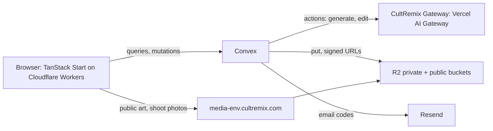

# CultRemix Checkpoint 0 — One-Day Build: Studio, Remix, Publish, Shop Page

Status: Not started
Date: 2026-09-29 (planned the night before) · Depth: Standard · Parent plan: `docs/plans/2026-09-27-feat-cultremix-v1-core-loop.md` (V1)
Event: one-day hackathon, 2026-09-29, 9:30 a.m.–6:00 p.m. PT. Application code starts at 9:30; plans, tests outside the repo, prompts, and image assets may be prepared the night before.
Baseline:
  CultRemix: `github.com/jonthewayne/cultremix` (private); `main` and `dev` start at the docs-only initial commit; today's work lands on `dev` (A13)
  starter: ~/Projects/starter @ a754258, being updated tonight in another thread; C1 records the exact commit it imports (gate G3)
  planned: 2026-09-29

This plan is **Checkpoint 0 of V1**. It builds V1's creative loop, publishing, and pages on V1's data model, so everything built today carries into the Monad hackathon build (due 2026-10-13) without migration. "V1 amendments" lists the V1 decisions this checkpoint changes; the V1 plan carries the same list as authoritative overrides.

---

## Decisions most likely to change

1. **Full V1 schema on day one (KTD-A → C2).** Every V1 table is declared tomorrow morning, split by area. Tables Checkpoint 0 writes get final validators; tables it does not write are declared with V1's fields and may still change shape until their first write. Additions are listed in "Data model additions".
2. **Members and creators (KTD-F → C5, C13).** Everyone who signs in is a member: they receive the starter credit grant the admin sets (default 24 credits), can generate, and can publish. A member becomes a creator only through a creator subscription (V1 S1) or an admin grant; that moment assigns the next sequential creator number. CuriousEntity is Creator № 1. Only creators will sell and earn (V1).
3. **Quick publish without a print file (KTD-G → C10).** A published work gets its CR number, lineage, public page, and photo shoot, and stays off sale (`commerceStatus: preparing`). Its publication snapshot records only the artwork and never changes; V1's Print Studio later sets the work's print identity once (`works.printKey`, `works.printSha256`) before it can go on sale.
4. **The fingerprint is the artwork hash (KTD-G).** `works.contentHash` is the SHA-256 of the published artwork PNG and is what V1's registry will record. Work pages show it beside a designed "Verified on Monad — coming soon" slot. No chain, wallet, or Circle code runs today.
5. **First CR number is 101-001 (official).** Families start at 101; creator numbers are separate and start at 1.
6. **Colors at publish (KTD-I → C10).** A swatch board shows the art on eight shirt colors with a low-contrast warning; the publisher chooses the colors to offer. Colorways are a stretch; a creator's own colorways stay in the same work, and someone else's is a remix.
7. **Work page is a shop page (C12).** Shoot photos, art, swatches, sizes and the $36 price shown but disabled, and "Buying opens soon — get early access" email capture per work.
8. **Shoot photos are generations (KTD-J → C11).** Each photo is a V1 `generations` row with `kind: shoot` in a hidden per-work session, so it uses V1's admission, dispatch, and sweeper unchanged. The world is picked by a fixed rule, not a model.
9. **One build thread, cheap parallel workers (Operating model).** One Opus 5.5 thread owns the checkout and builds the spine; up to three DeepSeek V4.1 Flash workers take bounded units with exclusive files; Jon designs in MagicPath and hands designs over at 1:30 and 4:00.
10. **Tomorrow's build is production at `cultremix.com` (KTD-M → C4; V1 amendment A12).** Convex `cultremix` production deployment, Worker `cultremix-prod`, `cultremix-prod-*` buckets, live by about 11:30 (fallback: the Worker's `workers.dev` URL), labeled "Early access". Commerce, chain, and Circle stay off by flag. Because CR and creator numbers in production are permanent, tests never write there (C0-INV-19). Staging is created later, when V1 needs Monad testnet or the Shopify development store.

---

## What this changes

- Anyone can sign in with an email code, pick a username, and start with the free credits the admin has set.
- In the studio you write the words for the shirt and a style direction, get four designs that fill in as they finish, heart the good ones, flip through favorites full screen, and branch "more like this" from any design.
- From any published design you can **Remix** it (new words, same look) or **Fork** it (new look); the result credits its parent.
- Picking a design and publishing it shows the art on shirt colors with warnings where it won't read, then reveals its CULTREMIX number.
- Every published design gets a photo shoot of people wearing it and a shop-style page where visitors see the photos, colors, family, and fingerprint, and leave an email for early access to buying.
- The Wall shows the newest designs; family pages show how a design has been remixed and forked; profiles show each person's work and whether they are a creator.
- The admin sets free credits for new members, the daily image spending cap, and the daily photo-shoot limit, grants credits or creator status, pauses or withdraws work, watches today's spend, and exports the early-access list.

---

## Product Contract

### Summary

A deployed CultRemix where the creative loop (create → favorite → view → remix/fork → publish → photo shoot → shop page) works end to end for any signed-in member, on V1's data model, with costs bounded by credits and a daily cap.

### Terms

| Term | Meaning | Numbering |
|---|---|---|
| Member | Anyone signed in with a username | none |
| Creator | A member with active creator access (owner, admin grant, or later a subscription) | Creator № 1, 2, 3… assigned once, in order |
| Original | A design published from a new session | new family: 101-001 |
| Remix (variation) | Same look, new words, from a published work | same family, next number: 101-004 |
| Fork | A new look for a published work | new family, credits its parent: 107-001 "forked from 101-001" |
| Colorway (stretch) | The same design recolored for one shirt color | same work when made by its creator |

### Requirements

Identity and membership
- **C0-R1.** Email-code sign-in (starter) and a unique username at first sign-in; a signed-in person without a username is sent to onboarding and then back to where they were going; phone sign-in off. (V1 R42)
- **C0-R2.** A new member receives the starter credit grant configured in admin, exactly once; the grant can be switched off. (new)
- **C0-R3.** CuriousEntity (verified `OWNER_EMAIL`) is admin owner and Creator № 1. Anyone else becomes a creator today only by admin grant, which assigns the next creator number. (V1 R41, amended)

Studio
- **C0-R4.** A session starts from *Words on the shirt* and *Style direction* (text plus preset chips) and generates a batch of 4 tiles that appear at once and fill in as each image finishes; a failed tile shows its reason and a retry. (V1 R1, R2 with a fixed batch size)
- **C0-R5.** Favorite and unfavorite any tile; a favorites tray lists favorites in favorited order; a full-screen viewer pages through favorites or the current batch with arrow keys, on-screen arrows, and swipe, preloads ±2 neighbors, keeps its state in the URL, and supports F (favorite), B (branch), P (pick), Esc; shortcuts are off while typing. (V1 R3–R5, partial)
- **C0-R6.** "More like this" branches a new batch from any tile, using it as the reference plus an optional instruction. (V1 R6)
- **C0-R7.** **Remix this** on a published work starts a session that changes only its words; tiles keep the parent's composition, typography, and palette. **Fork this** starts a session that describes a new look. Both work from a signed-out click through sign-in and onboarding. (V1 R16, R17)

Publish and pages
- **C0-R8.** Picking a tile opens quick publish: a swatch board of eight shirt colors with a low-contrast warning; the publisher chooses offered colors (at least one) and an optional AKA; the kind follows the session (original, variation, fork); publishing allocates the CR number and reveals it. (V1 R11 partial, R12, R17)
- **C0-R9.** The work page (`/cr/101-001`) renders signed out as a shop page: shoot photos (or the art on its first offered color when there are none), art, offered colors, sizes and price shown disabled, "Buying opens soon — get early access" email capture, creator (with creator number when present), family strip (parent, variations, forks), Remix and Fork buttons, fingerprint, and "Verified on Monad — coming soon". (V1 R13 partial, R18 partial)
- **C0-R10.** Publishing starts a photo shoot of three photos of people wearing the shirt in one of six house-style worlds, developing one at a time; a shoot that cannot start or finish shows why. (new)
- **C0-R11.** The Wall (`/`) shows published works newest first by publish time, 24 at a time, led by a shoot photo when one exists. (V1 R27 Latest, partial)
- **C0-R12.** The family page (`/family/101`) shows a family's variations as a tree and links forks in and out. (V1 R18)
- **C0-R13.** The profile (`/u/<username>`) shows the person's published works and remixes and a creator badge with number, or member status. (V1 R25 partial)
- **C0-R14.** The creator page (`/creator`) explains creator benefits and collects "tell me when subscriptions open" emails. (new; V1 S1 later)

Admin and cost control
- **C0-R15.** Admin (`/admin`, per the authorization matrix in KTD-S): signup credit grant (on/off, amount), daily image spending cap, per-member daily photo-shoot limit, generation and shoot switches, publishing pause; users (find by exact email or username prefix, credit balance, grant credits, grant or revoke creator status); withdraw or resume a work; today's spend and counts; early-access list with CSV export. (V1 R35 partial + new)
- **C0-R16.** Every image call is admitted against the day's budget with a reservation no smaller than its worst-case cost, and dispatches at most once. Tiles also spend the caller's credits (CuriousEntity exempt); shoot photos spend no credits and count toward the daily shoot limit. (V1 R34 amended, KTD-4)
- **C0-R17.** Production at `cultremix.com` is public by about 11:30, labeled "Early access", links short Terms and Privacy pages, and is redeployed at each checkpoint. (V1 R44 partial; amendment A12)

Stretch (only after baseline acceptance passes at checkpoint 2): **C0-S1** colorways; **C0-S2** start a shoot again from the work page; **C0-S3** hearts on published works.

### Scope boundaries

- **Out today, still V1:** ChatGPT sign-in and the subscription route (U3), Print Studio and upscaling (U6), Monad, Circle, and Backs (U7, U12), Shopify, Printful, and checkout (U9, U10), lineage amendments (U11), follows and feed tabs (U12), paid creator subscriptions (S1), notifications, judge password accounts (U2).
- **Inherited studio features deferred to V1 U4/U5 after the event:** reject (R3), session-wide viewer scope and the sessions rail (R5, UX spec), batch sizes other than 4 (R2), the owner's provider pill and Compare (R33).

### Success criteria

**Checkpoint acceptance.** Flows that create members, grant creator status, or publish test works run only on the acceptance setup, because CR and creator numbers in production are permanent (C0-INV-19). CP1 (1:00): F2 and F3 (except its Pick assertion, which needs C10 and is checked from CP2) on the acceptance setup, plus a sign-in and a private-thumbnail canvas read from the port-3001 URL; production live with Jon signed in; unit and convex-local suites. CP2 (3:30): F3–F9 on the acceptance setup; all suites; production seeded with `publishing` on and F1 checked there; cut decisions. CP3 (5:00): baseline flows F2–F5 and F9–F11 plus every conditional flow not cut on the acceptance setup; F1 and Jon's live publish on production; all suites; every C0 invariant's tests green.

**Baseline** is sign-in and onboarding, credits and budget, create/favorite/viewer, remix, quick publish, the work page, the Wall, admin settings and creator grants, and the production deploy at `cultremix.com`. **Conditional** scope is fork (F6), photo shoots (F7), early-access capture (F8), the family tree page, and the admin users table; each cut replaces its acceptance as listed in "Cut rules".

**Gate outcomes.** A failed gate uses its fallback in "Go/no-go gates", which keeps acceptance reachable. If G1 leaves no working image model, G2b leaves no production deployment, or production email reaches only Jon, the affected flows run on dev (OTP capture) or the tailnet dev URL, and the day is recorded as a degraded demo that does not meet acceptance.

**Demo script (from checkpoint 2, after the seed import; steps 6–7 and the export in step 8 are conditional):**

1. Open the Wall signed out: shoot photos with CR numbers and creators.
2. Open CULTREMIX № 101-001 (a 1970s motel sign reading "NO VACANCY FOR BAD VIBES"): shop page with photos, art, colors, family, fingerprint.
3. Press Remix signed out, sign in with an email code, pick a username, land back in the remix session with the starter credits shown.
4. **Remix:** change the words to "NO VACANCY FOR MONDAYS"; four tiles develop with the same look.
5. Heart two, open the viewer, flip with the arrow keys, pick one, publish on two colors; the number 101-00N clicks into place and joins the family strip.
6. **Fork** 101-001 as "a Swiss punk flyer"; publish as a new family, forked from 101-001.
7. The photo shoot develops on the new page; leave an early-access email.
8. As CuriousEntity: open admin, change the signup grant, grant a member creator status (they get the next creator number), and export the early-access list.

---

## Planning Contract

### Key technical decisions

- **KTD-A. Full V1 schema, split files.** `convex/schema.ts` only combines table groups from `convex/schema/{identity,studio,credits,works,social,commerce,chain,providers,admin,shoots}.ts`. The starter's tables keep every existing field and index; `users` gains V1's and this plan's optional fields. **Tables Checkpoint 0 writes** (`users`, `counters`, `crFamilies`, `featureFlags`, `creatorAccess`, `creditLedger`, `reservations`, `budgetDays`, `creativeSessions`, `batches`, `generations`, `providerCalls`, `publications`, `works`, `activityEvents`, and the additions) get the validators written out in "Settled validators" below, with state-dependent fields optional. **Tables it does not write** are declared with V1's field names, typed where V1 is specific and `v.any()` where V1 leaves an object's shape open; because they stay empty, their owning V1 unit finalizes them before the first write. Every later change to a written table is additive (V1 KTD-21).
- **KTD-B. R2 only, through the Convex R2 component.** No Convex file storage. `@convex-dev/r2`, one client per bucket (the component documents multiple buckets; C4 confirms by 11:15, fallback S3-signed requests with `aws4fetch` behind the same adapter). Per environment: `cultremix-<env>-private` (generation full images and 512 px WebP thumbnails, remix sources) and `cultremix-<env>-public` (`art/<sha256>.png`, `art/<sha256>.thumb.webp`, `shoots/<shootId>/<n>.webp`). Callers use only `convex/lib/storage.ts` (`putPrivate`, `putPublic`, `signedUrl`, `publicUrl`, `getBytes`, `exists`). Private images: signed GET URLs for 60 minutes; queries return `expiresAt`; the client refetches 5 minutes before expiry or on a load error (V1 "R2 browser access"). Public images: `https://media.cultremix.com/<key>` in production and `https://media-dev.cultremix.com/<key>` in dev and acceptance; until a media domain is live, the bucket's `r2.dev` URL. Public URLs never expire. Thumbnails are made with `sharp` in Node actions (`convex.json` `node.externalPackages: ["sharp"]`).
- **KTD-C. One provider interface (V1 KTD-2), gateway only today.** `convex/lib/providers/` exposes `generate` and `edit` returning PNG bytes plus provider, model, width, height, and reported cost when present. Implementations: `gateway` (CultRemix Gateway via the AI SDK with the AI Gateway provider) and `fake` (deterministic labeled PNGs, switchable to fail, time out, or return an unusable image; allowed only in dev and tests). Models: `openai/gpt-image-2.5-flare` for new designs; `openai/gpt-image-2.5-sunburst` for branch, remix, fork, colorway, and shoot edits, which send one reference image. Fixed per operation in `shared/config/pricing.ts`: size 1024×1536, quality, and background (transparent for designs, opaque for shoots). `maxRetries: 0`; prompts ≤1,000 characters; one input image ≤1024 px on its long side. Prep 1 fixes the exact call shape in `docs/setup/image-test-2026-09-28.md`.
- **KTD-D. Paid attempts follow V1, with a proven cost bound.** Admission, reservations, `authorizeDispatch`, `providerCalls`, the outcome table, and the sweeper are V1's "Paid attempt lifecycle" and KTD-4, with only CultRemix Gateway rows. **Reservation ceiling** per operation = published input and output token prices × (maximum input tokens at the fixed bounds + output tokens for the fixed size and quality) × 1.5, computed in `pricing.ts` from Prep 1's recorded token counts and the model pages' prices, and checked against the gateway's reported cost for each sample. **Gate:** `gen.vercel` stays off in production until `pricing.ts` has a ceiling for every operation (dev may use the fake provider or a measured real call). **Settlement:** the gateway-reported cost when present, otherwise the full reservation. A fallback model from gate G1 gets its own bounded profile in `pricing.ts` before it can pass the production gate: requested size and aspect, output normalized to 1024×1536 PNG with `sharp`, the lowest supported thinking setting (Gemini 3.1 Flash Image cannot turn thinking off; it offers `minimal` and `high`), `maxOutputTokens` bounding thinking and text together, and a ceiling covering the image price plus that token bound at the output token price, × 1.5; G1 must record this exact profile's billed tokens and reported cost. An observed cost above its reservation records the overage and turns `gen.vercel` off (V1 INV-12).
- **KTD-E. Credits.** Per tile: new design 1 credit; branch, remix, fork, and colorway 2 credits (V1 prices). Shoot photos reserve 0 credits and the worst-case cents against the budget. CuriousEntity uses no credits but counts toward the budget. Balance = settled ledger − open reservations (V1). The signup grant writes one `creditLedger` row (`kind: grant`, `reason: signup`) with the amount from `appSettings` at that moment, in the onboarding mutation that saves the username, and sets `users.signupGrantAt` in the same mutation so it can never run twice.
- **KTD-F. Membership and creator numbers.** A creator is a user with an active `creatorAccess` row (`source`: `owner`, `comp`, `subscription`). Activating a user's first creator access allocates `creatorNumber` from `counters.creatorNumber` (seeded at 2) in the same mutation; the number is never reused or changed, and revoking access keeps it. The owner claim (V1 U2) sets `platformRole: admin_owner`, `creatorNumber: 1`, and an `owner` access row, only when `users.emailVerified` is true and the email equals `OWNER_EMAIL`, once. Generation needs credits (or owner); publishing needs a username; selling will need creator access (V1).
- **KTD-G. Quick publish.** Mutation `publish.quick`, idempotent by `requestId` (a repeat returns the existing work): requires the `publishing` flag, session ownership, a studio session (not a shoot session), a `succeeded` picked generation of a studio kind in that session, a username, and ≥1 offered color from `shared/config/garments.ts`. Words and style come from the picked generation's batch `promptSnapshot`, never from the session's current fields. It writes the `publications` snapshot (generationId, kind, parentWorkId?, aka?, words, styleDirection, remixSchema {headline: words, subtitle?}, offeredColors, priceCents 3600), which never changes; allocates the CR number (V1 KTD-11: `counters.crFamily` seeded at 101, `crFamilies.nextExpression`); and inserts the `works` row (`status: preparing`, `commerceStatus: preparing`, `provenanceStatus: pending`, `offeredColors`, `styleDirection`, `aka`, `publicationId`), then starts the publish workflow (`@convex-dev/workflow`). Each step is safe to replay and first checks the work: withdrawn → stop; `publishing` off → record `pausedAtStep` and stop. Steps: (1) copy the generation's full image to the private bucket content-addressed as the remix source (V1 KTD-20) and compute SHA-256; (2) copy the same bytes to `art/<sha256>.png` and write its thumbnail in the public bucket, skipping existing keys; (3) only if the work is still `preparing`, in one mutation: set `contentHash`, `remixSourceKey`, `remixSourceSha256`, `artKey`, `artThumbKey`, `publishedAt`, `status: published`, and write the `activityEvents` row (a work already published skips this step, so `publishedAt` and the event are written once); (4) call `internal.shoots.startForWork`. A failed copy sets `status: asset_failed` and `assetError`. **Retry** (`publish.retryAssets` by the creator, `admin.retryAssets` by admins) applies only to `asset_failed` works: one mutation sets `status: preparing`, clears `assetError`, increments `assetAttempts`, and restarts the workflow from step 1. **Resume** (`admin.resumeWork`, or `admin.resumePaused` for all) applies only to paused works while `publishing` is on: it clears `pausedAtStep` and continues from that step without changing `status`. The CR number never changes. The creator sees progress through `publish.status`. Withdrawal always wins: resume and retry refuse withdrawn works, and un-withdrawing is left to V1. `works.printKey` and `works.printSha256` stay empty today.
- **KTD-H. Kinds and lineage.** Create sessions publish as `original` (new family, expression 1, `familyRootId` = itself). Remix sessions (`remixMode: variation`) publish as `variation` in the parent's family (next expression, `familyRootId` = the parent's root). Fork sessions (`remixMode: fork`) publish as `fork` (new family, expression 1, `parentWorkId` = source, `forkOriginId` = source). `effectiveParentWorkId` = `parentWorkId`. Remix and fork generations send the parent's private remix source, read server-side (V1 INV-32).
- **KTD-I. Swatches and contrast (advisory).** `shared/config/garments.ts` lists eight Comfort Colors 1717 shades with display hex values (V1 U0 later marks which are orderable). `shared/lib/contrast.ts` is pure: it takes the picked tile's private thumbnail pixels, read in the browser through its signed URL with `crossOrigin="anonymous"` (the private bucket's CORS allows the app origins, per V1 "R2 browser access"), ignores pixels with alpha below 0.5, and for each garment returns the share of remaining ink pixels whose WCAG contrast against the garment color is below 1.5. Above 25% shows "Hard to read on this color"; above 50% also starts unselected. It judges ink area only, not layout or legibility, and says so in its tooltip.
- **KTD-J. Photo shoots.** `shared/config/worlds.ts` holds six worlds (motel lot at night, laundromat, rooftop at dusk, backstage, desert highway, corner store), each a prompt template in the house style (raw flash, film texture, real places, cool casting, minimal retouching; vision §9) with a casting line. The world is chosen by keywords in the work's style direction, else by a stable hash of the work ID; no text model today. `internal.shoots.startForWork` creates the `shoots` row and three `shootPhotos` rows (`pending`), and, when the shoot can run, a hidden session (`creativeSessions.purpose: shoot`) and one batch. **Progression is durable:** `internal.shoots.advance` handles the lowest pending photo. Its first step is the mutation `claimPhoto`: if the photo has no `generationId`, it admits one `generations` row with `kind: shoot` and links it to the photo in the same mutation; if it already has one, it returns that one. Dispatch, settlement, and sweeping then work exactly as for tiles, so overlapping `advance` and `reconcile` calls, or a crash right after admission, reuse the linked attempt and never create a second one. After a success the action copies the private image to the public bucket and records it on the photo (idempotent by shoot and index), then schedules `advance` again. A photo whose generation ends `failed`, `unknown_outcome`, or `expired`, or whose public copy fails three times, is marked `failed` with a reason (`provider_rejected`, `timed_out`, `unusable_image`, `storage_failed`) and ends the shoot. `internal.shoots.reconcile` (cron every 5 minutes) finds `running` shoots whose current photo's generation is finished but not yet recorded, or with no progress for 10 minutes, and applies the same step without a new paid call. **Outcomes:** `not_started` with a reason (`flag_off`, `limit_reached`, `budget_reached`, `withdrawn`) when admission refuses the first photo; `running`; `done` (3 photos); `partial` (1–2); `failed` (0 after starting). Shoots need `gen.vercel` and `gen.shoots` on and a published, not withdrawn work; the daily limit counts shoots started per member per UTC day. **Boundary:** every public studio and publish function rejects shoot sessions and `kind: shoot` generations with `NOT_FOUND`, so a shoot photo can never be retried, favorited, branched, or published as art. A shoot ended by a photo failure records `reason: photo_failed`. The public projection is `WorkPage.shoot` {status, reason?, photos: {index, state, url?, reason?}}; `shared/config/shootCopy.ts` maps every reason to one line of page copy. The page shows the art on its first offered color whenever there are no photos.
- **KTD-K. The data seam for parallel and design work.** `shared/contracts.ts` defines read DTOs, write arguments and results, and error codes ("Contracts"). Pages and components read and write only through hooks in `src/data/`, each with a fixture implementation (`src/fixtures/`, in-memory, simulating mutations and refusals) and a live one, switched by `VITE_DATA_MODE=fixtures`. C3 creates stub Convex functions for every public name, returning fixtures or throwing `NOT_IMPLEMENTED`, so everything compiles from the start; each stub file passes to the unit that implements it.
- **KTD-L. Public data path (V1 KTD-1a).** `expectAuth: false` in `src/router.tsx`; public queries accept anonymous callers and return only allowlisted fields (V1 INV-24); private signed URLs go only to the object's owner.
- **KTD-M. Environments and deployment (subset of V1 KTD-14).** `DEPLOYMENT_ENV` fixes buckets, media domain, site URL, and allowed providers. `assertDeploymentConsistency()` runs at the start of every action with an external effect.

| Setting | dev | acceptance | production |
|---|---|---|---|
| Convex | owner's dev deployment of project `cultremix`, via `npx convex dev` (watcher in the shared checkout) | dev deployment of project `cultremix-accept`, via `npx convex dev --once` from the release worktree | production deployment of project `cultremix`, via `npx convex deploy` with its production deploy key |
| Frontend | shared checkout's Vite dev server, `https://mighteous.tailb6e2ea.ts.net:3000` | release worktree's Vite dev server, `https://mighteous.tailb6e2ea.ts.net:3001` | Worker `cultremix-prod` on `cultremix.com` and `www.cultremix.com` (fallback `workers.dev`) |
| Browser build values | `.env.local` | the release worktree's `.env.local` | `.env.production`, read by the production `vite build`: `VITE_CONVEX_URL`, `VITE_CONVEX_SITE_URL`, `VITE_DEPLOYMENT_ENV` |
| Worker runtime values (read by `src/lib/auth-server.ts`) | from `.env.local` | from the release worktree's `.env.local` | Wrangler `env.production.vars`, the same three values |
| Convex env | `DEPLOYMENT_ENV=dev`; `SITE_URL` and `AUTH_TRUSTED_ORIGINS` = the port-3000 URL | `DEPLOYMENT_ENV=dev`; `SITE_URL` and `AUTH_TRUSTED_ORIGINS` = the port-3001 URL | `DEPLOYMENT_ENV=prod`; `SITE_URL` = `https://cultremix.com`; `AUTH_TRUSTED_ORIGINS` = both cultremix.com hosts (and the `workers.dev` URL) |
| Buckets and media | `cultremix-dev-*`, `media-dev.cultremix.com` | the same dev buckets and media | `cultremix-prod-*`, `media.cultremix.com` |
| R2 CORS origins | both tailnet URLs | both tailnet URLs | both cultremix.com hosts and the `workers.dev` URL |
| Providers | gateway, fake | gateway, fake | gateway |

`npm run deploy:prod` (the starter's script: a `CLOUDFLARE_ENV=production` build, then `wrangler deploy`) publishes production. `/health` shows the frontend's `VITE_DEPLOYMENT_ENV` beside the backend's value from the public query `deployment.get` (C4); the smoke test requires both to read `prod`. The starter's `.github/workflows/deploy.yml` (which deploys `main` to production on every push) and `cleanup.yml` are removed in C1; production deploys are manual from the release worktree today, and V1 adds CI following its promotion policy (`dev` to the dev deployment, release tags to staging, then production).
- **KTD-N. Feature flags and pausing (V1 KTD-19, INV-27).** Seeded by bootstrap: `gen.vercel` on in dev and acceptance, off in production until KTD-D's gate passes; `gen.shoots` on; `publishing` on in dev and acceptance, off in production until C14's seed import finishes; `commerce.checkout`, `chain.writes`, `social.backs`, `gen.subscription`, `gen.upscale` off. Admission checks `gen.vercel` (and `gen.shoots` for shoots); `authorizeDispatch` checks them again, so a flag turned off after admission releases the reservation and fails the tile with "Generation is paused"; a dispatched attempt always records its outcome. `gen.vercel` off stops tiles and shoots; `gen.shoots` off stops only shoots. `publishing` is checked by `publish.quick` and at every workflow step (KTD-G).
- **KTD-O. Waitlist.** `waitlist` rows hold `emailLower`, `kind` (`buy` | `creator`), optional `workId` and `userId`, `createdAt`; one row per (`emailLower`, `kind`, `workId`). `waitlist.join` validates the address, accepts signed-out callers, returns the same success for a repeat, and is rate-limited per email with the starter's `convex/lib/authRateLimit.ts` pattern.
- **KTD-P. Starter import (V1 KTD-1).** Copy the updated starter without `.git` or `node_modules`. `AUTH_CONSUMER_PHONE_ENABLED=false`; delete `src/routes/$code.tsx`; exclude phone and SMS suites (`tests/convex/{phone*,sms*}.test.ts`) from `vitest.convex.config.ts` and remove the phone section from `tests/e2e/run-e2e.sh`; sender name "CultRemix" in `convex/email.ts` and `convex/auth.ts`; Wrangler names `cultremix-dev`, `cultremix-staging`, `cultremix-prod`; app name in `package.json`; remove the two GitHub workflows (KTD-M).
- **KTD-Q. Onboarding and returning to intent.** `src/lib/onboardingGuard.ts` runs from `__root.tsx`'s `beforeLoad`: a signed-in viewer with no username is redirected to `/onboarding?redirect=<path and search>`, except on `/login`, `/verify-email`, `/auth/*`, `/api/*`, `/onboarding`, and `/health`. Onboarding saves the username (and the signup grant), then navigates to the sanitized redirect (starter `sanitizeRedirect`). Remix and Fork buttons link to `/studio/new?remix=<cr>&mode=<variation|fork>`; signed out, they go to `/login?redirect=` with that path, which survives email verification and onboarding; `/studio/new` calls `sessions.startRemix` and opens the session. The default destination after sign-in and onboarding is `/studio`: C1 changes the `/superadmin` default in `src/lib/sanitize-redirect.ts` and `convex/lib/sanitizeRedirect.ts`, so a missing or rejected redirect lands there. `users.emailVerified` is synced from Better Auth by the user triggers in `convex/auth.ts` on create and update.
- **KTD-R. Bootstrap.** `internal.bootstrap.ensureDefaults` (idempotent) creates, when missing: `appSettings` `main` {signupGrant {enabled: true, credits: 24}, dailyBudgetCents: 5000, shootsPerMemberPerDay: 3}; `counters` `crFamily` 101 and `creatorNumber` 2; the flags in KTD-N for the current `DEPLOYMENT_ENV`. It runs on dev and `cultremix-accept` when C2 is accepted (after the acceptance push, and again after every push, since it is idempotent) and on production in C4 step 5. Admission, onboarding, and publish refuse with `NOT_CONFIGURED` when their settings are missing. 24 credits cover one remix and one fork batch (16) plus one new-design batch (4).
- **KTD-S. Admin authorization.** Capabilities added to `convex/lib/authzCapabilities.ts`: `admin:read`, `settings:manage`, `credits:grant`, `creators:manage`, `flags:manage`, `works:manage` (withdraw, resume, retry assets), `waitlist:export`. `admin_owner` keeps `*`; `admin_ops` gets all but `settings:manage`; `admin_support` gets `admin:read` only; `user` gets none. Every admin function checks its capability through the starter's permission helpers.
- **KTD-T. Accepted snapshots, the release worktree, and the acceptance backend.** Workers keep editing the shared checkout and its dev deployment, so nothing that gates acceptance or deploys uses either. **Acceptance commits:** when the owner accepts a unit (C1's scaffold and C3's stubs included), it commits exactly that unit's files to `dev` at once, before handing any of them to another unit, and pushes `dev` to `origin`. **Release worktree:** `/Users/starborn/Projects/CultRemix-release`, created in C1 right after the scaffold commit (this plan authorizes it) and always checked out, detached, at the latest acceptance commit on `dev`; setup is `npm ci` when the lockfile changed, its own `.env.local` pointing at the acceptance backend, and generated files rebuilt from the snapshot (`npx convex codegen`; the route tree by `vite build`). **Acceptance backend:** the dev deployment of a third Convex project, `cultremix-accept` (`DEPLOYMENT_ENV=dev`, dev buckets, its own auth secret), used only from the release worktree. **Acceptance procedure** for every unit: commit its files; update the release worktree; `npx convex dev --once` to push the accepted backend to `cultremix-accept`, then `npx convex run bootstrap:ensureDefaults` there once it exists; run `npm test`, `npm run test:convex:local`, and `npm run typecheck`; failures revert that commit with `git revert` and the fixes go back to the same worker. **Checkpoints** additionally run `npm run test:convex` and the dev browser flows against the release worktree's own dev server (port 3001, tailnet-exposed) and `cultremix-accept`, and record the commit SHA with the results in `docs/hackathon/log.md`. **Deploys** run only from the release worktree, with the production deploy key sourced from `~/.config/cultremix/prod.env` for each command and never written into a worktree. After each production deploy the owner fast-forwards `main` to the deployed commit and pushes it (A13).

### Settled validators (tables Checkpoint 0 writes)

V1 field names are kept; `?` marks optional. Unions list their literal values.

| Table | Validator summary |
|---|---|
| `users` (starter + V1) | starter fields unchanged; usernameLower?, username?, creatorNumber?, emailVerified?, signupGrantAt?; V1's chatgptEnabled?, generationPreference?, walletStatus?, walletIdempotencyKey?, circleWalletId?, walletAddress? |
| `counters` | name, next |
| `crFamilies` | family, nextExpression, rootWorkId? |
| `featureFlags` | key, enabled |
| `appSettings` | key, signupGrant {enabled, credits}, dailyBudgetCents, shootsPerMemberPerDay, updatedBy?, updatedAt |
| `creatorAccess` | userId, source (owner/comp/subscription), active, grantedBy?, activatedAt |
| `creditLedger` | userId, kind (grant/settle/refund_credit), amount, reservationId?, reason? (signup/admin/subscription), note? |
| `reservations` | attemptId (generation), provider (gateway), userId?, dayUtc, credits, worstCaseCents, pricingVersion, state (open/settled/released), actualCents?, closedAt? |
| `budgetDays` | provider (gateway/fal), dayUtc, capCents, settledCents, openCents |
| `creativeSessions` | ownerId, updatedAt, phrase, styleDirection, presets (string[]), remixOfWorkId?, remixMode? (variation/fork), purpose? (studio/shoot; absent means studio), shootWorkId?, chosenGenerationId?, publicationId? |
| `batches` | sessionId, promptSnapshot {operation (create/branch/remix/fork/shoot), words, styleDirection, presets, instruction?, world?}, providerPlan {provider (gateway), model, pricingVersion}, parentGenerationId?, count |
| `generations` | sessionId, batchId, kind (concept/branch/edit/remix/tool/shoot), status (V1's eight), provider, model, retryOf?, parentId?, toolOp?, dispatchedAt?, favorite, favoritedAt?, rejected, fullKey?, thumbKey?, width?, height?, hasAlpha?, error? |
| `providerCalls` | generationId, provider, model, startedAt, outcome? |
| `publications` | requestId, sessionId, snapshot {generationId, kind, parentWorkId?, aka?, words, styleDirection, remixSchema {headline, subtitle?}, offeredColors, priceCents}, workId |
| `works` | crFamily, crExpression, creatorId, kind (original/variation/fork), parentWorkId?, effectiveParentWorkId?, familyRootId?, forkOriginId?, remixSchema, styleDirection, aka?, publicationId?, offeredColors, status (preparing/published/withdrawn/asset_failed), commerceStatus (preparing/live/paused/failed), provenanceStatus (waiting_parent/pending/submitted/confirmed/failed), pausedAtStep?, assetError?, assetAttempts, publishedAt?, contentHash?, remixSourceKey?, remixSourceSha256?, artKey?, artThumbKey?, printKey?, printSha256?, mockupKeys?, shopifyProductId?, chainWriteId? |
| `activityEvents` | actorId, verb (published), objectId, createdAt |
| `waitlist`, `shoots`, `shootPhotos` | see "Data model additions" |

`familyRootId` for an original is set by a patch in the same mutation right after the insert. A convex-local test writes a work and a generation through every state they reach today to prove the validators accept each one.

### Data model additions (to V1's "Data model")

| Table / field | Fields | Indexes |
|---|---|---|
| `appSettings` (new) | as above; defaults in KTD-R | `by_key` |
| `waitlist` (new) | emailLower, kind (buy/creator), workId?, userId?, createdAt | `by_email_kind_work` (emailLower, kind, workId), `by_kind_created` (kind, createdAt), `by_work` (workId) |
| `shoots` (new) | workId, world, castingNote, status (not_started/running/done/partial/failed), reason? (flag_off/limit_reached/budget_reached/withdrawn/photo_failed), sessionId?, batchId?, requestedBy, dayUtc, createdAt, updatedAt | `by_work` (workId), `by_requestedBy_day` (requestedBy, dayUtc), `by_status_updated` (status, updatedAt) for reconcile |
| `shootPhotos` (new) | shootId, workId, index (1–3), state (pending/succeeded/failed), reason? (provider_rejected/timed_out/unusable_image/storage_failed), generationId?, publicKey?, thumbKey?, copyAttempts | `by_shoot_index` (shootId, index), `by_work` (workId) |
| `workColorways` (new; stretch) | workId, garmentColor, generationId, publicKey, createdBy, createdAt | `by_work` (workId) |
| `generations.kind` | adds `shoot` | — |
| `creativeSessions` | remixMode?, purpose?, shootWorkId? | — |
| `users` | signupGrantAt? | V1's `by_usernameLower`, `by_creatorNumber` |
| `works` | offeredColors, styleDirection, aka?, publicationId?, assetError?, assetAttempts, publishedAt?, artKey?, artThumbKey?, printSha256? | `by_status_publishedAt` (status, publishedAt) for the Wall |
| `creditLedger` | reason?, note? | — |
| `creatorAccess` | source values owner/comp/subscription; activatedAt | `by_user` (userId) |

`budgetDays.capCents` for the gateway comes from `appSettings.dailyBudgetCents` when a day's row is created; changing the setting also updates today's row.

### Contracts (`shared/contracts.ts`)

Written by the owner in C3 before dependent units start. Names are stable; fields may be added.

**Read DTOs.**

- `Viewer`: userId, username?, isCreator, creatorNumber?, capabilities (string[]), credits (available), needsUsername.
- `WallItem`: workId, cr ("101-001"), family, expression, kind, words, creator {username, creatorNumber?}, heroUrl (first finished shoot photo, else art), artUrl, artThumbUrl, offeredColors, parentCr?, publishedAt.
- `WorkPage`: WallItem fields plus aka?, styleDirection, shoot {status, reason?, photos: {index, state, url?, reason?}[]} | null, swatches {garment, hex, offered}[], priceDisplay ("$36"), sizes, fingerprint (hex SHA-256), provenance `coming_soon`, family {root, parent?, variations[], forks[], forkedFrom?} of FamilyNodeRef, canRemix, earlyAccessJoined. `works.byCr` returns only published works; a creator follows an unpublished work through `publish.status`.
- `FamilyNodeRef`: workId, cr, kind, thumbUrl, creatorUsername. `FamilyTree`: family, root, nodes (FamilyNodeRef + parentWorkId), forksOut, forkedFrom?.
- `StudioSessionView`: sessionId, words, styleDirection, remixMode?, source (FamilyNodeRef)?, batches (BatchView[], newest first), favorites (TileView[], favorited order).
- `BatchView`: batchId, promptChip, parentTile?, tiles. `TileView`: generationId, status, thumbUrl?, fullUrl?, expiresAt?, favorite, error?, creditCost.
- `ProfileView`: username, isCreator, creatorNumber?, works (WallItem[]), remixes (WallItem[]).
- `AdminOverview`: settings, todaySpendCents, todayCapCents, generationsToday, shootsToday, flags. `AdminUserRow`: userId, username?, email, credits, isCreator, creatorNumber?, createdAt.

**Public functions (arguments → result).** Errors are `ConvexError({ code })` with `code` from `ErrorCode`: `SIGNED_OUT`, `NEEDS_USERNAME`, `NOT_FOUND`, `NOT_PUBLISHED`, `NOT_OWNER`, `NOT_READY`, `NO_COLORS`, `INVALID_INPUT`, `PUBLISHING_OFF`, `RATE_LIMITED`, `FORBIDDEN`, `NOT_CONFIGURED`, `WITHDRAWN`, `NOT_IMPLEMENTED`. Admission refusals are results, not errors: `{ refused: RefusalReason }` with `NO_CREDITS`, `BUDGET_REACHED`, `GENERATION_OFF`, `NOT_CONFIGURED`.

| Function | Arguments | Result |
|---|---|---|
| `viewer.get` | — | `Viewer` or null |
| `deployment.get` | — | `{ deploymentEnv }` |
| `feed.wall` | paginationOpts (24) | page of `WallItem` |
| `works.byCr` | cr | `WorkPage` or null |
| `lineage.family` | family | `FamilyTree` or null |
| `profiles.byUsername` | username | `ProfileView` or null |
| `identity.completeOnboarding` | username | `Viewer` (applies the signup grant) |
| `sessions.create` | words, styleDirection, presets | `{ sessionId }` |
| `sessions.startRemix` | cr, mode (variation/fork) | `{ sessionId }` |
| `sessions.get` | sessionId | `StudioSessionView` |
| `studio.generateBatch` | sessionId, words?, styleDirection?, instruction? | `{ batchId }` or `{ refused }` |
| `studio.branch` | generationId, instruction? | `{ batchId }` or `{ refused }` |
| `studio.retryTile` | generationId | `{ generationId }` or `{ refused }` |
| `studio.toggleFavorite` | generationId | `{ favorite }` |
| `publish.quick` | requestId (client UUID), generationId, offeredColors, aka? | `{ workId, cr }` |
| `publish.status` | workId (creator only) | `{ cr, status, pausedAtStep?, error? }` |
| `publish.retryAssets` | workId (creator only) | `{ status }` |
| `waitlist.join` | email, kind, workId? | `{ ok: true }` |
| `admin.overview` / `admin.users` | — / query (exact email or username prefix) | `AdminOverview` / `AdminUserRow[]` (50 newest when empty) |
| `admin.updateSettings` | partial settings | settings |
| `admin.grantCredits` | userId, credits, note? | new balance |
| `admin.setCreator` | userId, active | `{ creatorNumber? }` |
| `admin.setFlag` | key, enabled | flags |
| `admin.withdrawWork` / `admin.resumeWork` / `admin.resumePaused` / `admin.retryAssets` | workId (none for `resumePaused`) | work status, or count resumed |
| `admin.exportWaitlist` | kind? | CSV text |

### Architecture

### Operating model for the day

| Role | Model | Pool | How it runs | Effort |
|---|---|---|---|---|
| Build owner | Opus 5.5 | Claude subscription | One interactive Codex thread in `/Users/starborn/Projects/CultRemix` | high |
| Workers W1–W3 (≤3 at once) | DeepSeek V4.1 Flash | Devin first, then OpenCode Go | `codex exec -C /Users/starborn/Projects/CultRemix -m devin/deepseek-v4-1-flash -c model_reasoning_effort=max --sandbox workspace-write --json "<work order>" < /dev/null` (OpenCode Go: `-m opencode-go/deepseek-v4.1-flash`) | max |
| Designer | Jon in MagicPath | none | separate thread or the MagicPath app, from "Page specs" | — |
| Reviewer | GPT-6 Astra | Codex subscription | `codex exec --sandbox read-only` at checkpoint 2 | high |
| Dogfood | GPT-5.6 Luna | Codex subscription | `codex exec` with `agent-browser` at checkpoints 2 and 3 | medium |

**File ownership.** A unit's listed files belong to its assignee from assignment until the owner accepts the unit, then return to the owner. No two running units list the same file. Owner-only at all times: `package.json`, the lockfile, `convex/schema.ts`, `convex/schema/*` (except C2 while it runs), `shared/contracts.ts`, `src/data/*`, `src/routes/__root.tsx`, `src/routeTree.gen.ts` (regenerated by the owner's dev server), `src/components/ai-elements/*`, `convex/crons.ts`. MagicPath designs are imported only at the handoffs, into files of accepted units or new files under `src/components/mp/`.

**Worker rules.** Each worker gets one unit, a self-contained work order (goal, exclusive files, contracts, tests to write and run, stopping condition), and is resumed by its `thread_id` for fixes. Workers never commit, deploy, install packages, or run `convex dev`. Their checks in the shared checkout are `npx vitest run <their test files>` (with `--config vitest.convex-local.config.ts` for Convex tests) and `npx tsc --noEmit -p tsconfig.json`, reporting only diagnostics in their own files. Acceptance follows KTD-T's procedure in the release worktree. The owner runs the single `convex dev` watcher in the shared checkout, all installs, all commits, and all deploys, and logs worker sessions, pools, outcomes, and acceptance SHAs in `docs/hackathon/log.md`.

**If Opus runs short.** Check allowances at 10:30, 12:30, and 3:00 with `sub check`. Keep the owner at high effort and push more work to workers. If the Claude five-hour window is exhausted: write `docs/hackathon/handoff.md` (done, in progress, next, open decisions) and continue in a new thread on `devin/claude-opus-5` (tested 2026-09-29 00:10), then `gpt-5.6-sol` or `gpt-6-astra` on Codex. Claude plan usage credits are a paid option Jon can switch on. A pool switch is announced in the log, never silent.

### Go/no-go gates

| Gate | Evidence | Deadline | If it fails |
|---|---|---|---|
| G1 Image calls | Prep 1 doc: call shape; Flare returns real alpha; three words-only remixes where the look holds in at least two (V1 U0(j) style, Jon judges); a fork and a shoot photo with a readable print; token counts and reported cost | 9:30 | No alpha: designs on a flat background, and the swatch board multiply-blends them. Weak remixes: a stricter remix prompt, retested on three designs. OpenAI image models unusable: `google/gemini-3.1-flash-image` through the same gateway (listed 2026-09-28), retested the same way with its own pricing profile (KTD-D). Nothing works: degraded demo (see "Gate outcomes") |
| G2a Dev prerequisites | Convex CLI logged in on mighteous; projects `cultremix` and `cultremix-accept` with dev deployments; Resend API key with the verified `cultremix.com` sender or the shared sender; `OWNER_EMAIL`; the tailnet URLs for ports 3000 (dev) and 3001 (acceptance) as each deployment's `SITE_URL` and `AUTH_TRUSTED_ORIGINS` | 9:30 (tonight) | Blocks C1; nothing else can start |
| G2b Production prerequisites | `cultremix.com` on Cloudflare; Resend sends from `cultremix.com` to two outside addresses; the `cultremix` production deploy key in `~/.config/cultremix/prod.env`; Cloudflare Worker access and the custom domain; R2 buckets and keys; gateway key with a spend limit; media DNS | 10:50 | Sending domain unverified: `AUTH_EMAIL_FROM=onboarding@resend.dev`, which Resend delivers only to the account owner, so only Jon can sign in on production (degraded, see "Gate outcomes"). Media domain or `cultremix.com` routing missing: `r2.dev` and `workers.dev` URLs. Missing deploy key, R2 keys, Cloudflare access, or gateway key: C4 cannot finish, and acceptance moves to the tailnet dev URL as a degraded demo |
| G3 Starter | The starter thread's final commit, email sign-in working | 9:30 | Import a754258 and apply KTD-P |
| G4 AI Elements | `prompt-input` and `suggestion` build under TanStack Start | 10:10 | Plain components with the same props |
| G5 R2 component | Two buckets through `@convex-dev/r2` from a Convex action, proven inside C4 | 11:15 | `aws4fetch` behind the same adapter |

---

## Implementation Units

Unit IDs are this plan's (C1–C15); each names the V1 units it seeds. **Depends on** means complete and accepted; **Starts against** means it may begin on contracts, stubs, or fixtures. Times are targets for the lanes in "Schedule".

### C1 — Scaffold, harness, and starter import (owner, 9:30–10:10)

**Goal:** A running app in this repo on the tailnet dev server with email sign-in, the test harness, and the starter cleanup (seeds V1 U1).
**Files:** everything imported from the starter; modify `package.json` (name, script `test:convex:local`), `wrangler.jsonc`, `convex.json`, `convex/auth.ts` (sender name only), `convex/email.ts`, `src/router.tsx`, `src/routes/__root.tsx` (calls `onboardingGuard`, a no-op until C5), `vitest.config.ts` (also exclude `tests/convex-local/**`), `vitest.convex.config.ts` (exclude phone and SMS suites), `tests/e2e/run-e2e.sh` (no phone section), `src/lib/sanitize-redirect.ts` and `convex/lib/sanitizeRedirect.ts` (default `/studio`), `.env.example`, `.gitignore` (`docs/e2e/**/_private/`, `.tmp/`); create `vitest.convex-local.config.ts` (edge-runtime environment, `tests/convex-local/**`), `src/lib/onboardingGuard.ts` (no-op stub), `docs/hackathon/log.md`; delete `src/routes/$code.tsx`, `.github/workflows/deploy.yml`, `.github/workflows/cleanup.yml`.
**Approach:** KTD-P. One install pass: `ai` and `@ai-sdk/gateway` (versions from G1), `@convex-dev/r2`, `sharp`, `motion`, `convex-test`, `@edge-runtime/vm`; AI Elements `prompt-input` and `suggestion` via `npx ai-elements@latest add` (G4). Set the Convex environment on the dev deployment and on `cultremix-accept` from G2a: a unique `BETTER_AUTH_SECRET` per deployment, `SITE_URL` and `AUTH_TRUSTED_ORIGINS` per the KTD-M matrix, `OWNER_EMAIL`, `AUTH_EMAIL_FROM`, `RESEND_API_KEY`, `AUTH_CONSUMER_PHONE_ENABLED=false`, `ENABLE_TEST_OTP_STORAGE=true`, `TEST_HELPER_SECRET`, `DEPLOYMENT_ENV=dev` (the starter's `docs/auth-setup.md` checklist; recorded without secrets in `docs/setup/accounts.md`). Start `convex dev` and the dev server, run `tailscale serve --bg --https=3000 3000`, commit "scaffold", create the release worktree, and accept C1 there by KTD-T's procedure.
**Test scenarios:** `npm test` passes and does not run `tests/convex-local`; `npm run test:convex:local` runs an empty suite; `npm run typecheck` passes; email-code sign-in works on dev.

### C2 — Schema and bootstrap (W1, 10:10–10:50)

**Goal:** V1's data model plus this plan's additions as split schema files, and the defaults bootstrap (KTD-A, KTD-R).
**Files:** `convex/schema.ts`, `convex/schema/*.ts`, `convex/bootstrap.ts`, `tests/unit/schemaShape.test.ts`, `tests/convex-local/lifecycleRecords.test.ts`, `tests/convex-local/bootstrap.test.ts`.
**Depends on:** C1.
**Test scenarios:** every V1 table and index name exists; a work and a generation pass through each state they reach today; `ensureDefaults` twice leaves one row of each; production defaults turn `gen.vercel` and `publishing` off.

### C3 — Contracts, stubs, hooks, fixtures (owner, 10:10–10:40)

**Goal:** The seam for workers and the MagicPath handoff (KTD-K).
**Files:** `shared/contracts.ts`, `shared/config/garments.ts`, `shared/config/worlds.ts`, `shared/lib/cr.ts`, `src/data/*.ts`, `src/fixtures/*.ts`, `shared/config/shootCopy.ts`, stub files for every public function and for `internal.shoots.startForWork` (`convex/{viewer,identity,feed,works,lineage,profiles,sessions,studio,publish,waitlist,admin,shoots,deployment}.ts`), `src/components/remix/RemixButtons.tsx` (stub), `convex/lib/storage.ts` (interface and a fake), `tests/unit/cr.test.ts`.
**Depends on:** C1. Runs beside C2; the stubs compile against the schema once C2 lands.
**Test scenarios:** `cr.ts` formats and parses `101-001` and rejects `1-1` and `101-1000`; fixture hooks satisfy the contract types; every public name exists.

### C4 — Storage, environments, production deploy (owner with Jon's accounts, 10:50–11:30)

**Goal:** Real R2 adapter, deployment consistency, bootstrap on every deployment, production public at `cultremix.com` by about 11:30 (KTD-B, KTD-M).
**Files:** `convex/lib/storage.ts` (real implementation), `convex/lib/deployment.ts`, `convex/deployment.ts` (`deployment.get`), `convex/convex.config.ts` (R2 component), `shared/config/env.ts`, `wrangler.jsonc`, `.env.production` (no secrets), `src/routes/health.tsx`, `docs/setup/accounts.md`, `tests/convex-local/storage.test.ts`, `tests/convex-local/deployment.test.ts`.
**Depends on:** C1, C2, gate G2b. Proves gate G5.
**Approach:** in order: (1) buckets, CORS for the origins in the KTD-M matrix (V1 "R2 browser access"), media domains; (2) storage and gateway values on the dev and acceptance deployments; (3) the production Convex environment: a unique `BETTER_AUTH_SECRET`, `RESEND_API_KEY`, `DEPLOYMENT_ENV=prod`, `OWNER_EMAIL`, `AUTH_EMAIL_FROM`, `AUTH_TRUSTED_ORIGINS`, `SITE_URL=https://cultremix.com`, gateway key, R2 credentials (`ENABLE_TEST_OTP_STORAGE` and `TEST_HELPER_SECRET` unset); (4) from the release worktree, `npx convex deploy` the accepted backend to production; (5) `npx convex run --prod bootstrap:ensureDefaults` and check the defaults; (6) `npm run deploy:prod` and attach `cultremix.com` and `www.cultremix.com`; (7) smoke test: `/health` shows `prod` twice and Jon signs in with an email code; a second outside address receives a code without completing sign-in.
**Test scenarios:** consistency refuses production with dev buckets, and refuses `fake`, OTP capture, or the test helper outside dev and acceptance; the adapter round-trips bytes through the fake client; `publicUrl` returns the media URL, or the `r2.dev` URL when no media domain is set; checkpoint smoke fetches one private object unsigned and gets 403.

### C5 — Identity, membership, credits (W1, 10:50–12:15)

**Goal:** Onboarding with intent return, owner claim, email-verified sync, creator numbers, signup grant, viewer, capability guards (KTD-E, KTD-F, KTD-Q; seeds V1 U2).
**Files:** `convex/identity.ts`, `convex/credits.ts`, `convex/viewer.ts`, `convex/profiles.ts`, `convex/lib/viewer.ts` (`requireUser`, `requireUsername`, `requireCapability`, `getViewer`), `convex/auth.ts` (user triggers: `emailVerified`), `src/lib/onboardingGuard.ts`, `src/routes/onboarding.tsx`, `src/routes/login.tsx`, `src/components/auth/*`, `tests/convex-local/identity.test.ts`, `tests/convex/emailVerifiedSync.test.ts`, `tests/unit/username.test.ts`.
**Depends on:** C2, C3.
**Approach:** V1 U2 username rules (3–20 letters, digits, underscore; case-insensitive unique; reserved: admin, cr, studio, family, creator, u, login, onboarding, health, api).
**Test scenarios:** owner claim only when verified and matching, once; an unverified account that becomes verified syncs and can then claim (live harness); case-insensitive collision; signup grant once with the current setting, none when off, never again after the setting changes; creator grant assigns 2, then 3, and keeps the number after revoke and re-grant; a user without a username is redirected with the intent preserved; a missing or rejected redirect lands on `/studio`; `viewer.get` signed out returns null.

### C6 — Image engine and paid attempts (W3, 10:50–12:30)

**Goal:** Providers, prompts, pricing ceilings, admission, dispatch, outcomes, sweeper, private R2 writes (KTD-C, KTD-D, KTD-E; seeds V1 U3's gateway rows and U4's backend).
**Files:** `convex/lib/providers/{index,gateway,fake}.ts`, `convex/lib/prompts.ts`, `convex/admission.ts`, `convex/studio.ts`, `convex/studioNode.ts`, `convex/sweeper.ts`, `shared/config/pricing.ts`, `tests/convex-local/admission.test.ts`, `tests/convex-local/attempts.test.ts`, `tests/unit/prompts.test.ts`, `tests/unit/pricing.test.ts`.
**Depends on:** C2, C3, gate G1. **Starts against:** the storage interface from C3; must pass with the real adapter from C4 before acceptance. At acceptance the owner registers the sweeper in `convex/crons.ts`.
**Approach:** prompt builders for create, branch, remix ("change only the words to …; keep composition, typography, palette"), fork (new look; keep the words), and shoot (world template, casting line, reference).
**Test scenarios:** concurrent batches against the last credits and the last budget (one refused whole); owner exempt from credits, counted in budget; each V1 outcome row with the fake provider; a replayed action never dispatches twice; the sweeper settles `dispatched` after 15 minutes and expires `queued` after 10; a flag turned off between admission and dispatch releases the reservation; settlement uses reported cost, else the reservation; an overage turns `gen.vercel` off; every public studio function rejects shoot sessions and `kind: shoot` generations.

### C7 — Studio (owner, 11:30–1:00)

**Goal:** Composer, batch stream, tiles, favorites tray, branch, credits display, URL refresh for private images (V1 U4, U5 partial; "Creative flow UX spec").
**Files:** `src/routes/studio.index.tsx`, `src/routes/studio.$sessionId.tsx`, `src/components/studio/*`, `convex/sessions.ts` (create, get).
**Depends on:** C3. **Starts against:** fixtures; live once C6 is accepted.
**Approach:** AI Elements `PromptInput` for the composer and `Suggestion` for preset chips; tiles on a 2:3 checkerboard with queued, running, ready, failed states; ♥ and "More like this" on hover and focus; refusals shown in place (out of credits links to `/creator`).
**Test scenarios:** flows F3 and F10.

### C8 — Viewer (W2, 10:10–11:15)

**Goal:** Pure navigation module and full-screen viewer (V1 KTD-16, R5 partial).
**Files:** `src/lib/viewerNav.ts`, `src/components/viewer/*`, `tests/unit/viewerNav.test.ts`.
**Depends on:** C1. **Starts against:** `TileView` from C3.
**Approach:** scope (favorites or batch) + current ID → ordered IDs; next and previous without wrap; ±2 preload; unfavorite in favorites scope advances; URL `?view=<id>&scope=favorites`; background toggle including garment colors; shortcuts off while an input has focus; swipe on touch.
**Test scenarios:** ends of list, single item, unfavorite current, scope switch; flow F11.

### C9 — Remix and fork sessions (owner, 2:45–3:30)

**Goal:** Remix this and Fork this from a work page into the studio, including the signed-out path (KTD-H, KTD-Q; V1 U11 partial).
**Files:** `convex/sessions.ts` (`startRemix`), `src/routes/studio.new.tsx`, `src/components/remix/*`, `src/components/studio/RemixComposer.tsx`, `tests/convex-local/remix.test.ts`.
**Depends on:** C6, C10.
**Test scenarios:** refused unless the parent is published and not withdrawn; the session stores `remixOfWorkId` and `remixMode`; the first batch's provider call carries the parent's private remix source key; signed out, the button's path survives sign-in and onboarding (flow F5).

### C10 — Quick publish, works, lineage, Wall queries (W1, 12:30–2:15)

**Goal:** Publish mutation and workflow, CR numbers, kinds, public queries, swatch board, CR reveal (KTD-G, KTD-H, KTD-I; V1 U8, U11 partial).
**Files:** `convex/publish.ts`, `convex/publishNode.ts`, `convex/works.ts`, `convex/lineage.ts`, `convex/feed.ts`, `shared/lib/contrast.ts`, `src/components/publish/*`, `tests/convex-local/publish.test.ts`, `tests/unit/contrast.test.ts`.
**Depends on:** C5, C6. **Starts against:** the `internal.shoots.startForWork` stub from C3.
**Test scenarios:** first publish is 101-001; concurrent publishes get distinct numbers; repeat `requestId` returns the same work; variation gets the next expression; fork gets a new family and `forkOriginId`; another user's session refused; no or unknown color refused; `publishing` off refuses the mutation and pauses the workflow at its next step, and resume finishes it; each step replayed writes nothing twice; the public art bytes hash to `contentHash`; signed-out queries return only allowlisted fields; words and style come from the picked tile's batch after the session was edited; `publish.status` answers only the creator; withdrawal while copying or paused stays withdrawn and resume refuses; a shoot generation is refused as art; a failed copy, then retry, publishes with the same CR number; a pause between steps 3 and 4, then resume, keeps the work visible with one `publishedAt` and one event; retry racing withdrawal ends withdrawn; Wall pages by `publishedAt`; contrast cases white on white, black lettering on black with a white badge, multicolor art, semi-transparent haze.

### C11 — Photo shoots (W3, 12:30–2:15)

**Goal:** World rule, shoot sessions, three sequential photo attempts, public copies, outcomes, limits (KTD-J; V1 amendment A4).
**Files:** `convex/shoots.ts`, `convex/shootsNode.ts`, `tests/convex-local/shoots.test.ts`, `tests/unit/worlds.test.ts`.
**Depends on:** C6. **Starts against:** works rows written by test fixtures; wired to C10 when both are accepted.
**Approach:** KTD-J; admission with budget only; per-member daily limit from `appSettings`; at acceptance the owner registers `shoots.reconcile` in `convex/crons.ts`.
**Test scenarios:** keyword and hash world choice; limit reached gives `not_started` / `limit_reached`; budget refusal after photo 1 gives `partial`; `gen.shoots` or `gen.vercel` off gives `not_started` / `flag_off`; a withdrawn work gets no further photos; each photo attempt is swept like a tile; a crash after dispatch ends the photo `timed_out` without a second call; a crash after the private image is saved is finished by `reconcile` with a public copy; a crash before the next photo starts is resumed by `reconcile`; overlapping `advance` and `reconcile`, and a crash right after admission, leave one generation per photo.

### C12 — Public pages (W2 on fixtures, 11:15–1:15; owner imports designs at 1:30 and 4:00 and wires live data as C5 and C10 are accepted)

**Goal:** Wall, work shop page, family tree, profile, creator page, early-access capture, the "Early access" label, Terms and Privacy pages (V1 U8, U12 partial).
**Files:** `src/routes/index.tsx`, `src/routes/cr.$cr.tsx`, `src/routes/family.$family.tsx`, `src/routes/u.$username.tsx`, `src/routes/creator.tsx`, `src/routes/terms.tsx`, `src/routes/privacy.tsx` (short text Jon approves), `src/components/{wall,work,family,profile,brand,layout}/*`, `convex/waitlist.ts`, `tests/convex-local/waitlist.test.ts`.
**Depends on:** C3. **Starts against:** fixtures; live data after C5 and C10.
**Approach:** "Page specs". `src/components/brand/CRNumber.tsx` is the CR lockup (raised № with the small underlined o, blocky numerals, odometer animation off under reduced motion). Remix and Fork buttons come from `src/components/remix/` (C9).
**Test scenarios:** waitlist repeat returns success without a second row; invalid email refused; rate limit; every page renders signed out; unknown CR shows not found; each shoot reason renders its copy line.

### C13 — Admin (W2, 1:15–2:45)

**Goal:** Settings, users, spend, flags, work controls, waitlist export (KTD-S; V1 R35 partial).
**Files:** `convex/admin.ts`, `convex/appSettings.ts`, `convex/lib/authzCapabilities.ts`, `src/routes/admin.tsx`, `src/routes/admin.index.tsx`, `src/routes/admin.users.tsx`, `src/routes/admin.waitlist.tsx`, `src/components/admin/*`, `tests/convex-local/admin.test.ts`.
**Depends on:** C5, C6.
**Test scenarios:** `user` and `admin_support` denied every mutation, support can read; `admin_ops` denied settings; a settings change applies to the next signup grant and today's cap; creator grant assigns the next number; withdraw hides the work and stops its shoot, including mid-publish; CSV has only waitlist fields; `internal.admin.setRole` is refused in production.

### C14 — Seed content (W3, 2:30–3:15)

**Goal:** Tonight's curated images become eight families of published works with shoots on production (and on the acceptance setup for tests).
**Files:** `scripts/seed/import.ts`, `convex/seed.ts` (internal functions; in production only while `ALLOW_SEED=true` is set for the import, then unset), `seed/manifest.json`.
**Depends on:** C10, C11.
**Approach:** images stay in `~/cultremix-seed/`; the manifest gives each work's words, style, kind, parent, creator, colors, and shoot photos; the importer writes R2 objects and rows through internal mutations keyed by seed ID. In production every seed work is by CuriousEntity, or by the real accounts of people Jon invites; no made-up members. On the acceptance setup two seed members stand in. Production's `publishing` stays off until the import finishes, so 101-001 is CuriousEntity's first original.
**Test scenarios:** rerun is a no-op; refused in production without `ALLOW_SEED=true`; imported works satisfy the fingerprint check.

### C15 — Production launch and demo (owner, 4:30–6:00)

**Goal:** Final deploy, demo script, backup video, README.
**Files:** `README.md`, `docs/hackathon/demo-script.md`, `docs/e2e/checkpoint-0/*`.
**Depends on:** every baseline unit.

---

## Page specs (also the MagicPath brief)

Design direction: Swiss, typography-first, big and bold, asymmetric grid, 2 px corners, flat color fields, subtle motion (tiles develop in place, the CR number clicks in like an odometer, gentle hover shifts; all off under reduced motion). The CR lockup is the signature: `CULTREMIX № 101-001` with the raised, underlined small o, set blocky and large. Raw flash photography against strict type. Font: pending Jon's link. Every page has loading, empty, and error states; public pages render signed out; production shows a small "Early access" label until checkout opens; the footer links Terms and Privacy.

| # | Page | Route | Shows | Key states |
|---|---|---|---|---|
| 1 | Wall | `/` | Grid of WallItem: hero photo, CR lockup, words, creator, kind badge (original/remix/fork) | empty, loading, next 24 on scroll |
| 2 | Work shop page | `/cr/101-001` | Shoot gallery, art on a swatch, CR lockup, AKA, creator with number, offered colors, sizes and $36 disabled, "Buying opens soon — get early access", family strip, Remix and Fork buttons, fingerprint, "Verified on Monad — coming soon" | shoot developing, partial, not started (with reason), joined early access, not found |
| 3 | Family | `/family/101` | Tree of the family's works, forks in and out | single work, deep chain |
| 4 | Studio | `/studio`, `/studio/<id>` | Composer (words, style, preset chips), batches newest first, tiles, favorites tray, credits left | first visit, generating, failed tile, refused (out of credits, daily cap, paused) |
| 5 | Viewer | overlay on studio | Full-size tile, position ("3 / 11 favorites"), arrows, favorite, more like this, pick, background toggle | first, last, unfavorited |
| 6 | Remix / Fork composer | `/studio/new?remix=…` then studio | Source work card, words field (remix) or new-look field (fork), what stays the same | parent not published |
| 7 | Quick publish | sheet from Pick | Swatch board (8 colors, low-contrast warnings), offered-color toggles, AKA, publish; then the CR reveal | no color chosen, publishing, paused, asset failed |
| 8 | Profile | `/u/<username>` | Username, creator badge with number or member, works, remixes | no works |
| 9 | Sign in and onboarding | `/login`, `/onboarding` | Email code entry, username choice, starter credits welcome | wrong code, username taken |
| 10 | Become a creator | `/creator` | Benefits (sell, earn, creator number, monthly credits), "tell me when subscriptions open" | already a creator, joined |
| 11 | Admin | `/admin`, `/admin/users`, `/admin/waitlist` | Settings, today's spend against cap, flags, users with grants, work controls, waitlist export | read-only for support |

MagicPath handoff at 1:30 and 4:00: Jon shares the project; the owner pulls components with the MagicPath CLI into accepted units' files or `src/components/mp/`, keeping data on the `src/data` hooks.

---

## Invariants and coverage

| ID | Rule | Unit | Tests |
|---|---|---|---|
| C0-INV-1 | CR numbers are unique and allocated in the same mutation as the work row; the first is 101-001 (V1 INV-5) | C10 | first publish; concurrency |
| C0-INV-2 | Each admitted attempt, tile or shoot photo, dispatches at most one provider request (V1 INV-26) | C6, C11 | replayed action; sweeper-expired attempt cannot dispatch |
| C0-INV-3 | Credits never go negative; admission never lets open plus settled spend exceed the day's cap using reservation ceilings; an observed overage turns `gen.vercel` off (V1 INV-12) | C6 | last-credit and last-budget concurrency; overage |
| C0-INV-4 | Only a session's owner generates, favorites, branches, or publishes from it (V1 INV-16) | C6, C7, C10 | cross-account denial |
| C0-INV-5 | Public queries return only allowlisted fields; private objects are reachable only by signed URLs issued to their owner (V1 INV-15, INV-24) | C4, C10, C12 | signed-out DTO tests; unsigned private fetch fails |
| C0-INV-6 | The owner identity is claimed once, only with a verified `OWNER_EMAIL`; creator numbers are sequential, assigned when creator access first activates, and never reused (V1 INV-18) | C5 | claim tests; revoke then re-grant keeps the number |
| C0-INV-7 | A publication snapshot and a work's identity fields (CR numbers, creator, kind, parent, family root, fork origin, contentHash) never change once set (V1 INV-6) | C10 | mutation refusal |
| C0-INV-8 | The signup grant is applied at most once per user | C5 | repeat onboarding; setting changed between attempts |
| C0-INV-9 | Remix and fork generations send the parent's private remix source (V1 INV-32) | C9 | provider call carries the remix source key |
| C0-INV-10 | The deployment refuses mismatched configuration; the fake provider runs only in dev and tests (V1 INV-13) | C4 | consistency matrix |
| C0-INV-11 | Shoots run only for published, not withdrawn works, count against the budget and the per-member daily limit, and spend no credits | C11 | limit, flag, withdrawal tests |
| C0-INV-12 | `publish.quick` is idempotent by `requestId` | C10 | repeat submit returns the same work |
| C0-INV-13 | One waitlist row per (email, kind, work) | C12 | repeat join |
| C0-INV-14 | A work offers at least one color, all from the garment config | C10 | empty and unknown colors refused |
| C0-INV-15 | A work's `contentHash` equals the SHA-256 of the bytes at its public art key | C10, C14 | hash check after publish and after seed |
| C0-INV-16 | `gen.vercel` off stops new admissions and undispatched attempts for tiles and shoots; `gen.shoots` off stops only shoots; `publishing` off pauses workflows at their next step; dispatched attempts always record outcomes (V1 INV-27) | C6, C10, C11 | flag changes between steps; studio keeps generating with only shoots off |
| C0-INV-17 | Withdrawal wins: no workflow step, resume, or retry makes a withdrawn work published, and a withdrawn work gets no further shoot photos | C10, C11, C13 | withdraw while copying, while paused, and mid-shoot |
| C0-INV-18 | Shoot sessions and `kind: shoot` generations are unreachable through public studio and publish functions | C6, C10 | direct calls by their owner refused |
| C0-INV-19 | Automated tests, test members, and test creator grants never touch production; production writes come only from real use, the owner's seed import, and admin actions | C4, C13, C14 | consistency refuses `fake`, OTP capture, and the test helper in prod; seed refused without `ALLOW_SEED`; `setRole` refused in prod |

---

## Testing plan

**Stack.** TanStack Start + React 19 + Convex + TypeScript; Vitest 4.

| Command | Suite | When |
|---|---|---|
| `npm test` | `tests/unit/` and other non-Convex tests (excludes `tests/convex/**` and `tests/convex-local/**`) | owner at unit acceptance; every checkpoint |
| `npm run test:convex:local` | `tests/convex-local/` with `convex-test` and `@edge-runtime/vm`; gateway, R2, and email faked through the adapters; components registered with their test helpers where they ship one, otherwise behind thin wrappers tests replace | owner at backend unit acceptance; every checkpoint |
| `npm run test:convex` | the starter's live harness in `tests/convex/`, run from the release worktree against `cultremix-accept` (its `.env.local` holds that deployment's URL, `CONVEX_DEPLOY_KEY`, and `TEST_HELPER_SECRET`; OTP capture via `ENABLE_TEST_OTP_STORAGE=true` there and on dev only); phone and SMS suites excluded | C5, checkpoints 2 and 3 |
| `npm run typecheck`, `npm run lint` | whole repo | checkpoints 2 and 3 |

**Unit.** `cr.ts`, username rules, `viewerNav.ts`, `contrast.ts`, prompt builders, pricing ceilings, credit balance math, world rule, schema shape.

**Integration (convex-local).** Lifecycle records; bootstrap; admission and budget concurrency; attempt outcomes, flags between steps, and sweeper; publish, kinds, CR allocation, idempotency, pause and resume, step replay, fingerprint; identity, owner claim, creator numbers, signup grant; admin capabilities and settings; waitlist; shoots, outcomes, and limits; public DTO allowlists; deployment consistency.

**E2E / dogfood.** agent-browser against the release worktree's dev server on `cultremix-accept` (port 3001); production gets only smoke checks (F1 signed out, Jon's sign-in, and Jon's live publish). Screenshots go to `docs/e2e/checkpoint-0/`; frames showing an email address or admin data go to `docs/e2e/checkpoint-0/_private/` (gitignored). **Identities:** on the acceptance setup, any address with OTP capture, fresh per run; the owner is `OWNER_EMAIL`; a support tester is promoted with `internal.admin.setRole` (dev and acceptance only, added in C13). Flows assert "the next creator number" and fresh-member credits, never fixed values.

| Flow | Acceptance | Evidence |
|---|---|---|
| F1 Wall signed out | works in publish order with CR numbers; responses carry no private fields | screenshot + saved response |
| F2 Sign in and onboard | code arrives; username saved; starter credits shown; a second visit grants nothing | `_private` screenshots |
| F3 Create, favorite, branch, pick | 4 tiles fill in; hearts land in the tray in order; "More like this" makes a linked batch; Pick opens publish (from CP2) | screenshots |
| F4 Publish original | low-contrast warning on a bad color; next CR number revealed; page renders; fingerprint matches the art file's hash | screenshots + hash check |
| F5 Remix from signed out | Remix while signed out → sign in → onboarding → the remix session; tiles keep the look; the variation joins the family strip | screenshots |
| F6 Fork | new family; "forked from" links both ways | screenshots |
| F7 Shoot | three photos develop; with the limit at 0 the page shows "not started" and the reason | screenshots |
| F8 Early access | email accepted once; appears in the admin export | screenshot + CSV row |
| F9 Admin | grant setting applies to the next new member; creator grant assigns the next number; support role sees read-only | `_private` screenshots |
| F10 Refusals | out of credits links to `/creator`; generation paused shows in place | screenshots |
| F11 Viewer | URL restores the open tile and scope; shortcuts ignored while typing; swipe in mobile emulation; the network log shows ±2 preloads | screenshots + network log |

---

## Schedule

| Time | Owner (Opus) | W1 | W2 | W3 | Jon |
|---|---|---|---|---|---|
| 9:30–10:10 | C1 | — | — | — | gates G1–G3 results; MagicPath |
| 10:10–10:50 | C3; accept C2 | C2 | C8 | — | accounts for C4 |
| 10:50–11:30 | C4 (production live ≈11:30) | C5 | C8 → 11:15, then C12 on fixtures | C6 | MagicPath |
| 11:30–1:00 | C7; accept C8, C5 (≈12:15), C6 (≈12:30) | C5 → 12:15; C10 from 12:30 | C12 | C6 → 12:30; C11 from 12:30 | MagicPath |
| **1:00 checkpoint 1** | from the release worktree: F2 and F3 without Pick on the acceptance setup; Jon signs in on production; unit and convex-local suites; commit | C10 | C12 → 1:15, then C13 | C11 | — |
| 1:30–2:15 | design handoff 1 (fixtures); wire onboarding, profile, and studio pieces live | C10 | C13 | C11 → 2:15 | hands over at 1:30 |
| 2:15–2:45 | accept C10 and C11; wire Wall, work page, and family live | review fixes | C13 → 2:45 | C14 from 2:30 | — |
| 2:45–3:30 | C9; accept C13, C14 | fixes | fixes | C14 → 3:15 | — |
| **3:30 checkpoint 2** | from the release worktree; F3–F9 on the acceptance setup; seed production, turn `publishing` on, F1 on production; all suites; Astra review of the day's diff; Luna dogfood; cut decisions; commit | fixes | fixes | fixes | — |
| 4:00–5:00 | design handoff 2; fixes; stretch only if baseline is green | fixes | fixes | — | hands over at 4:00 |
| **5:00 checkpoint 3** | freeze; from the release worktree; CP3 acceptance on the acceptance setup and production; commit | — | — | — | — |
| 5:30–6:00 | C15: rehearse; record backup video | — | — | — | demo |

### Cut rules

Decided at checkpoint 2, in this order; each cut is logged and replaces its acceptance as stated:

| Cut | Replacement acceptance | Picks it up |
|---|---|---|
| Stretch items | none | V1 follow-up |
| Family tree page | the work page's family strip (F5, F6) | V1 U11 |
| Admin users table | grant credits and creator status by exact email on the admin home (F9) | V1 U2 |
| Fork | demo step 6 and F6 dropped; remix stays | V1 U11 |
| Shoots down to one photo | F7 expects one photo; demo step 7 shows one | amendment A4 follow-up |
| Early-access capture | work page shows "Buying opens soon" without a form; F8 and step 8's export dropped | V1 U9 |

Never cut: sign-in and onboarding, credits and budget, create/favorite/viewer, remix, quick publish with CR number, work page, Wall, admin settings and creator grants, production deploy.

---

## Tonight's prep

| # | Item | Who | Status |
|---|---|---|---|
| 1 | Image test outside the repo for gate G1, written to `docs/setup/image-test-2026-09-28.md` | owner | needs `~/.config/cultremix/gateway.env` |
| 2 | Prompt pack: create, branch, remix, fork templates; six worlds with keywords and casting lines | owner | after 1 |
| 3 | Seed images for eight families and their shoots in `~/cultremix-seed/` | owner | after 2 |
| 4 | Updated starter with email sign-in (gate G3) | starter thread | in progress |
| 5 | Accounts for gates G2a (tonight) and G2b (by 10:50) | Jon | open |
| 6 | Font link | Jon | open |
| 7 | The event's submission requirements (repo, video, form) | Jon | open |

---

## Risks

- **Opus limits (medium).** One Opus thread at high; bulk work on DeepSeek; allowance checks at 10:30, 12:30, 3:00; the fallback ladder in "Operating model".
- **Schedule (high).** Every lane runs near capacity. Checkpoint 2 applies the cut rules; workers start on contracts and fixtures so no lane waits.
- **Image latency and gateway errors (high).** Tiles and shoots develop in place; failed tiles retry as new attempts; gate G1 has fallbacks; the backup video covers the live demo.
- **Email delivery (high).** Gate G2 by 10:30.
- **Integration between owner and workers (medium).** Exclusive files, owner-only shared files, contracts and stubs before workers start, one `convex dev` watcher, each result reviewed before the next assignment.
- **Public content (medium).** Anyone can prompt anything. The gateway's model policies apply; admin can pause generation and withdraw works.
- **Live production (medium).** Real members, real emails, and permanent numbers from day one. Tests never write to production (C0-INV-19); admin can pause generation or publishing and withdraw works; the daily cap bounds spend.

---

## V1 amendments (mirrored in the V1 plan)

- **A1. Members and creators.** Generation needs credits (or owner), not creator access; publishing, remixing, and forking need a username (and credits to generate); selling and earnings need creator access. Creator numbers are assigned when creator access first activates (owner 1; admin grant or subscription after, in order, never reused). New members receive the signup grant set in admin. Overrides R16 ("anyone with creator access"), R34, R35, R41, R42, the authorization matrix rows for sessions and generation, publishing, and remixing, INV-17 (now: revoked creator access blocks selling and earnings; generation and publishing depend on credits and a username; published works stay published), U2, and S1's grant of creator access. **Earnings eligibility (decide before U10; not needed today):** proposed default is that eligibility is judged at each order's economic event time; a share owed to someone without creator access is recorded as `held` with reason `not_creator` and becomes Available when they activate creator access; revoking creator access affects only later orders and never touches earned amounts. KTD-18's recipient table otherwise stands.
- **A2. Publish before print.** A work can be published without a print file and stays `commerceStatus: preparing`. The publication snapshot records only the artwork and never changes. When Print Studio first produces a print file that passes readiness for a work, it sets `works.printKey` and `works.printSha256` once; after that they never change. INV-14 gates going on sale, not publishing; R10, R11, and U8's publish flow follow.
- **A3. Fingerprint.** `works.contentHash` is the SHA-256 of the published artwork PNG and is what the registry records (R15, U7). INV-10 becomes "Printful receives bytes whose hash equals `works.printSha256`".
- **A4. Photo shoots.** Shoot photos are `generations` with `kind: shoot` in hidden per-work sessions, using the paid attempt lifecycle; `shoots` and `shootPhotos` join the data model. AI product photography beyond shoots stays deferred.
- **A5. Colors at publish.** Offered colors come from a swatch board with an advisory contrast check (`works.offeredColors`); U0 decides which are orderable. A creator's colorways stay in the same work (`workColorways`); someone else's is a variation.
- **A6. Early-access list.** `waitlist` joins the data model and lives in production from day one; opening checkout emails it.
- **A7. Admin settings.** `appSettings` holds the signup grant, daily gateway cap (feeds `budgetDays.capCents`), and per-member shoot limit; admin capabilities follow KTD-S.
- **A8. 101-001 is official** (decision 7).
- **A9. Schedule.** Checkpoint 0 replaces the 9/27–9/29 rows; the schedule is re-dated after 2026-09-29.
- **A10. Labels.** Production shows "Early access" until checkout opens; staging, once V1 creates it, shows "Testnet" (KTD-21).
- **A11. Provider boundary.** V1 U3 extends `convex/lib/providers/` from C6 (adding `chatgpt.ts` and the provider policy there) instead of creating `convex/lib/imageProviders/`.
- **A12. Production starts at Checkpoint 0.** `cultremix.com` runs production (Convex `cultremix` production deployment, `cultremix-prod-*` buckets, `DEPLOYMENT_ENV=prod`) from 2026-09-29 with commerce, chain, and Circle off by flag. KTD-21's "production starts empty and is seeded by script" now happens today: 101-001 in production is CuriousEntity's first seeded original. Staging is created when V1 first needs Monad testnet or the Shopify development store (U7/U9), seeded by script with its own numbering. U15 becomes turning on commerce and chain writes in the live production. Which link the Monad submission uses (production with mainnet writes if U7's production gates pass, otherwise staging on testnet) is decided when V1 is re-dated.
- **A13. Repo and branches.** The code lives at `github.com/jonthewayne/cultremix` (private; the V1 accounts table's submission sharing still applies). Work lands on `dev`; `main` holds only what production runs and is fast-forwarded to each deployed commit, never committed to directly. CI, when added, deploys `dev` to the dev deployment and release tags to staging, then production.

---

## Launch prompts

**Build thread (Opus 5.5, high), at 9:30:**

> You are the build owner for CultRemix Checkpoint 0. Read `docs/plans/2026-09-29-feat-checkpoint-0-one-day-build.md` fully, then the V1 plan sections it cites. Check gates G1–G3, then build in the Schedule's lanes: you take the owner units; assign W1–W3 units to DeepSeek with the command in "Operating model", one self-contained work order each, exclusive files, at most three at once; review and accept each result before assigning the next. You own the checkout, installs, `convex dev`, commits, and deploys. Keep `docs/hackathon/log.md` current. Run `sub check` at 10:30, 12:30, and 3:00; if the Claude window runs out, follow "If Opus runs short". Follow KTD-T: commit each unit to `dev` at acceptance and push `dev` (you are authorized), run acceptance checks and every deploy from the release worktree, and after each production deploy fast-forward `main` to the deployed commit and push it. At each checkpoint run its flows and suites and report what passed, what failed, and what you cut.

**Design thread (MagicPath), whenever Jon starts:**

> Read the "Page specs" section of `docs/plans/2026-09-29-feat-checkpoint-0-one-day-build.md` and its "Contracts" DTOs. Design the eleven pages in MagicPath in the stated direction, using those fields for content. Keep one MagicPath project; name components after the spec's pages. Hand over at 1:30 and 4:00.

---

## Sources

- V1 plan (parent): data model, KTD-1/1a/2/4/6/11/14/16/19/20/21, paid attempt lifecycle, R2 browser access, creative flow UX spec, invariants, rollout.
- Starter at a754258: `package.json`, `vitest.config.ts`, `vitest.convex.config.ts`, `convex/auth.ts` (user triggers sync email, name, phone), `convex/email.ts`, `convex/convex.config.ts`, `convex/lib/authzCapabilities.ts`, `src/router.tsx`, `src/lib/auth-server.ts`, `src/routes/verify-email.tsx`, `src/routes/__root.tsx`, `.github/workflows/deploy.yml`, `tests/convex/`, `tests/e2e/run-e2e.sh`, `AGENTS.md`.
- Vercel changelog, GPT Image 2.5 Flare and Sunburst on AI Gateway (accessed 2026-09-28): https://vercel.com/changelog/gpt-image-2-5-flare-and-sunburst-now-available-on-ai-gateway
- AI SDK image generation and editing (accessed 2026-09-28): https://ai-sdk.dev/docs/ai-sdk-core/image-generation
- AI Elements setup (accessed 2026-09-28): https://elements.ai-sdk.dev/docs/setup
- Convex R2 component, including multiple buckets (accessed 2026-09-28): https://github.com/get-convex/r2
- Route checks on this host, 2026-09-28/29: `claude -p` Opus served by claude-opus-5-5; `devin/deepseek-v4-1-flash` at high and max; `devin/claude-opus-5` and `devin/claude-fable-5-1` answered.

---

## Plan review history

*(Appended, never rewritten.)*

### Cycle 1 — full review, 2026-09-29 (codex gpt-6-astra/xhigh)

| # | Section | Problem | Class | Resolution |
|---|---|---|---|---|
| 1 | Schedule | units started before their dependencies | MUST | lane schedule W1–W3; Depends on vs Starts against; checkpoint flows |
| 2 | KTD-D | 25¢ not a proven ceiling | MUST | ceiling formula from tokens and prices; `gen.vercel` gate on staging; settlement rule |
| 3 | Shoots | attempts outside the V1 lifecycle | MUST | shoot photos are `generations` (kind shoot) in hidden sessions; `shootPhotos` links them |
| 4 | KTD-G, A2–A3 | later print vs immutable snapshot | MUST | snapshot = artwork only; print identity set once on the work |
| 5 | KTD-M | staging build/runtime values; CI deploys main to prod | MUST | deployment matrix; `/health` match; workflows removed |
| 6 | C5 | `emailVerified` not synced | MUST | C5 owns trigger sync + live test |
| 7 | C5 | onboarding entry and intent | MUST | KTD-Q guard, redirect chain, `/studio/new` |
| 8 | Bootstrap | settings, counters, flags uninitialized | MUST | KTD-R `ensureDefaults`, defaults, `NOT_CONFIGURED` |
| 9 | Ownership | C9/C12 overlap; MagicPath writes | MUST | `src/components/remix/`; owner-only list; release rule; handoff targets |
| 10 | KTD-A | schema not executable | MUST | settled validators for written tables; open tables rule; lifecycle test |
| 11 | Testing | convex-local ran under `npm test` | MUST | config split; `test:convex:local`; suites per checkpoint |
| 12 | Starter | phone/SMS suites; live harness setup | MUST | excluded in C1; harness prerequisites listed |
| 13 | Contracts | no write interfaces | MUST | argument/result table, error codes, refusal results, stubs |
| 14 | Flags | no pause/resume path | MUST | KTD-N checks; `pausedAtStep`; resume/withdraw; C0-INV-16 |
| 15 | Admin | support tier ambiguous | MUST | KTD-S capability matrix; support denial tests |
| 16 | A1 | R16, remix row, INV-17 left in force | MUST | override list completed in both plans |
| 17 | Shoots | skipped/partial outcomes | MUST | outcome states and reasons; nullable shoot DTO; art fallback |
| 18 | Prep | no go/no-go | MUST | gates G1–G5 with deadlines and fallbacks; R2 component chosen |
| 19 | KTD-J | text-model picker unspecified | SHOULD | deterministic keyword/hash rule |
| 20 | KTD-B | public signed URLs expire | SHOULD | public URLs never signed; `r2.dev` fallback; private refresh rule |
| 21 | Wall | ordering and pagination | SHOULD | `publishedAt`, `by_status_publishedAt`, 24-item pages; admin search semantics |
| 22 | Invariants | gaps; E2E omissions | SHOULD | C0-INV-12–16; F3 branch, F5 signed-out path, F11 viewer |
| 23 | Staging | labeling and lead handling | SHOULD | Preview badge (A10); A6 export to production |
| 24 | Scope | cuts vs acceptance; deferred studio features | SHOULD | baseline vs conditional acceptance; cut rules; deferrals listed |
| 25 | KTD-I | average-luminance heuristic | SHOULD | low-contrast ink share with thresholds; four test cases |

Edits: rewrote the schedule, KTDs A–S, contracts, units C1–C14, invariants, testing plan, cut rules, and amendments; mirrored A1–A10 in V1.

### Cycle 2 — full review, 2026-09-29 (codex gpt-6-astra/xhigh, resumed session)

| # | Section | Problem | Class | Resolution |
|---|---|---|---|---|
| 1 | KTD-I | swatches read a public thumbnail that doesn't exist yet | MUST | private thumbnail via signed URL and bucket CORS |
| 2 | KTD-G, contracts | no publish progress or creator retry | MUST | `publish.status`, `publish.retryAssets`; `works.byCr` published only |
| 3 | Validators | style direction and AKA not on works; metadata source | MUST | batch `promptSnapshot` is the source; works store styleDirection, aka, publicationId |
| 4 | KTD-J | shoot recovery after crashes | MUST | `advance` + `reconcile`, per-photo state and reasons, crash tests |
| 5 | KTD-J | hidden sessions reachable through public functions | MUST | public studio/publish reject shoot sessions and generations; C0-INV-18 |
| 6 | KTD-G, C13 | withdrawal undone by completion or resume | MUST | withdrawal wins at every step; resume refuses; C0-INV-17 |
| 7 | Schedule | C4 before C2; G5 circular; health query owner; live wiring before C10 | MUST | C4 10:50 after C2; C4 proves G5; `deployment.get` in C4; wiring after acceptance |
| 8 | Checkpoints | building while workers edit | MUST | KTD-T release worktree and accepted-only commits |
| 9 | KTD-Q | default destination `/superadmin` | MUST | default `/studio` in both sanitize helpers; tests |
| 10 | G2 | fallbacks didn't cover missing infrastructure; Jon-only email undefined | MUST | Resend shared sender procedure; degraded path named |
| 11 | G1 | degraded demo vs baseline | MUST | Gemini fallback; gate outcomes separate success from degraded demo |
| 12 | Acceptance | cuts vs checkpoint flows | MUST | per-checkpoint acceptance; cut table with replacements |
| 13 | A1 | V1 economics for non-creator recipients | MUST | proposed default recorded as a decision before U10 (flagged to Jon) |
| 14 | E2E | identities and repeat runs | SHOULD | per-run inbox aliases, support promotion, relative assertions |
| 15 | Workers | filtered typecheck undefined | SHOULD | exact worker commands; owner full checks at acceptance |
| 16 | C0-INV-16 | flag scope | SHOULD | scoped per flag; studio-with-shoots-off test |
| 17 | KTD-M | CI policy differed from V1 | SHOULD | follows V1 promotion (main → dev, tags → staging) |
| 18 | C6 vs V1 U3 | provider directory names | SHOULD | A11: V1 U3 extends `convex/lib/providers/` |

Edits: KTD-G, I, J, M, N, Q, new KTD-T; validators, additions, contracts; gates; C1, C4–C6, C9–C14; invariants 16–18; testing identities; schedule; cut table; A1 and A11 (mirrored in V1).

### Cycle 3 — full review, 2026-09-29 (codex gpt-6-astra/xhigh, resumed session)

| # | Section | Problem | Class | Resolution |
|---|---|---|---|---|
| 1 | KTD-T | accepted versions (stubs) not captured; generated files | MUST | commit each unit at acceptance; generated files rebuilt in the release worktree |
| 2 | KTD-G | asset error storage; retry transition | MUST | `assetError`, `assetAttempts`; guarded retry mutation; tests |
| 3 | KTD-J | duplicate paid attempt per photo | MUST | `claimPhoto` admits and links in one mutation; overlap and crash tests |
| 4 | KTD-T | release worktree setup and credentials | MUST | `.env.local` copy, codegen, staging key sourced per command |
| 5 | C4, acceptance | first deploy and acceptance ran on the shared checkout | MUST | release worktree created in C4; acceptance checks there, revert on failure |
| 6 | C1 vs G2 | dev prerequisites too late | MUST | G2a tonight (blocks C1); G2b by 10:50; C1 sets dev env |
| 7 | G1 | Gemini fallback unbounded | MUST | fallback pricing profile with normalization and token limits |
| 8 | G2 | owner-only email vs acceptance | MUST | classified as degraded; flows move to dev OTP capture |
| 9 | Shoot DTO | failure reasons not public | SHOULD | per-photo state and reason; `shootCopy.ts`; render test |
| 10 | C3, crons | missing stubs; cron ownership | SHOULD | stub list incl. `deployment` and `shoots.startForWork`; owner registers crons at acceptance |
| 11 | Times | C7 heading; G5 deadline | SHOULD | aligned to 11:30 and 11:15 |

Edits: KTD-B, D, G, J, T; validators and contracts; gates G2a/G2b; C1, C3, C4, C6, C7, C10–C12; schedule wording; launch prompt.

### Cycle 4 — full review, 2026-09-29 (codex gpt-6-astra/xhigh, resumed session)

| # | Section | Problem | Class | Resolution |
|---|---|---|---|---|
| 1 | KTD-G | resume could unpublish and repeat step 3 | MUST | retry only for `asset_failed`; resume continues from the paused step; step 3 writes once; test |
| 2 | KTD-T | release worktree created after units needing it | MUST | created in C1; one acceptance procedure; worker rules aligned |
| 3 | KTD-T | live tests used the moving dev backend | MUST | `cultremix-accept` deployment pushed from the release worktree; SHA recorded |
| 4 | C1, C4 | `BETTER_AUTH_SECRET`, staging `RESEND_API_KEY` missing | MUST | per-deployment auth checklist in C1 and C4 |
| 5 | C4 | bootstrap before the backend deploy | MUST | explicit seven-step order |
| 6 | KTD-D | Gemini thinking cannot be disabled | MUST | minimal thinking, token bound covers thinking + text, G1 evidence for that profile |
| 7 | CP1 | Pick assertion before C10 | SHOULD | Pick checked from CP2 |

Edits: KTD-D, G, T; worker rules; gates G1, G2a; C1, C4, C10; CP1 acceptance; F3; contracts.

### Cycle 5 — full review, 2026-09-29 (codex gpt-6-astra/xhigh, resumed session)

| # | Section | Problem | Class | Resolution |
|---|---|---|---|---|
| 1 | KTD-R, KTD-T | acceptance backend never bootstrapped | MUST | bootstrap after every acceptance push; dev at C2 acceptance; staging in C4 step 5 |
| 2 | KTD-M | acceptance origin (port 3001) missing from auth and CORS | MUST | acceptance column in the matrix; G2a URLs; C4 CORS; CP1 smoke from 3001 |

Edits: KTD-M matrix, KTD-R, KTD-T, G2a, C1, C4, CP1 acceptance. Loop budget (5 passes) reached with these two fixes not yet confirmed; the confirmation and the adversarial pass wait for Jon's go (mega-plan rule).

### Owner revision — 2026-09-29 (production at cultremix.com)

Jon asked for the hackathon build to be live in production. The public deploy moves from staging to production at `cultremix.com` (decision 10, KTD-B, D, M, N, R, T, G2b, C4, C12, C14, C15, schedule, acceptance, risks, C0-INV-19, amendments A6, A10, A12). Tests run only on the acceptance setup; production gets smoke checks and real use. Not yet reviewed.

### Owner revision — 2026-09-29 (GitHub repo and branches)

At Jon's request the repo went to GitHub as `jonthewayne/cultremix` (private) with two branches: `dev` for the day's work and `main` for what production runs. Acceptance commits go to `dev` and are pushed; the release worktree follows `dev` detached; `main` is fast-forwarded after each production deploy (baseline, KTD-M deploy note, KTD-T, launch prompt, A13). Not yet reviewed.
